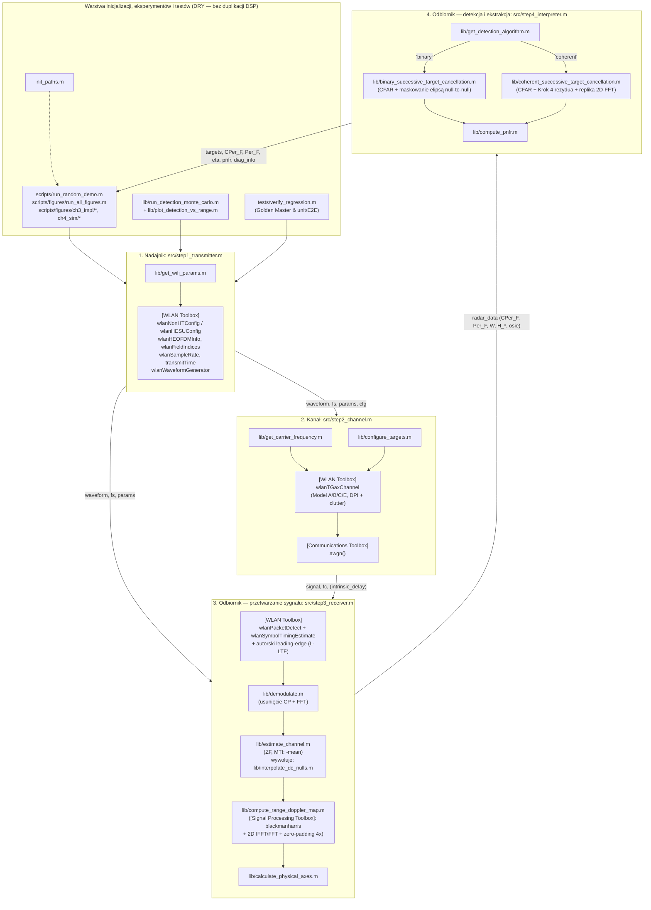

# Plan Redakcji Rozdziału 3: Opis oprogramowania

Dokument stanowi kompletny, śledzony plan pisania **Rozdziału 3** pracy dyplomowej (plik źródłowy: [`thesis/tex/30_radar_implementation.tex`](file:///c:/Users/tymwo/Projects/MATLAB/WiFi%20Radar/thesis/tex/30_radar_implementation.tex), tytuł rozdziału w nowym układzie pracy: **`3. Opis oprogramowania`**). Plan jest w pełni spójny z kodem w [`src/`](file:///c:/Users/tymwo/Projects/MATLAB/WiFi%20Radar/src/) i [`lib/`](file:///c:/Users/tymwo/Projects/MATLAB/WiFi%20Radar/lib/), z nowo przyjętą strukturą pracy ([`docs/plan_structure_migration.md`](plan_structure_migration.md)) oraz z teorią opisaną w Rozdziałach 1 i 2 ([`docs/plan_chapter_2.md`](plan_chapter_2.md)).

> [!IMPORTANT]
> **Kontekst nowej struktury pracy:** W zaktualizowanym układzie pracy teoria sygnału Wi-Fi 802.11 / OFDM stanowi **Rozdział 1 (`1. Sygnał 802.11`)**, teoria radaru pasywnego stanowi **Rozdział 2 (`2. Radar pasywny`)**, a niniejszy **Rozdział 3 (`3. Opis oprogramowania`)** dokumentuje środowisko programistyczne, architekturę symulatora, implementację wszystkich bloków oraz świadome uproszczenia modelowe (w tym brak *ray-tracingu* 3D). Szczegółowe definicje matematyczne pozostają w Rozdziałach 1–2, a Rozdział 3 odwołuje się do nich przez `\ref{...}` i `\eqref{...}`.

---

## 1. Tablica Śledzenia Postępów Redakcji

| Podrozdział | Tytuł docelowy | Limit stron | Rysunki / Tabele | Status redakcji | Status weryfikacji |
| :---: | :--- | :---: | :---: | :---: | :---: |
| **3.1** | Środowisko symulacyjne MATLAB i wykorzystane pakiety narzędziowe | 1,2–1,5 str. | 1 tab. (`tab:toolboxes_vs_custom`) | [x] Napisano | [ ] Do weryfikacji |
| **3.2** | Ogólna architektura oprogramowania i przepływ danych | 1,5 str. | 1 rys. (nowy **Rys. 3.1**: schemat blokowy zależności), 1 tab. (`tab:software_modules`) | [ ] Do napisania | [ ] Do weryfikacji |
| **3.3** | Implementacja nadajnika sygnału IEEE 802.11 | 0,8–1,0 str. | 0 rys. | [ ] Do napisania | [ ] Do weryfikacji |
| **3.4** | Implementacja modelu kanału propagacyjnego i celów ruchomych | 2,0 str. | 0 rys. | [ ] Do napisania | [ ] Do weryfikacji |
| **3.5** | Implementacja odbiornika radarowego *(wprowadzenie + 3.5.1–3.5.4)* | **5,0–6,0 str.** | **3 rys.** (istniejące PNG) | [ ] Do napisania | [ ] Do weryfikacji |
| *3.5.1* | *Synchronizacja czasowa ramki i demodulacja OFDM* | 1,0–1,2 str. | 0 rys. | [ ] Do napisania | [ ] Do weryfikacji |
| *3.5.2* | *Estymacja odpowiedzi kanału, tłumienie ech stałych i interpolacja luki DC* | 1,3–1,5 str. | 1 rys. (**Rys. 3.2**: `rys_3_1_macierz_transmitancji_h.png`) | [ ] Do napisania | [ ] Do weryfikacji |
| *3.5.3* | *Wyznaczanie mapy odległość–prędkość i kalibracja osi fizycznych* | 1,3–1,5 str. | 2 rys. (**Rys. 3.3**: `rys_3_2_mapa_range_doppler.png`, **Rys. 3.4**: `rys_3_3_etapy_przetwarzania.png`) | [ ] Do napisania | [ ] Do weryfikacji |
| *3.5.4* | *Detekcja progowa CFAR, iteracyjna ekstrakcja celów i weryfikacja oprogramowania* | 1,5–1,8 str. | 0 rys. (ew. 1 tab. podsumowująca weryfikację) | [ ] Do napisania | [ ] Do weryfikacji |
| **SUMA** | **Rozdział 3 (całość)** | **10,0–12,5 str.** | **4 rys., 2–3 tab.** | **Postęp: 0/5** | **Do napisania po migracji struktury** |

---

## 2. Kluczowe Zasady Redakcji Rozdziału 3

1. **Forma gramatyczna i styl inżynierski:**
   - Stosujemy wyłącznie **formę bezosobową czasu przeszłego** (*„zaimplementowano”*, *„zastosowano”*, *„wyznaczono”*, *„zweryfikowano”*), bez pierwszej osoby liczby pojedynczej (*„zrobiłem”*, *„napisałem”*).
   - Zwięzłe, przyczynowo-skutkowe zdania wyjaśniające *dlaczego* przyjęto dane rozwiązanie programistyczne (np. dlaczego potrzebne jest podejście *leading-edge* w synchronizacji, dlaczego `awgn` kotwiczy moc do `clutter_signal`, dlaczego w `coherent_successive_target_cancellation.m` ograniczono liczbę iteracji i zastosowano `log1p`/`expm1`).
2. **Rozdział teorii od implementacji (brak dublowania wzorów z Rozdz. 1–2):**
   - Pełne wyprowadzenia matematyczne znajdują się w Rozdziałach 1 i 2. W Rozdziale 3 konsekwentnie odsyłamy do właściwych podrozdziałów i równań (`\ref{subsec:...}`, `\eqref{...}`), a opisujemy **architekturę kodu, struktury danych, wymiary macierzy, obsługę przypadków brzegowych, stabilność numeryczną oraz mapowanie zmiennych matematycznych na implementację MATLAB**.
3. **Zasada czystości kodu w tekście (listingi przeniesione do Dodatku A):**
   - W głównej treści Rozdziału 3 nie wklejamy długich bloków kodu źródłowego. Przywołujemy wyłącznie nazwy plików/funkcji (`\texttt{...}`), sygnatury wywołań oraz pojedyncze kluczowe wyrażenia numeryczne.
   - Wybrane, reprezentatywne fragmenty kodu w środowisku `minted` umieszczamy w **Dodatku A** (`\ref{app:listings}`), na który Rozdział 3 wskazuje w odpowiednich miejscach.
4. **Wszystkie obiekty jawnie przywołane i zinterpretowane:**
   - Każdy z 4 rysunków (schemat blokowy + 3 wykresy diagnostyczne z `thesis/img/ch3_impl/`) i każda tabela musi mieć jawne odwołanie `\ref{...}` oraz komentarz inżynierski w tekście.
5. **Status pakietów narzędziowych MATLAB-a:**
   - Zgodnie z [`docs/plan_deliverables.md`](plan_deliverables.md) pakiety MathWorks (**WLAN Toolbox**, **Communications Toolbox**, **Signal Processing Toolbox**) oraz przykłady MathWorks **nie wchodzą do bibliografii jako artykuły naukowe** — ich rolę i zakres użytych funkcji dokumentuje się jawnie w podrozdziale **3.1** oraz na schemacie blokowym w **3.2**.

---

## 3. Projekt Schematu Blokowego Zależności Między Funkcjami (Nowy Rys. 3.1)

### 3.1. Forma graficzna i realizacja techniczna
- **Rekomendowana technologia:** wektorowy diagram **TikZ** osadzony bezpośrednio w `thesis/tex/30_radar_implementation.tex` (lub wyodrębniony do włączanego pliku w `thesis/tex/`). Zapewnia identyczną czcionkę jak reszta tekstu pracy, idealną ostrość w druku oraz łatwą edycję w Git. Wymaga dodania `\usepackage{tikz}` i `\usetikzlibrary{arrows.meta, positioning, fit, backgrounds, shapes.geometric}` w [`thesis/tex/00_preambule.tex`](file:///c:/Users/tymwo/Projects/MATLAB/WiFi%20Radar/thesis/tex/00_preambule.tex).
- **Wyróżnienie wizualne na schemacie (3 warstwy kolorystyczne/ramkowe):**
  1. **Fasady potoku głównego (`src/`):** 4 główne etapy (`step1_transmitter`, `step2_channel`, `step3_receiver`, `step4_interpreter`).
  2. **Funkcje pomocnicze i numeryczne (`lib/`):** moduły wywoływane przez dany etap.
  3. **Pakiety narzędziowe MATLAB (Toolboxes):** wyraźnie oznaczone obrysem przerywanym lub inną barwą bloki *WLAN Toolbox*, *Communications Toolbox* i *Signal Processing Toolbox*, aby czytelnik na pierwszy rzut oka odróżnił gotowe komponenty środowiska od autorskiego kodu DSP.
  4. **Warstwa sterująca i testowa (bez duplikacji logiki DSP — zasada DRY):** `init_paths.m`, skrypty `scripts/figures/*`, `scripts/run_random_demo.m`, `lib/run_detection_monte_carlo.m` oraz `tests/verify_regression.m`.

### 3.2. Diagram roboczy zależności i przepływu danych

### 3.3. Wpływ nowego schematu na numerację rysunków w Rozdziale 3
Dodanie schematu blokowego jako pierwszego rysunku w Rozdziale 3 powoduje naturalne przesunięcie numeracji wyświetlanej przez LaTeX:
- **Rys. 3.1** *(nowy, TikZ)*: Schemat blokowy architektury oprogramowania i zależności między funkcjami (`\label{fig:software_architecture}`).
- **Rys. 3.2** *(plik `thesis/img/ch3_impl/rys_3_1_macierz_transmitancji_h.png`)*: Macierz transmitancji $\hat{H}(k,l)$ przed i po odjęciu średniej czasowej oraz interpolacji luki DC (`\label{fig:impl_channel_matrix}`).
- **Rys. 3.3** *(plik `thesis/img/ch3_impl/rys_3_2_mapa_range_doppler.png`)*: Porównanie periodogramu Range–Doppler (bazowy vs po przetworzeniu DSP, 3D i 2D, `\label{fig:impl_range_doppler}`).
- **Rys. 3.4** *(plik `thesis/img/ch3_impl/rys_3_3_etapy_przetwarzania.png`)*: Dekompozycja 4 etapów przetwarzania w odbiorniku i interpreterze (`\label{fig:impl_processing_stages}`).

> [!NOTE]
> Nazwy plików PNG na dysku w `thesis/img/ch3_impl/` i nazwy skryptów w `scripts/figures/ch3_impl/` pozostawiamy bez zmian, aby nie naruszać działania `scripts/figures/run_all_figures.m` oraz historii testów; LaTeX automatycznie nadaje właściwe numery 3.1–3.4 w kolejności pojawienia się w tekście.

---

## 4. Szczegółowy Plan Redakcji Podrozdziałów (Krok po Kroku)

### Podrozdział 3.1: Środowisko symulacyjne MATLAB i wykorzystane pakiety narzędziowe
- **Docelowa objętość:** 1,2–1,5 strony.
- **Obiekty:** 1 tabela (`tab:toolboxes_vs_custom`).
- **Plan akapitów:**
  1. **Akapit 1 — Środowisko bazowe MATLAB i profil obliczeń:**
     - Wskazanie środowiska uruchomieniowego (**MATLAB R2024b / R2025b**), natywnie zoptymalizowanego do wektorowych i macierzowych operacji na liczbach zespolonych (macierze podnośnych $N_{\mathrm{FFT}} \times M$, dwuwymiarowe transformaty Fouriera `fft`/`ifft` z dopełnianiem zerami, szybkie indeksowanie logiczne).
     - Omówienie konfiguracji ścieżek roboczych poprzez skrypt [`init_paths.m`](file:///c:/Users/tymwo/Projects/MATLAB/WiFi%20Radar/init_paths.m) (dodanie `src/`, `lib/` oraz rekurencyjnie `scripts/`) i deterministycznego sterowania generatorem liczb pseudolosowych (`rng(..., 'twister')`) zapewniającego powtarzalność eksperymentów i testów regresyjnych.
  2. **Akapit 2 — Zakres użycia pakietów narzędziowych (Toolboxes) vs. brak „czarnych skrzynek” radarowych:**
     - Wyjaśnienie podziału kompetencji między gotowe biblioteki MathWorks a autorską implementację DSP:
       - **WLAN Toolbox:** wykorzystany wyłącznie do zgodnej ze standardami IEEE 802.11a/802.11ax generacji przebiegów transmisyjnych (`wlanNonHTConfig`, `wlanHESUConfig`, `wlanHEOFDMInfo`, `wlanFieldIndices`, `wlanSampleRate`, `transmitTime`, `wlanWaveformGenerator`), standaryzowanej symulacji kanału wielodrogowego (`wlanTGaxChannel`) oraz wstępnej synchronizacji ramki w odbiorniku (`wlanPacketDetect`, `wlanSymbolTimingEstimate`).
       - **Communications Toolbox:** wykorzystany w module kanału do kontrolowanego dodawania zespolonego szumu termicznego AWGN (`awgn`).
       - **Signal Processing Toolbox:** wykorzystany w jednym miejscu — do wygenerowania wektorów wag 4-wyrazowego okna Blackmana–Harrisa (`blackmanharris`) w [`lib/compute_range_doppler_map.m`](file:///c:/Users/tymwo/Projects/MATLAB/WiFi%20Radar/lib/compute_range_doppler_map.m). *(Uwaga korekcyjna wobec starszych notatek: funkcja `blackmanharris` pochodzi właśnie z Signal Processing Toolbox, natomiast normalizacja energetyczna i złożenie okna 2D na paśmie aktywnym są autorskie).*
       - **Świadoma rezygnacja z Radar Toolbox / Phased Array System Toolbox:** cały tor przetwarzania radarowego (demodulacja po usunięciu CP, estymacja CFR metodą Zero-Forcing, filtracja MTI w czasie wolnym, interpolacja luki DC, periodogram 2D, kalibracja osi fizycznych oraz algorytmy detekcji Binary STC i Coherent STC z progiem CFAR) został napisany od podstaw w czystym MATLAB-ie, co zapewnia pełną przejrzystość matematyczną i kontrolę nad każdym etapem przetwarzania.
  3. **Tabela `tab:toolboxes_vs_custom`:**
     - Kolumny: *Warstwa / Pakiet*, *Wykorzystane funkcje / Moduły*, *Etap potoku*, *Rola w symulatorze*.

---

### Podrozdział 3.2: Ogólna architektura oprogramowania i przepływ danych
- **Docelowa objętość:** 1,5 strony.
- **Obiekty:** **Rys. 3.1** (schemat blokowy zależności — `\ref{fig:software_architecture}`), 1 tabela (`tab:software_modules`).
- **Plan akapitów:**
  1. **Akapit 1 — Podział na fasady potoku (`src/`) i bibliotekę numeryczną (`lib/`):**
     - Opis dwupoziomowej architektury repozytorium: cztery funkcje orkiestrujące w [`src/`](file:///c:/Users/tymwo/Projects/MATLAB/WiFi%20Radar/src/) (`step1_transmitter`, `step2_channel`, `step3_receiver`, `step4_interpreter`) odwzorowują fizyczny podział systemu na nadajnik, kanał i odbiornik, podczas gdy atomowe operacje numeryczne i pomocnicze wydzielono do czystych funkcji w [`lib/`](file:///c:/Users/tymwo/Projects/MATLAB/WiFi%20Radar/lib/).
     - Podkreślenie zasady **DRY** (*Don't Repeat Yourself*): skrypty demonstracyjne (`scripts/run_random_demo.m`), generatory wykresów (`scripts/figures/`), silnik Monte Carlo (`lib/run_detection_monte_carlo.m`) oraz testy regresyjne (`tests/verify_regression.m`) wywołują bezpośrednio produkcyjne funkcje z `src/` i `lib/` bez powielania kodu DSP. W tym celu struktura `radar_data` zwracana przez `step3_receiver` udostępnia również macierze pośrednie (`H_raw`, `H_no_static`, `H_shifted`, `W`, `Per_F`, `CPer_F`).
  2. **Akapit 2 — Omówienie schematu blokowego zależności (Rys. 3.1) i odzwierciedlenia układu fizycznego:**
     - Przywołanie **Rys. 3.1** (`\ref{fig:software_architecture}`) i prześledzenie przepływu danych: `waveform, fs, params, cfg` $\to$ `signal, fc, intrinsic_delay` $\to$ `radar_data` $\to$ `targets, CPer_F, Per_F, eta, pnfr, diag_info`.
     - Jawne powiązanie architektury programowej z geometrią opisaną w Rozdziale 2 (`\ref{subsec:pbr_fundamentals}`): ponieważ w układzie współlokowanym (monostatycznym z dwiema odizolowanymi antenami Tx i Rx) odbiornik znajduje się przy nadajniku, `step3_receiver` otrzymuje bezpośrednio bezszumowy sygnał odniesienia `waveform` z `step1_transmitter` obok sygnału odebranego `signal` z `step2_channel`.
  3. **Tabela `tab:software_modules` (Nawigacyjna mapa modułów i powiązań z teorią):**
     - Zestawienie wszystkich plików `src/` (4) oraz `lib/` (15 — z pogrupowaniem lub kompletną listą głównych funkcji DSP i narzędzi ewaluacyjnych), z kolumnami: *Plik (`src/` lub `lib/`)*, *Główna odpowiedzialność*, *Kluczowe wejścia / wyjścia*, *Odniesienie teoretyczne (Rozdz. 1–2)*.

---

### Podrozdział 3.3: Implementacja nadajnika sygnału IEEE 802.11
- **Docelowa objętość:** 0,8–1,0 strony *(celowo zwięzły — zgodnie z założeniem, że nadajnik bazuje na gotowym generatorze WLAN Toolbox i nie wymaga rozbudowanego opisu)*.
- **Obiekty:** 0 rysunków.
- **Plan akapitów:**
  1. **Akapit 1 — Synteza przebiegu bazowego przy użyciu WLAN Toolbox (`step1_transmitter.m`):**
     - Wyjaśnienie, że nadajnik (`src/step1_transmitter.m`) celowo wykorzystuje certyfikowany generator fali z pakietu WLAN Toolbox (`wlanWaveformGenerator`), co gwarantuje 100% zgodności preambuł, kodowania, pilotów i mapowania podnośnych ze specyfikacjami IEEE 802.11a oraz 802.11ax (Rozdział 1, `\ref{subsec:wifi_signal}`, tabela `tab:wifi_params`).
     - Opis interfejsu wejściowego `(WIFI_STANDARD, cbw, mcs, psdu_length)`: wygenerowanie losowego strumienia bitów `randi([0, 1], psdu_length * 8, 1)` i przekazanie go wraz z obiektem konfiguracyjnym `cfg` (`wlanNonHTConfig` lub `wlanHESUConfig`) do `wlanWaveformGenerator`, zwracającego zespolony wektor pasma podstawowego `waveform` oraz częstotliwość próbkowania `fs = wlanSampleRate(cfg)`.
  2. **Akapit 2 — Autorska parametryzacja i ekstrakcja metadanych siatki (`lib/get_wifi_params.m`):**
     - Wskazanie wartości dodanej poza samym wywołaniem toolboxa — funkcja `get_wifi_params.m` ujednolica oba standardy pod wspólny interfejs odbiornika:
       - wymuszenie spójnych wartości domyślnych (`CBW20` dla 802.11a z ostrzeżeniem przy próbie użycia szerszego pasma, zaciskanie indeksu MCS do `0..7` dla 802.11a i `0..11` dla 802.11ax, stały prefiks cykliczny `GuardInterval = 0.8` $\mu\text{s}$ w `wlanHESUConfig`),
       - **automatyczne skalowanie długości ładunku (`PSDULength` / `APEPLength`)** w przypadku pominięcia argumentu `psdu_length`: rozmiar ładunku jest przeliczany proporcjonalnie do liczby podnośnych danych i stopy bitowej MCS tak, aby utrzymać stały czas trwania ramki ($\approx 3{,}87\ \text{ms}$, czyli $M = 280$ symboli w 802.11ax i $M = 963$ w 802.11a; w 802.11a z uwzględnieniem limitu sprzętowego 4095 bajtów w polu L-SIG). Umożliwia to rzetelne izolowanie wpływu pasma $B$ i rzędu modulacji MCS w eksperymentach Rozdziału 4 przy niezmienionym czasie CPI,
       - wyznaczenie początku pola danych `payload_start` (przez `wlanFieldIndices`), binarnej maski aktywnych podnośnych `active_mask` w dziedzinie wycentrowanej (`fftshift`) oraz dokładnych indeksów wewnętrznych prążków zerowych `dc_indices` (w tym obu wewnętrznych luk podkanałów 80 MHz przy `CBW160`, wyliczanych dynamicznie przez `setdiff` z `ofdminfo.ActiveFrequencyIndices`).

---

### Podrozdział 3.4: Implementacja modelu kanału propagacyjnego i celów ruchomych
- **Docelowa objętość:** 2,0 strony.
- **Obiekty:** 0 rysunków.
- **Plan akapitów:**
  1. **Akapit 1 — Kluczowe założenie modelowe: model propagacyjny zamiast *ray-tracingu* 3D:**
     - **Wyraźne i jednoznaczne zastrzeżenie metodologiczne:** w pracy **nie zaimplementowano geometrycznego symulatora śledzenia promieni (*ray-tracingu* 3D)** ani elektromagnetycznego modelu sprzężenia międzyantenowego i analogowego układu tłumienia samoprzekłóceń (SIC).
     - Zamiast tego w [`src/step2_channel.m`](file:///c:/Users/tymwo/Projects/MATLAB/WiFi%20Radar/src/step2_channel.m) zastosowano **hybrydowy uproszczony model propagacyjny**, złożony z dwóch addytywnych gałęzi: (1) standaryzowanego statystycznego modelu kanału wielodrogowego `wlanTGaxChannel` generującego resztkowy przesłuch bezpośredni (DPI) i stacjonarny clutter otoczenia, oraz (2) analitycznego, deterministycznego toru syntezy ech celów ruchomych.
     - Uzasadnienie inżynierskie tego uproszczenia: model TGax dostarcza powtarzalnych, opisanych w standardzie profili opóźnień mocy (PDP) dla typowych przestrzeni wewnętrznych i halowych bez konieczności definiowania trójwymiarowej geometrii pomieszczeń i współczynników odbicia materiałów. Świadomym kosztem uproszczenia jest brak zależności od kątów nadejścia/odejścia (AoA/AoD), efektów przesłaniania (*shadowing*) oraz odbić wielokrotnych między samymi celami ruchomymi — konsekwencje te omówiono również w Rozdziale 4 i Wnioskach końcowych (`\ref{sec:conclusion}`).
  2. **Akapit 2 — Tło wielodrogowe i resztkowy przesłuch bezpośredni (`wlanTGaxChannel`):**
     - Konfiguracja obiektu `wlanTGaxChannel`: tryb `DelayProfile` (`Model-A`, `Model-B`, `Model-C`, `Model-E`, z normalizacją skróconych nazw `'A'`–`'E'`), `LargeScaleFadingEffect = 'None'` oraz `NormalizeChannelOutputs = false`.
     - Wyjaśnienie roli trybu `LargeScaleFadingEffect = 'None'`: przy domyślnej odległości odniesienia modelu TGax ($3\ \text{m} < d_{\mathrm{BP}}$) odpowiada on propagacji LOS (*Line-of-Sight*), dzięki czemu pierwszy klaster kanału zachowuje składową bezpośrednią pełniącą w symulatorze rolę resztkowego przesłuchu DPI po izolacji antenowej, a kolejne klastry o zróżnicowanym rozrzucie opóźnień ($\tau_{\mathrm{rms}} \in \{0, 15, 30, 100\}\ \text{ns}$) odwzorowują statyczne odbicia wielodrogowe otoczenia (podstawa do badania tłumienia clutteru w Rozdziale 4, `\ref{subsec:sim_clutter_suppression}`).
     - Odczyt wewnętrznego opóźnienia filtru interpolującego `intrinsic_delay = info(tgax).ChannelFilterDelay`, które służy zarówno do wyrównania opóźnień celów w kanale, jak i jako wzorzec odniesienia przy ocenie błędu synchronizacji odbiornika w badaniach Monte Carlo.
  3. **Akapit 3 — Parametryzacja fizyczna celów (`configure_targets.m`, `get_carrier_frequency.m`):**
     - Opis [`lib/get_carrier_frequency.m`](file:///c:/Users/tymwo/Projects/MATLAB/WiFi%20Radar/lib/get_carrier_frequency.m): mapowanie pasm `'2.4GHz'` ($2{,}437\ \text{GHz}$), `'5GHz'` ($5{,}500\ \text{GHz}$, domyślne), `'6GHz'` ($6{,}200\ \text{GHz}$) lub dowolnej częstotliwości liczbowej na $f_c$.
     - Opis [`lib/configure_targets.m`](file:///c:/Users/tymwo/Projects/MATLAB/WiFi%20Radar/lib/configure_targets.m): przeliczenie opisu fizycznego celu (`range_m`, `velocity_mps`, `type`/`rcs`, opcjonalnie ręczny `gain`) na opóźnienie w próbkach `delays = range_m / (c0 / (2 * fs))`, przesunięcie Dopplera `dopplers = 2 * fc * vel_mps / c0` (zgodnie z równaniami dwudrożnymi z Rozdziału 2, `\ref{subsec:pbr_fundamentals}`) oraz amplitudę echa `taps` według skalowania równania radiolokacji Brauna:
       $$b_h = b_{\mathrm{ref}} \left(\frac{d_{\mathrm{ref}}}{\max(R, 1{,}0\ \text{m})}\right)^2 \sqrt{\frac{\sigma}{\sigma_{\mathrm{ref}}}}$$
       z parametrami odniesienia $d_{\mathrm{ref}} = 10\ \text{m}$, $\sigma_{\mathrm{ref}} = 1\ \text{m}^2$, $b_{\mathrm{ref}} = 0{,}03$ oraz predefiniowanymi przekrojami czynnymi RCS (`car` $10{,}0\ \text{m}^2$, `human` $1{,}0\ \text{m}^2$, `pet` $0{,}1\ \text{m}^2$, `drone` $0{,}05\ \text{m}^2$).
  4. **Akapit 4 — Synteza opóźnień ułamkowych, efektu Dopplera i szumu AWGN (`step2_channel.m`):**
     - Implementacja pętli po celach ruchomych: przesunięcie o całkowitą liczbę próbek `d_int = floor(delays(k) + intrinsic_delay)` oraz precyzyjna realizacja części ułamkowej `d_frac` (*fractional delay*) w dziedzinie częstotliwości przez wymnożenie widma przez liniową rampę fazową $\exp(-j 2\pi k_{\mathrm{freq}} d_{\mathrm{frac}} / N)$ (`ifft(fft(delayed) .* ...)`). Zapewnia to ciągłe, podpróbkowe położenie celów (*off-grid*) bez błędów kwantyzacji do siatki próbkowania $c_0 / (2 f_s)$.
     - Nałożenie zespolonej modulacji dopplerowskiej $\exp(j 2\pi f_{D,k} t)$ oraz zsumowanie `signal = clutter_signal + target_signal`.
     - Sposób dodawania szumu AWGN (`awgn(signal, snr_dB, ref_power_dBW)`): moc odniesienia `ref_power_dBW` wyliczana jest wyłącznie względem `clutter_signal` (DPI + tło stacjonarne), a nie względem sumy `signal`. Dzięki temu zmiana obecności lub przekroju RCS celu nie zaburza poziomu podłogi szumowej odbiornika, co zapewnia fizyczną poprawność scenariuszy porównawczych i statystycznych.

---

### Podrozdział 3.5: Implementacja odbiornika radarowego
*(Najobszerniejszy podrozdział Rozdziału 3 — stanowi rdzeń wkładu własnego; podzielony na krótkie wprowadzenie oraz 4 logiczne podpodrozdziały `3.5.1`–`3.5.4` z gęstymi odwołaniami do Rozdziału 1 i Rozdziału 2).*

- **Akapit wprowadzający (3–4 zdania):**
  - Wyjaśnienie podziału logicznego odbiornika na dwa moduły programowe: [`src/step3_receiver.m`](file:///c:/Users/tymwo/Projects/MATLAB/WiFi%20Radar/src/step3_receiver.m) (synchronizacja, demodulacja OFDM, estymacja i kondycjonowanie transmitancji kanału oraz wyznaczenie zespolonej mapy Range–Doppler) i [`src/step4_interpreter.m`](file:///c:/Users/tymwo/Projects/MATLAB/WiFi%20Radar/src/step4_interpreter.m) (progowanie CFAR, iteracyjna detekcja i estymacja parametrów fizycznych celów oraz wyznaczenie kontrastu PNFR). Wskazanie odwzorowania kolejnych etapów teorii z Rozdziału 2 w poniższych punktach `3.5.1`–`3.5.4`.

#### 3.5.1. Synchronizacja czasowa ramki i demodulacja OFDM
- **Docelowa objętość:** 1,0–1,2 strony.
- **Odwołania do teorii:** Rozdział 1 (`\ref{subsec:wifi_signal}`, `\ref{subsec:ofdm_modulation}`, `\eqref{eq:ofdm_discrete_ifft}`, `\eqref{eq:ofdm_symbol_duration}`).
- **Treść:**
  - Rozwiązanie parametrów ramki w `step3_receiver.m` (obsługa przekazanej struktury `params` z `step1_transmitter` lub odtworzenie przez `get_wifi_params`).
  - Dwuetapowa synchronizacja czasowa oparta na WLAN Toolbox i autorskiej rafinacji:
    1. Zgrubne wykrycie początku pakietu na polu L-STF za pomocą `wlanPacketDetect(signal, cbw)` (z przerwaniem i błędem w razie braku detekcji).
    2. Wyznaczenie metryki korelacyjnej `M` na polu L-LTF w ograniczonym oknie preambuły (`24 us`, obejmującym L-STF + L-LTF = `16 us` z zapasem `8 us`) za pomocą `wlanSymbolTimingEstimate`.
    3. **Autorska detekcja pierwszego czoła (*leading-edge / first-arrival path*):** uzasadnienie problemu w kanałach silnie wielodrogowych (`Model-E`), gdzie odbity klaster opóźniony bywa silniejszy od ścieżki bezpośredniej LOS — klasyczne maksimum `max(M)` blokuje się wówczas na opóźnionym echu, przesuwając całą oś odległości na mapie RDM. W implementacji przeszukuje się okno wsteczne `lookback = min(Ncp, round(1.6e-6 * fs))` przed maksimum `n_peak`, wyznacza pierwszy indeks przekraczający próg `0.20 * M_max` (bezpiecznie ponad listkami bocznymi autokorelacji L-LTF $\approx 0{,}034$) i przesuwa wskaźnik w górę lokalnego zbocza do pierwszego lokalnego maksimum `n_first`.
  - Odcięcie preambuły w obu torach: `y_cut = signal(sync_idx + params.payload_start : end)` oraz `x_cut = waveform(params.payload_start : end)`.
  - Manualna demodulacja OFDM w [`lib/demodulate.m`](file:///c:/Users/tymwo/Projects/MATLAB/WiFi%20Radar/lib/demodulate.m): wyznaczenie całkowitej liczby pełnych symboli `n_syms = floor(length(signal) / (n_fft + n_cp))`, przycięcie wektora, przekształcenie do macierzy `(n_fft + n_cp) x n_syms`, odrzucenie pierwszych `n_cp` próbek prefiksu cyklicznego i wykonanie kolumnowej transformaty `fft(..., n_fft, 1)` (odwrotność `\eqref{eq:ofdm_discrete_ifft}`), a następnie wyrównanie liczby kolumn `n_symbols = min(n_symbols_rx, n_symbols_tx)` dla macierzy `F_rx` i `F_tx`.

#### 3.5.2. Estymacja odpowiedzi kanału, tłumienie ech stałych i interpolacja luki DC
- **Docelowa objętość:** 1,3–1,5 strony.
- **Obiekty:** **Rys. 3.2** (`thesis/img/ch3_impl/rys_3_1_macierz_transmitancji_h.png`, `\ref{fig:impl_channel_matrix}`).
- **Odwołania do teorii:** Rozdział 1 (`\ref{subsec:wifi_signal}`), Rozdział 2 (`\ref{subsec:channel_estimation}`, `\ref{subsec:clutter_filtering}`).
- **Treść:**
  - Szczegółowy opis [`lib/estimate_channel.m`](file:///c:/Users/tymwo/Projects/MATLAB/WiFi%20Radar/lib/estimate_channel.m) realizującego trzy operacje na macierzach `F_rx`, `F_tx` o wymiarze $N_{\mathrm{FFT}} \times M$:
    1. **Estymacja CFR metodą Zero-Forcing:** dzielenie element po elemencie `H = F_rx ./ (F_tx + 1e-9)` z regularyzacją $\varepsilon = 10^{-9}$ oraz wyzerowanie pasm ochronnych i luki DC maską `ifftshift(params.active_mask)`. Równolegle wyznaczany jest bezwymiarowy współczynnik wzmocnienia szumu $\zeta_{\mathrm{ZF}}$ w dB na aktywnych podnośnych `X_act` (`10 * log10(mean(pwr_x) * mean(1 ./ (pwr_x + epsilon^2)))`), odzwierciedlający teorię z Rozdziału 2 (`\ref{subsec:channel_estimation}`) i wykorzystywany bezpośrednio w Eksperymencie E3.
    2. **Przesunięcie widma i filtr MTI w czasie wolnym:** wycentrowanie osi częstotliwości (`H_raw_shifted = fftshift(H, 1)`) oraz odjęcie średniej po drugim wymiarze (`H_no_static_shifted = H_raw_shifted - mean(H_raw_shifted, 2)`), realizujące filtr MTI rzędu zerowego z Rozdziału 2 (`\ref{subsec:clutter_filtering}`).
    3. **Adaptacyjna interpolacja luki DC w [`lib/interpolate_dc_nulls.m`](file:///c:/Users/tymwo/Projects/MATLAB/WiFi%20Radar/lib/interpolate_dc_nulls.m):** automatyczne wykrywanie spójnych przedziałów pustych podnośnych wewnętrznych za pomocą analizy różnic indeksów (`diff(dc) > 1`). Dla każdej wykrytej luki $[k_L+1, \dots, k_R-1]$ o szerokości $G$ wyznaczane są wagi liniowe `weights = (1:G).' / (G + 1)` między skrajnymi aktywnymi podnośnymi `H(idx_left, :)` i `H(idx_right, :)`. Rozwiązanie to obsługuje jednolicie zarówno pojedynczą lukę 802.11a ($G=1$), centralne luki 802.11ax ($G \in \{3, 5, 23\}$), jak i podwójne 5-podnośne luki podkanałów 80 MHz w trybie `CBW160`.
  - **Prezentacja i interpretacja Rys. 3.2 (`rys_3_1_macierz_transmitancji_h.png`):**
    - Skrypt generujący: `scripts/figures/ch3_impl/gen_fig_3_1_channel_matrix_h.m` (802.11ax, `CBW80`, `MCS 0`, `Model-C`, $\mathrm{SNR} = 25\ \text{dB}$, dwa cele: pieszy $22{,}5\ \text{m}, -4{,}0\ \text{m/s}$ i samochód $67{,}5\ \text{m}, +18{,}0\ \text{m/s}$).
    - Omówienie obu paneli: (a) surowa macierz `H_raw` zdominowana przez silny przesłuch DPI i selektywne zaniki wielodrogowe oraz wyraźną czarną szczeliną 5 zerowych podnośnych DC pośrodku; (b) macierz `H_shifted` po filtracji MTI (stłumienie składowej stacjonarnej DPI $> 120\ \text{dB}$, spadek całkowitej mocy macierzy o $24{,}89\ \text{dB}$) oraz po interpolacji luki DC, przywracającej ciągłość widma w osi częstotliwości i odsłaniającej fazowo-amplitudową strukturę ech obiektów ruchomych.

#### 3.5.3. Wyznaczanie mapy odległość–prędkość i kalibracja osi fizycznych
- **Docelowa objętość:** 1,3–1,5 strony.
- **Obiekty:** **Rys. 3.3** (`thesis/img/ch3_impl/rys_3_2_mapa_range_doppler.png`, `\ref{fig:impl_range_doppler}`) oraz **Rys. 3.4** (`thesis/img/ch3_impl/rys_3_3_etapy_przetwarzania.png`, `\ref{fig:impl_processing_stages}`).
- **Odwołania do teorii:** Rozdział 2 (`\ref{subsec:pbr_fundamentals}`, `\ref{subsec:range_doppler_map}`).
- **Treść:**
  - Implementacja [`lib/compute_range_doppler_map.m`](file:///c:/Users/tymwo/Projects/MATLAB/WiFi%20Radar/lib/compute_range_doppler_map.m):
    - Wyznaczenie rozpiętości pasma aktywnego `L_active = idx(end) - idx(1) + 1` na podstawie `active_mask` (kluczowe: okno wagowe nie obejmuje zerowych pasm ochronnych, dzięki czemu jego boki opadają płynnie dokładnie na krańcach pasma użytecznego).
    - Konstrukcja separowalnego okna 2D Blackmana–Harrisa `W = win_f .* win_t` (funkcja `blackmanharris`), przy czym oba jednowymiarowe wektory są normalizowane tak, aby średnia energia okna po aktywnym obszarze była jednostkowa (`w * sqrt(L) / norm(w)`).
    - Obliczenie rozmiarów siatki po 4-krotnym dopełnieniu zerami (*zero-padding*): `N_per = pad_factor * 2^nextpow2(Nfft)`, `M_per = pad_factor * 2^nextpow2(n_symbols)` (`pad_factor = 4`).
    - Wyznaczenie zespolonego periodogramu `CPer_F = fftshift(N_per * ifft(fft(H_win, M_per, 2), N_per, 1), 2)` — wyjaśnienie dwóch szczegółów implementacyjnych: (1) mnożenia przez `N_per` w celu skompensowania domyślnego skalowania `1/N_per` funkcji `ifft` w MATLAB-ie (tak aby amplitudy były zgodne z równaniami periodogramu z Rozdz. 2, `\ref{subsec:range_doppler_map}`), oraz (2) wycentrowania `fftshift(..., 2)` wyłącznie po osi Dopplera (oś odległości pozostaje jednostronna $[0, R_{\max})$).
    - Wyznaczenie znormalizowanego rzeczywistego periodogramu mocy `Per_F = (1 / (N_act * n_symbols)) * abs(CPer_F).^2`.
  - Implementacja [`lib/calculate_physical_axes.m`](file:///c:/Users/tymwo/Projects/MATLAB/WiFi%20Radar/lib/calculate_physical_axes.m):
    - Dokładne odwzorowanie indeksów DFT/IDFT na jednostki fizyczne (`axis_range`, `axis_velocity`) z zastosowaniem symetrycznego indeksowania `m_idx = floor(-M_per / 2) : (ceil(M_per / 2) - 1)` dla osi prędkości. Podkreślenie, dlaczego nie wolno używać funkcji `linspace(-v_unamb/2, v_unamb/2, M_per)` — `fftshift` umieszcza bin zerowy `0 Hz` w indeksie `M_per/2 + 1`, więc `linspace` wprowadzałoby systematyczne przesunięcie o pół kroku siatki (asymetrię między celami zbliżającymi się i oddalającymi).
  - **Prezentacja i interpretacja Rys. 3.3 (`rys_3_2_mapa_range_doppler.png`) oraz Rys. 3.4 (`rys_3_3_etapy_przetwarzania.png`):**
    - Oba rysunki wygenerowane dla tego samego scenariusza referencyjnego co Rys. 3.2 (`CBW80`, `Model-C`, pieszy + samochód).
    - **Rys. 3.3** (`gen_fig_3_2_range_doppler.m`): zestawienie $2 \times 2$ (widok 3D całej mapy jednoznacznej oraz zbliżenie 2D na strefę celów) porównujące surowy periodogram bazowy (zdominowany przez potężny grzbiet na $v = 0\ \text{m/s}$ i pasma przecieku od okna prostokątnego) z mapą po usunięciu echa stałego, interpolacji DC i oknie 2D Blackmana–Harrisa, na której wyraźnie wyłaniają się oba cele ruchome, poprawnie zlokalizowane przez Coherent STC.
    - **Rys. 3.4** (`gen_fig_3_3_processing_stages.m`): dekompozycja 4 kolejnych etapów przetwarzania w jednakowym kadrze 2D ($R \in [0, 85]\ \text{m}$, $v \in [-25, +25]\ \text{m/s}$): Krok 0 (periodogram bazowy) $\to$ Krok 1 (po odjęciu średniej czasowej — znika grzbiet $v=0$, lecz pozostają wysokie listki boczne okna prostokątnego oraz podniesiona podłoga zakłóceń od luki DC) $\to$ Krok 2 (po interpolacji DC i oknie 2D Blackmana–Harrisa — redukcja tła i wykrycie obu celów) $\to$ Krok 3 (periodogram rezydualny po ekstrakcji celów algorytmem Coherent STC, z tłem poniżej progu CFAR).

#### 3.5.4. Detekcja progowa CFAR, iteracyjna ekstrakcja celów i weryfikacja oprogramowania
- **Docelowa objętość:** 1,5–1,8 strony.
- **Obiekty:** 0 rysunków (ewentualnie zwięzła tabela podsumowująca zestaw testów w `verify_regression.m` lub opis zwarty w tekście).
- **Odwołania do teorii:** Rozdział 2 (`\ref{subsec:target_detection_extraction}`), Rozdział 4 (`\ref{subsec:sim_clean_performance}`), Dodatek A (`\ref{app:listings}`).
- **Treść:**
  - Fasada [`src/step4_interpreter.m`](file:///c:/Users/tymwo/Projects/MATLAB/WiFi%20Radar/src/step4_interpreter.m) oraz wzorzec centralnego rejestru [`lib/get_detection_algorithm.m`](file:///c:/Users/tymwo/Projects/MATLAB/WiFi%20Radar/lib/get_detection_algorithm.m): ujednolicony interfejs wyboru detektora (`'binary'` jako metoda domyślna lub `'coherent'`), normalizacja parametrów wejściowych i zwracanie spójnej struktury diagnostycznej `diag_info` (`num_iterations`, `num_residuals`, `sigma2_hat`, `N_max`, `N_win`, `M_win`, `p_FA`).
  - Wspólne mechanizmy numeryczne obu detektorów (odpowiadające równaniom z Rozdz. 2, `\ref{subsec:target_detection_extraction}`):
    1. **Estymacja mocy szumu $\hat{\sigma}^2$ poza $N_{\max}$:** wyznaczenie granicy bez ISI `N_max = ceil((Ncp / Nfft) * N_Per)` oraz obustronnego marginesu ochronnego `n_guard` (`row_start = N_max + n_guard + 1` do `row_end = N_Per - n_guard`), który chroni estymator ML przed wyciekiem energii celów przy $N_{\max}$ oraz przed zawinięciem cyklicznym piku z $R = 0$ na koniec osi odległości.
    2. **Stabilne numerycznie wyznaczanie progu CFAR $\eta$:** zastosowanie funkcji `expm1` i `log1p` (`p_FA_bin = -expm1(log1p(-p_FA) / (N * M))`), zapobiegających katastrofalnemu skróceniu mantysy przy bardzo małych wartościach $p_{\mathrm{FA}} / (NM)$.
    3. **Dwuwymiarowa interpolacja paraboliczna piku (`quadratic_peak_interp`):** wyznaczana na periodogramie mocy `Per_F` z użyciem indeksowania modulo (`mod(..., N_Per)` / `mod(..., M_Per)`) zapewniającego poprawność na brzegach zawinięcia widma, z ograniczeniem przesunięcia podpikselowego $\delta_n, \delta_m \in [-0{,}5;\ +0{,}5]$ oraz kalibracją estymaty $\hat{\sigma}_{\mathrm{RCS}}$ za pomocą stałej `c_norm` i zysku koherentnego okna `G_win = sum(W(:))^2 / (N*M)^2`.
  - Różnice implementacyjne obu wariantów STC:
    - **Binary STC ([`lib/binary_successive_target_cancellation.m`](file:///c:/Users/tymwo/Projects/MATLAB/WiFi%20Radar/lib/binary_successive_target_cancellation.m)):** wyliczenie szerokości listka głównego do pierwszych zer (*null-to-null*) funkcją `compute_mainlobe_null_width`, utrzymywanie maski logicznej `B` i cykliczne zerowanie elipsy o półosiach `(N_win/2, M_win/2)` w metryce `min(dn, N_Per - dn)`. Zwrócenie historii masek `B_history` wyłącznie przy obecności 5. argumentu wyjściowego (`nargout >= 5`) — brak zbędnego narzutu pamięciowego w pętlach Monte Carlo.
    - **Coherent STC ([`lib/coherent_successive_target_cancellation.m`](file:///c:/Users/tymwo/Projects/MATLAB/WiFi%20Radar/lib/coherent_successive_target_cancellation.m)):** wyliczenie efektywnej szerokości `-3 dB` listka głównego w `compute_mainlobe_3dB_width` z liniową interpolacją progu `0.5`; kontrola rezyduów dekonwolucji w **Kroku 4** (porównanie dystansu cyklicznego wobec wszystkich wcześniej wykrytych celów w elipsie `-3 dB` — odrzucenie rezyduum bez dopisywania do `targets`, lecz z jego koherentnym odjęciem w Kroku 6–7); synteza idealnej macierzy pojedynczego celu `F_target`, nałożenie okna `W`, wyznaczenie `CPer_target`, normalizacja w punkcie piku `CPer_target(rn, dm)` i koherentne odjęcie zespolone od `CPer_F`; zabezpieczenie `max_iter = 200` przed niestabilnością pętli.
  - Wyznaczanie kontrastu **PNFR** w [`lib/compute_pnfr.m`](file:///c:/Users/tymwo/Projects/MATLAB/WiFi%20Radar/lib/compute_pnfr.m): przeszukiwanie lokalnego maksimum w oknie $\pm 1$ bin wokół pozycji piku, wykluczenie stref ochronnych (*guard boxes*, domyślnie $\pm 16$ binów w obu osiach z zawinięciem cyklicznym `mod`) ze wszystkich wykrytych celów i obliczenie średniej mocy tła `floor_lin`.
  - **Weryfikacja poprawności oprogramowania i zaplecze statystyczne (Monte Carlo):**
    - Omówienie zestawu testów automatycznych [`tests/verify_regression.m`](file:///c:/Users/tymwo/Projects/MATLAB/WiFi%20Radar/tests/verify_regression.m): (1) weryfikacja regresyjna wobec wzorca odniesienia *Golden Master* (`tests/golden_*.mat`, próg zgodności numerycznej $< 10^{-12}$ dla przebiegu, sygnału kanału, mapy RDM oraz wyników Binary/Coherent STC), (2) testy jednostkowe syntetyczne na czystym AWGN (weryfikacja $\hat{\sigma}^2$ i $\eta$), pojedynczym celu *off-grid* i symetrii prędkości $\pm 12\ \text{m/s}$, (3) testy kompletnego potoku *end-to-end* (w tym scenariusz E5 dynamiki $30\ \text{dB}$ potwierdzający maskowanie pieszego w Binary STC i poprawne odsłonięcie w Coherent STC) oraz (4) testy rejestru `get_detection_algorithm`.
    - Krótka wzmianka o module ewaluacyjnym [`lib/run_detection_monte_carlo.m`](file:///c:/Users/tymwo/Projects/MATLAB/WiFi%20Radar/lib/run_detection_monte_carlo.m) i [`lib/plot_detection_vs_range.m`](file:///c:/Users/tymwo/Projects/MATLAB/WiFi%20Radar/lib/plot_detection_vs_range.m), które realizują wielopróbowe symulacje stochastyczne z asocjacją 1-do-1 w bramce Rayleigha, estymacją błędu synchronizacji oraz wyznaczaniem $95\%$ przedziałów ufności Wilsona (szczegółowo wykorzystane w Rozdziale 4).
    - Odesłanie czytelnika do wybranych fragmentów kodu źródłowego w **Dodatku A** (`\ref{app:listings}`).

---

## 5. Tabela Etykiet i Odwołań Skrośnych Rozdziału 3

| Rodzaj odwołania | Etykieta docelowa (`\ref` / `\eqref`) | Miejsce definicji | Zastosowanie w Rozdziale 3 |
| :--- | :--- | :--- | :--- |
| Rozdział 1 | `\ref{sec:wifi_signal}`, `\ref{subsec:wifi_signal}`, `\ref{tab:wifi_params}` | `10_wifi_signal.tex` | Parametry PHY 802.11a/ax, ramki PPDU, luka DC (3.3, 3.5.1, 3.5.2) |
| Rozdział 1 (wzory) | `\ref{subsec:ofdm_modulation}`, `\eqref{eq:ofdm_discrete_ifft}`, `\eqref{eq:ofdm_symbol_duration}` | `10_wifi_signal.tex` | Synteza IFFT/FFT i usuwanie prefiksu cyklicznego CP (3.3, 3.5.1) |
| Rozdział 2 | `\ref{subsec:pbr_fundamentals}` | `20_passive_radar.tex` | Układ współlokowany z dwiema antenami, $\tau = 2R/c$, $f_D = 2vf_c/c$ (3.2, 3.4, 3.5.3) |
| Rozdział 2 | `\ref{subsec:channel_estimation}` | `20_passive_radar.tex` | Estymacja CFR metodą ZF i wzmocnienie szumu $\zeta_{\mathrm{ZF}}$ (3.5.2) |
| Rozdział 2 | `\ref{subsec:clutter_filtering}` | `20_passive_radar.tex` | Filtr MTI rzędu 0 i interpolacja wielopunktowa luki DC (3.5.2) |
| Rozdział 2 | `\ref{subsec:range_doppler_map}` | `20_passive_radar.tex` | Periodogram 2D, okno Blackmana–Harrisa, zero-padding (3.5.3) |
| Rozdział 2 | `\ref{subsec:target_detection_extraction}` | `20_passive_radar.tex` | Próg CFAR $\eta$, estymacja ML $\hat{\sigma}^2$, 2D interp., Binary/Coherent STC, PNFR (3.5.4) |
| Rozdział 4 | `\ref{subsec:sim_clutter_suppression}`, `\ref{subsec:sim_clean_performance}` | `40_simulation_results.tex` | Zapowiedź badań E4 (TGax + *leading-edge*) oraz E5 / Monte Carlo (3.4, 3.5.1, 3.5.4) |
| Wnioski | `\ref{sec:conclusion}` | `50_conclusion.tex` | Rozwinięcie ograniczeń braku ray-tracingu 3D i modelu SIC (3.4) |
| Dodatek A | `\ref{app:listings}` | `60_appendices.tex` | Wybrane listingi MATLAB i instrukcja uruchomienia symulatora (3.2, 3.5) |

---

## 6. Powiązanie z Dodatkiem A i Checklista Przed Zamknięciem Rozdziału 3

### 6.1. Planowane listingi w Dodatku A (`thesis/tex/60_appendices.tex`)
Aby Rozdział 3 pozostał czytelny i wolny od wielostronicowych bloków kodu, w Dodatku A należy umieścić 4 zwarte listingi w `minted` (z pominięciem redundantnych nagłówków `fprintf`) oraz skróconą instrukcję odtworzenia wyników:
1. **Listing A.1:** `src/step2_channel.m` + `lib/configure_targets.m` — realizacja opóźnień ułamkowych w dziedzinie częstotliwości, translacja celów i zakotwiczenie szumu `awgn` do `clutter_signal`.
2. **Listing A.2:** `src/step3_receiver.m` (sekcja synchronizacji *leading-edge*) + `lib/estimate_channel.m` + `lib/interpolate_dc_nulls.m`.
3. **Listing A.3:** `lib/compute_range_doppler_map.m` + `lib/calculate_physical_axes.m` — normalizowane okno 2D Blackmana–Harrisa, 2D-FFT i kalibracja osi fizycznych.
4. **Listing A.4:** `lib/coherent_successive_target_cancellation.m` (pętla główna CFAR, Krok 4 odrzucania rezyduów i koherentne odjęcie repliki).

### 6.2. Checklista weryfikacyjna Rozdziału 3
- [ ] **Spójność ze strukturą pracy:** Numeracja podrozdziałów `3.1`–`3.5` (z `3.5.1`–`3.5.4`), tytuł rozdziału `Opis oprogramowania`, poprawne odwołania do Rozdziału 1 (`1. Sygnał 802.11`) i Rozdziału 2 (`2. Radar pasywny`).
- [ ] **Zgodność 1:1 z kodem:** Każda wymieniona w tekście nazwa pliku, funkcji, parametru (`LeadingEdge = 0.20 * M_max`, `epsilon = 1e-9`, `pad_factor = 4`, `max_iter = 200`, `guard = [16, 16]`, `LargeScaleFadingEffect = 'None'`) odpowiada aktualnej zawartości `src/` i `lib/`.
- [ ] **Toolboxy:** Jawnie i poprawnie wymienione wszystkie 3 użyte toolboxy (*WLAN Toolbox*, *Communications Toolbox*, *Signal Processing Toolbox* dla `blackmanharris`), bez umieszczania ich jako artykuły w bibliografii.
- [ ] **Uproszczenie kanału:** Brak *ray-tracingu* 3D i modelu SIC wyraźnie opisany i uzasadniony w podrozdziale 3.4.
- [ ] **Rysunki i tabele:** Schemat blokowy (Rys. 3.1) + 3 wykresy z `thesis/img/ch3_impl/` (Rys. 3.2–3.4) oraz tabele przywołane i zinterpretowane w tekście.
- [ ] **Kompilacja PDF:** `pdflatex` + `bibtex` przechodzą bez błędów i niezdefiniowanych odwołań `??`.
