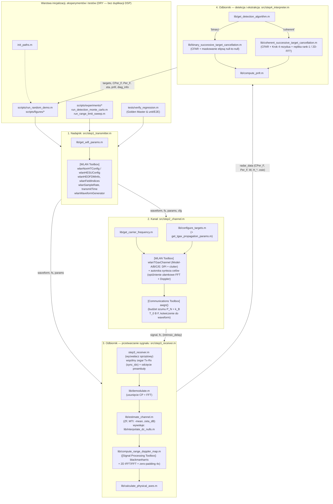

# Plan Redakcji Rozdziału 3: Opis oprogramowania

Dokument stanowi kompletny, śledzony plan pisania **Rozdziału 3** pracy dyplomowej (plik źródłowy: [`thesis/tex/30_radar_implementation.tex`](file:///c:/Users/tymwo/Projects/MATLAB/WiFi%20Radar/thesis/tex/30_radar_implementation.tex), tytuł rozdziału: **`3. Opis oprogramowania`**). Plan jest w pełni spójny z aktualnym kodem w [`src/`](file:///c:/Users/tymwo/Projects/MATLAB/WiFi%20Radar/src/) i [`lib/`](file:///c:/Users/tymwo/Projects/MATLAB/WiFi%20Radar/lib/), tabelami w [`thesis/tables/`](file:///c:/Users/tymwo/Projects/MATLAB/WiFi%20Radar/thesis/tables/), wygenerowanymi mikrolistingami w [`thesis/listings/`](file:///c:/Users/tymwo/Projects/MATLAB/WiFi%20Radar/thesis/listings/), strukturą pracy ([`docs/plan_structure_migration.md`](plan_structure_migration.md)) oraz teorią z Rozdziałów 1 i 2 ([`docs/plan_chapter_2.md`](plan_chapter_2.md)).

> [!IMPORTANT]
> **Kontekst struktury pracy:** Teoria sygnału Wi-Fi 802.11 / OFDM stanowi **Rozdział 1 (`1. Sygnał 802.11`)**, teoria radaru pasywnego stanowi **Rozdział 2 (`2. Radar pasywny`)**, a niniejszy **Rozdział 3 (`3. Opis oprogramowania`)** dokumentuje środowisko programistyczne, architekturę symulatora, implementację wszystkich bloków (wraz z 12 zwartymi mikrolistingami 1:1 z równaniami) oraz świadome uproszczenia modelowe (w tym brak *ray-tracingu* 3D). Szczegółowe definicje matematyczne pozostają w Rozdziałach 1–2, a Rozdział 3 odwołuje się do nich przez `\ref{...}` i `\eqref{...}`.

---

## 1. Tablica Śledzenia Postępów Redakcji

| Podrozdział | Tytuł docelowy | Limit stron | Rysunki / Tabele / Listingi | Status redakcji | Status weryfikacji |
| :---: | :--- | :---: | :--- | :---: | :---: |
| **3.1** | Środowisko symulacyjne MATLAB i wykorzystane pakiety narzędziowe | 1,2–1,5 str. | 1 tab. ([`tab_toolboxes_vs_custom.tex`](file:///c:/Users/tymwo/Projects/MATLAB/WiFi%20Radar/thesis/tables/tab_toolboxes_vs_custom.tex)), 0 rys., 0 list. | [x] Napisano | [x] Skorygowano (`sync_idx`) |
| **3.2** | Ogólna architektura oprogramowania i przepływ danych | 1,5 str. | **Rys. 3.1** ([`fig_software_architecture.tex`](file:///c:/Users/tymwo/Projects/MATLAB/WiFi%20Radar/thesis/tex/fig_software_architecture.tex)), 1 tab. ([`tab_software_modules.tex`](file:///c:/Users/tymwo/Projects/MATLAB/WiFi%20Radar/thesis/tables/tab_software_modules.tex)), 0 list. | [x] Napisano | [x] Skorygowano |
| **3.3** | Implementacja nadajnika sygnału IEEE 802.11 | 0,8–1,0 str. | 0 rys., 0 tab., **0 list.** *(pominięty celowo)* | [x] Napisano | [ ] Do weryfikacji |
| **3.4** | Implementacja modelu kanału propagacyjnego i celów ruchomych | 1,8–2,0 str. | 0 rys., 1 tab. (parametry TGn/TGax + RCS), **3 mikrolistingi** (`02_channel/01`–`03`) | [ ] Do napisania | [ ] Do weryfikacji |
| **3.5** | Implementacja odbiornika radarowego *(wprowadzenie + 3.5.1–3.5.4)* | **4,5–5,5 str.** | **3 rys.** (istniejące PNG), 1 tab. (Binary vs Coherent STC), **9 mikrolistingów** (`03_receiver/01`–`09`) | [ ] Do napisania | [ ] Do weryfikacji |
| *3.5.1* | *Wyzwalanie ramki i demodulacja OFDM* | 0,8–1,0 str. | 0 rys., **1 mikrolisting** (`03_receiver/01`) | [ ] Do napisania | [ ] Do weryfikacji |
| *3.5.2* | *Estymacja odpowiedzi kanału, tłumienie ech stałych i interpolacja luki DC* | 1,3–1,5 str. | **Rys. 3.2** (`rys_3_1_macierz_transmitancji_h.png`), **2 mikrolistingi** (`03_receiver/02`–`03`) | [ ] Do napisania | [ ] Do weryfikacji |
| *3.5.3* | *Wyznaczanie mapy odległość–prędkość i kalibracja osi fizycznych* | 1,2–1,4 str. | **Rys. 3.3** (`rys_3_2_mapa_range_doppler.png`), **3 mikrolistingi** (`03_receiver/04`–`06`) | [ ] Do napisania | [ ] Do weryfikacji |
| *3.5.4* | *Detekcja progowa CFAR, ekstrakcja celów (Binary/Coherent STC), PNFR i weryfikacja* | 1,5–1,8 str. | **Rys. 3.4** (`rys_3_3_etapy_przetwarzania.png`), 1 tab. (Binary vs Coherent), **3 mikrolistingi** (`03_receiver/07`–`09`) | [ ] Do napisania | [ ] Do weryfikacji |
| **SUMA** | **Rozdział 3 (całość)** | **10,0–11,5 str.** | **4 rys., 4 tab., 12 mikrolistingów (0 + 3 + 9)** | **Postęp: 3/5** | **Do napisania: 3.4 i 3.5** |

---

## 2. Kluczowe Zasady Redakcji Rozdziału 3

1. **Forma gramatyczna i styl inżynierski:**
   - Stosujemy wyłącznie **formę bezosobową czasu przeszłego** (*„zaimplementowano”*, *„zastosowano”*, *„wyznaczono”*, *„zweryfikowano”*), bez pierwszej osoby liczby pojedynczej (*„zrobiłem”*, *„napisałem”*).
   - Zwięzłe, przyczynowo-skutkowe zdania wyjaśniające *dlaczego* przyjęto dane rozwiązanie programistyczne (np. dlaczego w `step2_channel.m` szum `awgn` jest kotwiczony do nominalnej mocy `waveform`, dlaczego `calculate_physical_axes.m` używa `m_idx` zamiast `linspace`, dlaczego w `coherent_successive_target_cancellation.m` zastosowano `log1p`/`expm1` oraz ograniczenie `max_iter = 200`).
2. **Rozdział teorii od implementacji (brak dublowania wzorów z Rozdz. 1–2):**
   - Pełne wyprowadzenia matematyczne znajdują się w Rozdziałach 1 i 2. W Rozdziale 3 konsekwentnie odsyłamy do właściwych podrozdziałów i równań (`\ref{subsec:...}`, `\eqref{...}`), a opisujemy **architekturę kodu, struktury danych, wymiary macierzy, obsługę przypadków brzegowych, stabilność numeryczną oraz mapowanie zmiennych matematycznych na implementację MATLAB**.
3. **Zasada zwartych mikrolistingów 1:1 z równaniami (bezpośrednio w 3.4 i 3.5):**
   - W tekście Rozdziału 3 nie wklejamy pełnych plików z kontrolą `nargin`, logami `fprintf` i obsługą diagnostyki. Zamiast tego w podrozdziałach **3.4** i **3.5** osadzamy przez `\inputminted{matlab}{...}` **12 oczyszczonych mikrolistingów (5–12 linii każdy)** z katalogu `thesis/listings/`, pogrupowanych w osobne foldery etapowe (`02_channel/` — 3 listingi, `03_receiver/` — 9 listingów; etap nadajnika `01_transmitter` pominięty celowo).
   - Każdy mikrolisting znajduje się tuż przy opisie odpowiadającego mu przekształcenia matematycznego i posiada własny podpis `\caption` oraz etykietę `\label{lst:...}` (z polską nazwą `Listing` skonfigurowaną w [`00_preambule.tex`](file:///c:/Users/tymwo/Projects/MATLAB/WiFi%20Radar/thesis/tex/00_preambule.tex)).
4. **Wszystkie obiekty jawnie przywołane i zinterpretowane:**
   - Każdy z **4 rysunków** (`Rys. 3.1` schemat TikZ + `Rys. 3.2–3.4` z `thesis/img/ch3_impl/`), każda z **4 tabel** i każdy z **12 listingów** musi mieć jawne odwołanie `\ref{...}` oraz komentarz inżynierski w tekście.
5. **Status pakietów narzędziowych MATLAB-a:**
   - Zgodnie z [`docs/plan_deliverables.md`](plan_deliverables.md) pakiety MathWorks (**WLAN Toolbox**, **Communications Toolbox**, **Signal Processing Toolbox**) oraz przykłady MathWorks **nie wchodzą do bibliografii jako artykuły naukowe** — ich rolę i zakres użytych funkcji dokumentuje się jawnie w podrozdziale **3.1** oraz na schemacie blokowym w **3.2**.

---

## 3. Schemat Blokowy Zależności (Rys. 3.1) i Wykresy Rozdziału 3 (Rys. 3.2–3.4)

### 3.1. Forma graficzna schematu Rys. 3.1
- Wektorowy diagram **TikZ** wyodrębniony do pliku [`thesis/tex/fig_software_architecture.tex`](file:///c:/Users/tymwo/Projects/MATLAB/WiFi%20Radar/thesis/tex/fig_software_architecture.tex) i włączany w podrozdziale 3.2.
- **Warstwy wizualne na schemacie:**
  1. **Warstwa sterująca i testowa:** `init_paths.m`, `scripts/run_random_demo.m`, `scripts/figures/*`, `scripts/experiments/*`, `tests/verify_regression.m`.
  2. **Fasady potoku głównego (`src/`):** 4 główne etapy (`step1_transmitter`, `step2_channel`, `step3_receiver`, `step4_interpreter`).
  3. **Kod autorski DSP (`lib/`):** ramki ciągłe niebieskie (w tym wyzwalacz sprzętowy `sync_idx` w `step3_receiver.m`).
  4. **Pakiety narzędziowe MATLAB (Toolboxes):** ramki pomarańczowe przerywane (*WLAN Toolbox* wyłącznie w `step1` i `step2`, *Communications Toolbox* `awgn()` w `step2`, *Signal Processing Toolbox* `blackmanharris` w `step3`).

### 3.2. Diagram roboczy zależności i przepływu danych

### 3.3. Przypisanie i numeracja wszystkich rysunków w Rozdziale 3
Wszystkie trzy wykresy w `thesis/img/ch3_impl/` dotyczą jednolitego scenariusza referencyjnego (**802.11ax, `CBW80`, `MCS 0`, `Model-C`**, dwa cele: **pieszy $7{,}5\ \text{m}, -4{,}0\ \text{m/s}$** oraz **samochód $18{,}0\ \text{m}, +14{,}0\ \text{m/s}$**, domyślne $P_{\mathrm{rx}} = -50\ \text{dBm}$, $F = 7\ \text{dB}$):

- **Rys. 3.1** *(podrozdział **3.2**, TikZ: [`fig_software_architecture.tex`](file:///c:/Users/tymwo/Projects/MATLAB/WiFi%20Radar/thesis/tex/fig_software_architecture.tex))*: Schemat blokowy architektury oprogramowania i zależności między funkcjami (`\label{fig:software_architecture}`).
- **Rys. 3.2** *(podrozdział **3.5.2**, plik [`rys_3_1_macierz_transmitancji_h.png`](file:///c:/Users/tymwo/Projects/MATLAB/WiFi%20Radar/thesis/img/ch3_impl/rys_3_1_macierz_transmitancji_h.png), skrypt [`gen_fig_3_1_channel_matrix_h.m`](file:///c:/Users/tymwo/Projects/MATLAB/WiFi%20Radar/scripts/figures/ch3_impl/gen_fig_3_1_channel_matrix_h.m))*: Macierz transmitancji $|H(k,l)|$ przed (`H_raw`) i po odjęciu średniej czasowej (`H_no_static` — przed interpolacją DC, stąd wyraźna centralna luka 5 pustych podnośnych DC wymagająca kolejnego kroku) (`\label{fig:impl_channel_matrix}`).
- **Rys. 3.3** *(podrozdział **3.5.3**, plik [`rys_3_2_mapa_range_doppler.png`](file:///c:/Users/tymwo/Projects/MATLAB/WiFi%20Radar/thesis/img/ch3_impl/rys_3_2_mapa_range_doppler.png), skrypt [`gen_fig_3_2_range_doppler.m`](file:///c:/Users/tymwo/Projects/MATLAB/WiFi%20Radar/scripts/figures/ch3_impl/gen_fig_3_2_range_doppler.m))*: Zestawienie $2 \times 2$ (widok 3D całej mapy jednoznacznej oraz zbliżenie 2D $R \in [0, 30]\ \text{m}, v \in [-25, +25]\ \text{m/s}$, oś Y `Odległość [m]`) porównujące periodogram bazowy z mapą po MTI, interpolacji DC i oknie 2D Blackmana–Harrisa (`\label{fig:impl_range_doppler}`).
- **Rys. 3.4** *(podrozdział **3.5.4**, plik [`rys_3_3_etapy_przetwarzania.png`](file:///c:/Users/tymwo/Projects/MATLAB/WiFi%20Radar/thesis/img/ch3_impl/rys_3_3_etapy_przetwarzania.png), skrypt [`gen_fig_3_3_processing_stages.m`](file:///c:/Users/tymwo/Projects/MATLAB/WiFi%20Radar/scripts/figures/ch3_impl/gen_fig_3_3_processing_stages.m))*: Dekompozycja 4 etapów przetwarzania w kadrze 2D ($R \in [0, 30]\ \text{m}, v \in [-25, +25]\ \text{m/s}$, oś Y `Odległość [m]`): Krok 0 (bazowy) $\to$ Krok 1 (odjęcie średniej czasowej) $\to$ Krok 2 (interpolacja DC + okno 2D Blackmana–Harrisa + detekcje) $\to$ Krok 3 (periodogram rezydualny po ekstrakcji Coherent STC) (`\label{fig:impl_processing_stages}`).

> [!NOTE]
> Nazwy plików PNG na dysku w `thesis/img/ch3_impl/` i nazwy skryptów w `scripts/figures/ch3_impl/` pozostają bez zmian, aby nie naruszać działania `scripts/figures/run_all_figures.m`; LaTeX automatycznie nadaje numery 3.1–3.4 w kolejności pojawienia się w tekście.

---

## 4. Szczegółowy Plan Redakcji Podrozdziałów (Krok po Kroku)

### Podrozdział 3.1: Środowisko symulacyjne MATLAB i wykorzystane pakiety narzędziowe *(napisano, zweryfikowano)*
- **Docelowa objętość:** 1,2–1,5 strony.
- **Obiekty:** 1 tabela (`tab:toolboxes_vs_custom` w [`thesis/tables/tab_toolboxes_vs_custom.tex`](file:///c:/Users/tymwo/Projects/MATLAB/WiFi%20Radar/thesis/tables/tab_toolboxes_vs_custom.tex)), 0 listingów.
- **Zakres:** MATLAB R2024b, `init_paths.m`, `rng(seed, 'twister')`, podział na **WLAN Toolbox** (synteza ramek + `wlanTGaxChannel`), **Communications Toolbox** (`awgn`), **Signal Processing Toolbox** (`blackmanharris`) oraz własną implementację całego toru radarowego w `src/` i `lib/` (z wyzwalaczem sprzętowym `sync_idx`).

---

### Podrozdział 3.2: Ogólna architektura oprogramowania i przepływ danych *(napisano, zweryfikowano)*
- **Docelowa objętość:** 1,5 strony.
- **Obiekty:** **Rys. 3.1** (`\ref{fig:software_architecture}`), 1 tabela (`tab:software_modules` w [`thesis/tables/tab_software_modules.tex`](file:///c:/Users/tymwo/Projects/MATLAB/WiFi%20Radar/thesis/tables/tab_software_modules.tex)), 0 listingów.
- **Zakres:** dwupoziomowy podział `src/` + `lib/`, zasada DRY, udostępnianie macierzy pośrednich w `radar_data`, odzwierciedlenie geometrii współlokowanej (tor odniesienia `waveform` + wspólny zegar `sync_idx`).

---

### Podrozdział 3.3: Implementacja nadajnika sygnału IEEE 802.11 *(napisano)*
- **Docelowa objętość:** 0,8–1,0 strony.
- **Obiekty:** 0 rysunków, 0 tabel, **0 listingów** *(celowo pominięte — nadajnik korzysta z gotowego `wlanWaveformGenerator`, a autorska parametryzacja `get_wifi_params.m` opisana jest słownie)*.
- **Zakres:** `step1_transmitter.m` + `get_wifi_params.m` (ujednolicenie 802.11a/ax, automatyczne skalowanie ładunku dla stałego czasu ramki $\approx 3{,}87\ \text{ms}$, maska `active_mask`, indeksy luk DC przez `setdiff` z obsługą podwójnej luki `CBW160`).

---

### Podrozdział 3.4: Implementacja modelu kanału propagacyjnego i celów ruchomych *(do napisania)*
- **Docelowa objętość:** 1,8–2,0 strony.
- **Obiekty:** 0 rysunków, **1 krótka tabela** (parametry modelu TGn/TGax z `get_tgax_propagation_params.m` + predefiniowane przekroje RCS), **3 mikrolistingi**:
  - `thesis/listings/02_channel/01_target_radar_equation.m` (`\label{lst:ch_target_radar_eq}`),
  - `thesis/listings/02_channel/02_target_fractional_delay.m` (`\label{lst:ch_fractional_delay}`),
  - `thesis/listings/02_channel/03_thermal_noise_awgn.m` (`\label{lst:ch_thermal_noise}`).
- **Plan akapitów:**
  1. **Akapit 1 — Kluczowe założenie modelowe (hybrydowy model propagacyjny zamiast *ray-tracingu* 3D):**
     - Jednoznaczne zastrzeżenie metodologiczne: w pracy **nie zaimplementowano geometrycznego symulatora śledzenia promieni (*ray-tracingu* 3D)** ani elektromagnetycznego modelu sprzężenia międzyantenowego i analogowego układu SIC.
     - Zastosowano dwugałęziowy model addytywny w [`src/step2_channel.m`](file:///c:/Users/tymwo/Projects/MATLAB/WiFi%20Radar/src/step2_channel.m): statystyczny kanał wielodrogowy `wlanTGaxChannel` (resztkowy przesłuch DPI + statyczny clutter) oraz deterministyczną ścieżkę ech celów ruchomych. Świadome ograniczenia: brak zależności od kątów AoA/AoD, przesłaniania (*shadowing*) i wielokrotnych odbić między celami (rozwinięte we Wnioskach końcowych, `\ref{sec:conclusion}`).
  2. **Akapit 2 — Tło wielodrogowe i resztkowy przesłuch DPI (`wlanTGaxChannel`):**
     - Konfiguracja `wlanTGaxChannel`: profile `Model-A`, `Model-B`, `Model-C`, `Model-E` (normalizacja skrótów `'A'`–`'E'`), `LargeScaleFadingEffect = 'None'`, `NormalizeChannelOutputs = false`, `EnvironmentalSpeed = 0.001`, `FluorescentEffect = false`.
     - Rola ustawień: brak wielkoskalowego tłumienia ścieżki w `wlanTGaxChannel` (bo poziom przesłuchu resztkowego zadawany jest jawnie przez budżet mocy $P_{\mathrm{rx}}$, domyślnie $-50\ \text{dBm}$ przy $P_{\mathrm{Tx}} = 20\ \text{dBm}$ i ok. $70\ \text{dB}$ izolacji Tx–Rx + SIC), zachowanie pierwszego klastra LOS jako resztkowego DPI oraz kolejnych klastrów jako statycznego clutteru otoczenia.
     - Odczyt `intrinsic_delay = info(tgax).ChannelFilterDelay`, służącego do wyrównania opóźnień celów w kanale oraz wyzwalania ramki w odbiorniku (`sync_idx`).
  3. **Akapit 3 — Fizyczna parametryzacja celów (`configure_targets.m`, `get_carrier_frequency.m`, `get_tgax_propagation_params.m`) + Tabela + Listing `\ref{lst:ch_target_radar_eq}`:**
     - Opis `get_carrier_frequency.m` (`2.4GHz` = $2{,}437\ \text{GHz}$, `5GHz` = $5{,}500\ \text{GHz}$, `6GHz` = $6{,}200\ \text{GHz}$).
     - Opis `configure_targets.m` z osadzeniem **Listingu `01_target_radar_equation.m`**: przeliczenie `(range_m, velocity_mps, type/rcs)` na opóźnienie w próbkach `del_spl`, przesunięcie Dopplera `dop_hz`, moc echa $P_{\mathrm{target,LOS}}$ z monostatycznego równania radiolokacji Brauna (odniesioną do $P_{\mathrm{rx}}$, przy $P_{\mathrm{Tx}} = 0{,}1\ \text{W}$ i $G = 1$), **dwuodcinkowe tłumienie NLOS** dla $R > d_{\mathrm{bp}}$ według modelu TGn/TGax ($n_{\mathrm{LOS}} = 2{,}0$, $n_{\mathrm{NLOS}} = 3{,}5$) oraz nadanie zespolonej fazy nośnej $\exp(-j 2\pi f_c \tau_s)$.
     - Krótka tabela zestawiająca odległości przełamania $d_{\mathrm{bp}}$ dla modeli `A`–`F` oraz domyślne przekroje RCS (`car` $10{,}0\ \text{m}^2$, `human` $1{,}0\ \text{m}^2$, `pet` $0{,}1\ \text{m}^2$, `drone` $0{,}05\ \text{m}^2$).
  4. **Akapit 4 — Synteza opóźnień ułamkowych, modulacja Dopplera i budżet szumu AWGN (`step2_channel.m`) + Listingi `\ref{lst:ch_fractional_delay}` i `\ref{lst:ch_thermal_noise}`:**
     - Osadzenie **Listingu `02_target_fractional_delay.m`**: podział opóźnienia na część całkowitą `d_int` i ułamkową `d_frac` realizowaną liniową rampą fazową w dziedzinie FFT (eliminacja kwantyzacji położenia celów do siatki próbkowania $c_0/(2f_s)$), modulacja dopplerowska na osi `t_eff` (ze wzmianką o wsparciu dla podpróbkowania w czasie wolnym `k_pri > 1`, modyfikującego odstęp między symbolami danych).
     - Osadzenie **Listingu `03_thermal_noise_awgn.m`**: fizyczny budżet szumu termicznego $P_N = k_B T_0 B F$ ($T_0 = 290\ \text{K}$, domyślny współczynnik szumów $F = 7\ \text{dB}$), z którego wprost wynika degradacja $\mathrm{SNR}_{\mathrm{eff}}$ o $9\ \text{dB}$ przy poszerzeniu pasma z $20\ \text{MHz}$ do $160\ \text{MHz}$, oraz zakotwiczenie funkcji `awgn` do nominalnej mocy `waveform` (niezależnie od zaników TGax i obecności celów).

---

### Podrozdział 3.5: Implementacja odbiornika radarowego *(do napisania)*
- **Docelowa objętość:** 4,5–5,5 strony.
- **Akapit wprowadzający (3–4 zdania):** podział na moduł przetwarzania sygnałowego [`src/step3_receiver.m`](file:///c:/Users/tymwo/Projects/MATLAB/WiFi%20Radar/src/step3_receiver.m) i moduł detekcji [`src/step4_interpreter.m`](file:///c:/Users/tymwo/Projects/MATLAB/WiFi%20Radar/src/step4_interpreter.m); powiązanie z podrozdziałami `3.5.1`–`3.5.4`.

#### 3.5.1. Wyzwalanie ramki i demodulacja OFDM
- **Docelowa objętość:** 0,8–1,0 strony.
- **Obiekty:** 0 rysunków, **1 mikrolisting**: `thesis/listings/03_receiver/01_ofdm_demodulation.m` (`\label{lst:rx_demodulation}`).
- **Odwołania do teorii:** Rozdział 1 (`\ref{subsec:wifi_signal}`, `\ref{subsec:ofdm_modulation}`, `\eqref{eq:ofdm_discrete_ifft}`, `\eqref{eq:ofdm_symbol_duration}`).
- **Treść:**
  - Rozwiązanie parametrów ramki w `step3_receiver.m` (przekazana struktura `params` z nadajnika lub odtworzenie przez `get_wifi_params`).
  - Współlokowane wyzwalanie sprzętowe (`sync_idx`, `payload_start_rx = sync_idx + params.payload_start`): dzięki wspólnemu zegarowi i połączeniu Tx–Rx w jednym urządzeniu pominięto estymację synchronizacji na preambule, dokładnie wyrównując oba tory: `y_cut = signal(payload_start_rx : end)` i `x_cut = waveform(params.payload_start : end)`.
  - Ręczna demodulacja w [`lib/demodulate.m`](file:///c:/Users/tymwo/Projects/MATLAB/WiFi%20Radar/lib/demodulate.m) + **Listing `01_ofdm_demodulation.m`**: wyznaczenie liczby pełnych symboli, przekształcenie do macierzy `(n_fft + n_cp) x n_syms`, odrzucenie prefiksu cyklicznego CP, kolumnowe `fft` i wyrównanie liczby kolumn `n_symbols = min(n_symbols_rx, n_symbols_tx)`.

#### 3.5.2. Estymacja odpowiedzi kanału, tłumienie ech stałych i interpolacja luki DC
- **Docelowa objętość:** 1,3–1,5 strony.
- **Obiekty:** **Rys. 3.2** ([`rys_3_1_macierz_transmitancji_h.png`](file:///c:/Users/tymwo/Projects/MATLAB/WiFi%20Radar/thesis/img/ch3_impl/rys_3_1_macierz_transmitancji_h.png), `\label{fig:impl_channel_matrix}`), **2 mikrolistingi**:
  - `thesis/listings/03_receiver/02_cfr_zf_and_mti.m` (`\label{lst:rx_cfr_mti}`),
  - `thesis/listings/03_receiver/03_dc_null_interpolation.m` (`\label{lst:rx_dc_interp}`).
- **Odwołania do teorii:** Rozdział 1 (`\ref{subsec:wifi_signal}`), Rozdział 2 (`\ref{subsec:channel_estimation}`, `\ref{subsec:clutter_filtering}`).
- **Treść:**
  - Omówienie [`lib/estimate_channel.m`](file:///c:/Users/tymwo/Projects/MATLAB/WiFi%20Radar/lib/estimate_channel.m) z **Listingiem `02_cfr_zf_and_mti.m`**:
    1. Estymacja CFR metodą Zero-Forcing z regularyzacją $\varepsilon = 10^{-9}$ i maską `ifftshift(params.active_mask)`.
    2. Wyznaczenie bezwymiarowego współczynnika wzmocnienia szumu $\zeta_{\mathrm{ZF}}$ w dB na aktywnych podnośnych `X_act` (wykorzystywanego w Eksperymencie E3, `\ref{subsec:sim_mcs_noise_enhancement}`).
    3. Centrowanie osi częstotliwości (`fftshift`) i filtr MTI rzędu zerowego (`H_raw_shifted - mean(H_raw_shifted, 2)`).
  - Omówienie [`lib/interpolate_dc_nulls.m`](file:///c:/Users/tymwo/Projects/MATLAB/WiFi%20Radar/lib/interpolate_dc_nulls.m) z **Listingiem `03_dc_null_interpolation.m`**: wykrywanie spójnych luk wewnętrznych przez `diff(dc) > 1` i wektorowa interpolacja liniowa między skrajnymi aktywnymi podnośnymi (jednolita obsługa 802.11a oraz 802.11ax `CBW20`–`CBW160`, w tym podwójnych luk podkanałów).
  - **Prezentacja i interpretacja Rys. 3.2 (`rys_3_1_macierz_transmitancji_h.png`):** scenariusz referencyjny (`802.11ax, CBW80, MCS 0, Model-C`, pieszy $7{,}5\ \text{m}, -4{,}0\ \text{m/s}$, samochód $18{,}0\ \text{m}, +14{,}0\ \text{m/s}$); panel (a) `H_raw` zdominowany przez DPI i selektywne zaniki wielodrogowe; panel (b) `H_no_static` po filtracji MTI (usunięcie składowej stałej i odsłonięcie fazowo-amplitudowej modulacji celów ruchomych, przy nadal widocznej 5-podnośnej luce DC uzasadniającej krok interpolacji).

#### 3.5.3. Wyznaczanie mapy odległość–prędkość i kalibracja osi fizycznych
- **Docelowa objętość:** 1,2–1,4 strony.
- **Obiekty:** **Rys. 3.3** ([`rys_3_2_mapa_range_doppler.png`](file:///c:/Users/tymwo/Projects/MATLAB/WiFi%20Radar/thesis/img/ch3_impl/rys_3_2_mapa_range_doppler.png), `\label{fig:impl_range_doppler}`), **3 mikrolistingi**:
  - `thesis/listings/03_receiver/04_window_2d_blackman_harris.m` (`\label{lst:rx_window_2d}`),
  - `thesis/listings/03_receiver/05_range_doppler_periodogram.m` (`\label{lst:rx_periodogram}`),
  - `thesis/listings/03_receiver/06_physical_axes.m` (`\label{lst:rx_axes}`).
- **Odwołania do teorii:** Rozdział 2 (`\ref{subsec:pbr_fundamentals}`, `\ref{subsec:range_doppler_map}`).
- **Treść:**
  - Okno 2D w [`lib/compute_range_doppler_map.m`](file:///c:/Users/tymwo/Projects/MATLAB/WiFi%20Radar/lib/compute_range_doppler_map.m) z **Listingiem `04_window_2d_blackman_harris.m`**: dopasowanie okna `blackmanharris` wyłącznie do rozpiętości pasma aktywnego `L_active` (bez pasm ochronnych) oraz normalizacja obu wektorów 1D do jednostkowej średniej energii (`w * sqrt(L) / norm(w)`).
  - Periodogram 2D z **Listingiem `05_range_doppler_periodogram.m`**: 4-krotne dopełnianie zerami do potęg dwójki (`N_per`, `M_per`), mnożenie przez `N_per` kompensujące skalowanie `1/N_per` funkcji `ifft`, wycentrowanie `fftshift(..., 2)` wyłącznie osi Dopplera oraz normalizacja mocy `Per_F` przez `N_act * n_symbols`.
  - Kalibracja osi w [`lib/calculate_physical_axes.m`](file:///c:/Users/tymwo/Projects/MATLAB/WiFi%20Radar/lib/calculate_physical_axes.m) z **Listingiem `06_physical_axes.m`**: uwzględnienie `k_pri` w okresie symbolu $T_O$ oraz symetryczne indeksowanie `m_idx = floor(-M_per/2) : (ceil(M_per/2)-1)` (dlaczego `linspace` wprowadzałoby przesunięcie o pół binu wobec `fftshift`).
  - **Prezentacja i interpretacja Rys. 3.3 (`rys_3_2_mapa_range_doppler.png`):** zestawienie $2 \times 2$ (widok 3D całej mapy oraz zbliżenie 2D $R \in [0, 30]\ \text{m}, v \in [-25, +25]\ \text{m/s}$, oś Y `Odległość [m]`) dla tego samego scenariusza co Rys. 3.2 — kontrast między surowym periodogramem bazowym (grzbiet na $v=0\ \text{m/s}$ i przeciek widmowy okna prostokątnego) a mapą po kondycjonowaniu z poprawnymi wykryciami pieszego i samochodu przez Coherent STC.

#### 3.5.4. Detekcja progowa CFAR, iteracyjna ekstrakcja celów, PNFR i weryfikacja oprogramowania
- **Docelowa objętość:** 1,5–1,8 strony.
- **Obiekty:** **Rys. 3.4** ([`rys_3_3_etapy_przetwarzania.png`](file:///c:/Users/tymwo/Projects/MATLAB/WiFi%20Radar/thesis/img/ch3_impl/rys_3_3_etapy_przetwarzania.png), `\label{fig:impl_processing_stages}`), **1 tabela porównawcza** (Binary STC vs Coherent STC), **3 mikrolistingi**:
  - `thesis/listings/03_receiver/07_cfar_threshold.m` (`\label{lst:rx_cfar}`),
  - `thesis/listings/03_receiver/08_binary_stc_masking.m` (`\label{lst:rx_binary_stc}`),
  - `thesis/listings/03_receiver/09_coherent_stc_subtraction.m` (`\label{lst:rx_coherent_stc}`).
- **Odwołania do teorii:** Rozdział 2 (`\ref{subsec:target_detection_extraction}`), Rozdział 4 (`\ref{subsec:sim_clean_performance}`).
- **Treść:**
  - Fasada [`src/step4_interpreter.m`](file:///c:/Users/tymwo/Projects/MATLAB/WiFi%20Radar/src/step4_interpreter.m) i centralny rejestr [`lib/get_detection_algorithm.m`](file:///c:/Users/tymwo/Projects/MATLAB/WiFi%20Radar/lib/get_detection_algorithm.m) (`'binary'` domyślny, `'coherent'`, struktura `diag_info`).
  - Estymator ML mocy szumu i próg CFAR z **Listingiem `07_cfar_threshold.m`**: strefa poza $N_{\max} = \lceil (N_{\mathrm{CP}}/N_{\mathrm{FFT}}) N_{\mathrm{per}} \rceil$ z obustronnym marginesem `n_guard = ceil(N_win_null)` chroniącym przed wyciekiem i zawinięciem z $R = 0$, oraz stabilne numerycznie wyznaczenie `p_FA_bin` funkcjami `expm1`/`log1p`.
  - Wspólny szkielet iteracyjny obu detektorów (opis słowny bez powtarzania kodu): wyszukanie maksimum `Per_F`, warunek stopu `< eta`, dwuwymiarowa interpolacja paraboliczna piku `quadratic_peak_interp` z zawinięciem `mod` i ograniczeniem $\delta_n, \delta_m \in [-0{,}5;\ +0{,}5]$ oraz kalibracja $\hat{d}, \hat{v}, \hat{\sigma}_{\mathrm{RCS}}$ (z uwzględnieniem zysku okna $G_{\mathrm{win}}$ i $P_{\mathrm{rx}}$).
  - Porównanie obu wariantów STC (**Tabela porównawcza** + **Listingi `08_binary_stc_masking.m` i `09_coherent_stc_subtraction.m`**):
    - **Binary STC:** wykluczenie zamaskowanych binów w `Per_search` oraz periodyczne zerowanie elipsy listka głównego *null-to-null* w masce binarnej `B` (brak usuwania listków bocznych spoza elipsy).
    - **Coherent STC:** w Kroku 4 wykorzystuje ten sam warunek periodycznej elipsy co Binary STC, lecz z węższą szerokością `-3 dB` (`compute_mainlobe_3dB_width`), odrzucając rezydua dekonwolucji bez dopisywania duplikatu do `targets`; w Krokach 6–8 realizuje szybką syntezę separowalnej repliki rank-1 (`v_r * v_d`) dopasowanej do filtru MTI (`e_d - mean(e_d)` przy `mti_applied = true`, lub pełny 2D-FFT dla okna nieseparowalnego) i koherentne odejmowanie zespolone od `CPer_F` z zabezpieczeniem `max_iter = 200`.
  - **Prezentacja i interpretacja Rys. 3.4 (`rys_3_3_etapy_przetwarzania.png`):** dekompozycja 4 kolejnych kroków na kadrze 2D ($R \in [0, 30]\ \text{m}, v \in [-25, +25]\ \text{m/s}$, oś Y `Odległość [m]`): Krok 0 (bazowy) $\to$ Krok 1 (po MTI — znika grzbiet $v=0$, pozostaje tło od luki DC i listków bocznych okna prostokątnego) $\to$ Krok 2 (po interpolacji DC i oknie 2D Blackmana–Harrisa — wyraźne detekcje obu celów) $\to$ Krok 3 (periodogram rezydualny po Coherent STC — usunięcie zarówno głównych maksimów, jak i ich listków bocznych poniżej progu CFAR).
  - Metryka kontrastu [`lib/compute_pnfr.m`](file:///c:/Users/tymwo/Projects/MATLAB/WiFi%20Radar/lib/compute_pnfr.m): przeszukanie lokalnego maksimum w $\pm 1$ binie wokół wykrycia i uśrednienie podłogi szumowo-zakłóceniowej poza strefami ochronnymi o rozmiarze równym połowie szerokości *null-to-null* okna (`ceil(N_win_null/2)`, `ceil(M_win_null/2)`).
  - Krótka informacja o automatycznej weryfikacji w [`tests/verify_regression.m`](file:///c:/Users/tymwo/Projects/MATLAB/WiFi%20Radar/tests/verify_regression.m) (testy *Golden Master* względem `tests/golden_*.mat`, testy jednostkowe AWGN/*off-grid*/symetrii prędkości oraz *end-to-end*) oraz wzmianka o narzędziach statystycznych Monte Carlo w `scripts/experiments/` i `lib/` użytych w Rozdziale 4.

---

## 5. Tabela Etykiet i Odwołań Skrośnych Rozdziału 3

| Rodzaj odwołania | Etykieta docelowa (`\ref` / `\eqref`) | Miejsce definicji | Zastosowanie w Rozdziale 3 |
| :--- | :--- | :--- | :--- |
| Rozdział 1 | `\ref{sec:wifi_signal}`, `\ref{subsec:wifi_signal}`, `\ref{tab:wifi_params}` | `10_wifi_signal.tex`, `tab_wifi_params.tex` | Parametry PHY 802.11a/ax, ramki PPDU, luka DC (3.3, 3.5.1, 3.5.2) |
| Rozdział 1 (wzory) | `\ref{subsec:ofdm_modulation}`, `\eqref{eq:ofdm_discrete_ifft}`, `\eqref{eq:ofdm_symbol_duration}` | `10_wifi_signal.tex` | Synteza IFFT/FFT i usuwanie prefiksu cyklicznego CP (3.3, 3.5.1) |
| Rozdział 2 | `\ref{subsec:pbr_fundamentals}` | `20_passive_radar.tex` | Układ współlokowany z dwiema antenami, $\tau = 2R/c$, $f_D = 2vf_c/c$ (3.2, 3.4, 3.5.3) |
| Rozdział 2 | `\ref{subsec:channel_estimation}` | `20_passive_radar.tex` | Estymacja CFR metodą ZF i wzmocnienie szumu $\zeta_{\mathrm{ZF}}$ (3.5.2) |
| Rozdział 2 | `\ref{subsec:clutter_filtering}` | `20_passive_radar.tex` | Filtr MTI rzędu 0 i interpolacja wielopunktowa luki DC (3.5.2) |
| Rozdział 2 | `\ref{subsec:range_doppler_map}` | `20_passive_radar.tex` | Periodogram 2D, okno Blackmana–Harrisa, zero-padding (3.5.3) |
| Rozdział 2 | `\ref{subsec:target_detection_extraction}` | `20_passive_radar.tex` | Próg CFAR $\eta$, estymacja ML $\hat{\sigma}^2$, 2D interp., Binary/Coherent STC, PNFR (3.5.4) |
| Rozdział 4 | `\ref{subsec:sim_bandwidth_resolution}`, `\ref{subsec:sim_mcs_noise_enhancement}`, `\ref{subsec:sim_clutter_suppression}`, `\ref{subsec:sim_clean_performance}` | `40_simulation_results.tex` | Eksperymenty pasma, MCS, tłumienia clutteru oraz Coherent STC / Monte Carlo (3.3, 3.4, 3.5.2, 3.5.4) |
| Wnioski | `\ref{sec:conclusion}` | `50_conclusion.tex` | Rozwinięcie ograniczeń braku ray-tracingu 3D i modelu SIC (3.4) |

---

## 6. Rejestr Mikrolistingów i Checklista Przed Zamknięciem Rozdziału 3

### 6.1. Wygenerowane mikrolistingi w `thesis/listings/` (0 + 3 + 9 = 12 plików)

| Etap / Katalog | Plik listingu | Linie | Etykieta LaTeX | Podrozdział | Status |
| :--- | :--- | :---: | :--- | :---: | :---: |
| **1. Nadajnik** | *(pominięty celowo)* | — | — | 3.3 | [x] Zatwierdzono |
| **2. Kanał** (`02_channel/`) | `01_target_radar_equation.m` | 11 | `\label{lst:ch_target_radar_eq}` | 3.4 | [x] Wygenerowano |
| | `02_target_fractional_delay.m` | 9 | `\label{lst:ch_fractional_delay}` | 3.4 | [x] Wygenerowano |
| | `03_thermal_noise_awgn.m` | 6 | `\label{lst:ch_thermal_noise}` | 3.4 | [x] Wygenerowano |
| **3. Odbiornik** (`03_receiver/`) | `01_ofdm_demodulation.m` | 7 | `\label{lst:rx_demodulation}` | 3.5.1 | [x] Wygenerowano |
| | `02_cfr_zf_and_mti.m` | 12 | `\label{lst:rx_cfr_mti}` | 3.5.2 | [x] Wygenerowano |
| | `03_dc_null_interpolation.m` | 12 | `\label{lst:rx_dc_interp}` | 3.5.2 | [x] Wygenerowano |
| | `04_window_2d_blackman_harris.m` | 9 | `\label{lst:rx_window_2d}` | 3.5.3 | [x] Wygenerowano |
| | `05_range_doppler_periodogram.m` | 5 | `\label{lst:rx_periodogram}` | 3.5.3 | [x] Wygenerowano |
| | `06_physical_axes.m` | 8 | `\label{lst:rx_axes}` | 3.5.3 | [x] Wygenerowano |
| | `07_cfar_threshold.m` | 8 | `\label{lst:rx_cfar}` | 3.5.4 | [x] Wygenerowano |
| | `08_binary_stc_masking.m` | 10 | `\label{lst:rx_binary_stc}` | 3.5.4 | [x] Wygenerowano |
| | `09_coherent_stc_subtraction.m` | 10 | `\label{lst:rx_coherent_stc}` | 3.5.4 | [x] Wygenerowano |

### 6.2. Checklista weryfikacyjna Rozdziału 3
- [ ] **Spójność ze strukturą pracy:** Numeracja podrozdziałów `3.1`–`3.5` (z `3.5.1`–`3.5.4`), tytuł rozdziału `Opis oprogramowania`, poprawne odwołania do Rozdziału 1 (`1. Sygnał 802.11`) i Rozdziału 2 (`2. Radar pasywny`).
- [ ] **Zgodność 1:1 z kodem:** Każda wymieniona w tekście nazwa pliku, funkcji i parametru (`sync_idx`, `p_rx_dBm = -50.0`, `nf_dB = 7.0`, `epsilon = 1e-9`, `pad_factor = 4`, `max_iter = 200`, `mti_applied = true`, `LargeScaleFadingEffect = 'None'`) odpowiada aktualnej zawartości `src/` i `lib/`.
- [x] **Toolboxy:** Jawnie i poprawnie wymienione wszystkie 3 użyte toolboxy (*WLAN Toolbox*, *Communications Toolbox*, *Signal Processing Toolbox* dla `blackmanharris`), bez umieszczania ich jako artykuły w bibliografii i bez nieaktualnego `wlanPacketDetect` / *leading-edge*.
- [ ] **Uproszczenia modelowe:** Brak *ray-tracingu* 3D i modelu SIC jawnie opisany i uzasadniony w podrozdziale 3.4.
- [ ] **Rysunki, tabele i listingi:** Schemat blokowy (Rys. 3.1) + 3 wykresy z `thesis/img/ch3_impl/` (Rys. 3.2–3.4 z poprawioną osią `Odległość [m]`), 4 tabele oraz wszystkie 12 mikrolistingów z `thesis/listings/` przywołane i zinterpretowane w tekście.
- [ ] **Kompilacja PDF:** `pdflatex -shell-escape` + `bibtex` przechodzą bez błędów, brakujących odwołań `??` i przepełnień marginesów.

### 6.3. Zasady kompilacji PDF i ochrony spisu treści
> [!CAUTION]
> **Zapobieganie znikaniu spisu treści (`.toc` / `.lof` / `.lot`):**
> - W konfiguracji VS Code ([`thesis/master_thesis_vscode_workspace.code-workspace`](../thesis/master_thesis_vscode_workspace.code-workspace)) ustawiono `"latex-workshop.latex.autoClean.run": "onFailed"`. Każde niepowodzenie kompilacji (np. błąd `bibtex` w `latexmk` z `-outdir=build`, który nie znajduje `bibliography.bib` w katalogu nadrzędnym) powoduje automatyczne usunięcie plików pomocniczych `.aux`, `.toc`, `.lof`, `.lot` z `thesis/build/`.
> - **Wymagany sposób kompilacji:** zawsze stosować przepis **`pdflatex ➞ bibtex ➞ pdflatex × 2`** (domyślny w workspace) zamiast `latexmk`, lub z terminala w katalogu `thesis/` uruchamiać pełną sekwencję:
>   `pdflatex -shell-escape -synctex=1 -interaction=nonstopmode -output-directory=build main.tex` → `bibtex build/main` → dwa kolejne przebiegi `pdflatex`.
> - Pojedynczy przebieg `pdflatex` po czyszczeniu katalogu `thesis/build/` wygeneruje PDF **bez spisu treści** — drugi przebieg jest obowiązkowy.
