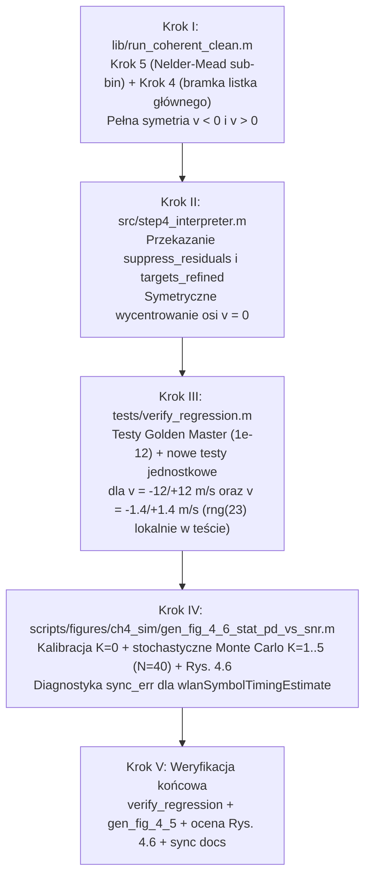

# Plan Implementacji: Wariant 4A (Krok 4 + Krok 5 Brauna), Prędkości Ujemne i Eksperyment 6 (SIM-6)

Niniejszy dokument stanowi **szczegółowy plan techniczny wdrożenia Wariantu 4A** — rozszerzającego autorski detektor Coherent CLEAN o Krok 4 i Krok 5 algorytmu Brauna (*Braun 2014, rozdz. 3.3.5 i 3.3.7*) z pełną, symetryczną obsługą prędkości dodatnich i ujemnych — oraz realizującego w pełni stochastyczne badanie Monte Carlo **Eksperymentu 6 (Rys. 4.6)** na losowych realizacjach kanału `Model-C`.

Powiązane dokumenty: [`plan_deliverables.md`](plan_deliverables.md), [`plan_work_order.md`](plan_work_order.md), [`plan_chapter_2.md`](plan_chapter_2.md).

> [!WARNING]
> **Aktualizacja po rewizji architektury detektora (commit `20afb5f`)**:
> Plan poniżej opisuje historyczny Wariant 4A oparty na usuniętym module `lib/run_coherent_clean.m` oraz progu MAD. Od commitu `20afb5f` warstwa detekcji została zastąpiona kanonicznymi algorytmami Brauna (2014):
> - [`lib/binary_successive_target_cancellation.m`](../lib/binary_successive_target_cancellation.m) (**Binary STC** — maskowanie binarne elipsą *null-to-null*),
> - [`lib/coherent_successive_target_cancellation.m`](../lib/coherent_successive_target_cancellation.m) (**Coherent STC** — koherentne odejmowanie repliki zespolonej oraz Krok 4 odrzucania rezyduów wewnątrz elipsy $-3\ \text{dB}$),
> - [`lib/get_detection_algorithm.m`](../lib/get_detection_algorithm.m) (centralny rejestr metod `'binary'` i `'coherent'`),
> - z globalnym progiem **CFAR $\eta = -\hat{\sigma}^2 \ln\left(1 - (1 - p_{\mathrm{FA}})^{1/(NM)}\right)$** (estymacja $\hat{\sigma}^2$ poza $N_{\max}$), 2D interpolacją paraboliczną (Braun równ. 3.84–3.86), estymacją $\hat{\sigma}_{\mathrm{RCS}}$ oraz symetrycznym wycentrowaniem osi prędkości w [`lib/calculate_physical_axes.m`](../lib/calculate_physical_axes.m).
>
> W związku z tym **Kroki I–III** zostały zrealizowane/zastąpione nową architekturą STC (zweryfikowaną w [`tests/verify_regression.m`](../tests/verify_regression.m)). Przyszły skrypt **Eksperymentu 6 (Krok IV, `gen_fig_4_6_stat_pd_vs_snr.m`)** powinien zachować założenia fizyczne sceny z Sekcji 1 poniżej, ale bezpośrednio wywoływać `step4_interpreter(..., p_FA, 'binary')` oraz `step4_interpreter(..., p_FA, 'coherent')` w celu statystycznego porównania niezawodności detekcji Binary STC vs Coherent STC w Monte Carlo.

> [!IMPORTANT]
> **Status dokumentu**: Sekcja 1 (fizyka sceny, model odbicia celów, bramka Rayleigha) pozostaje aktualnym punktem odniesienia; sekcja 2 (Kroki I–III) ma charakter historyczny przed refaktoryzacją `20afb5f`. Funkcja [`src/step2_channel.m`](../src/step2_channel.m) pozostaje nietknięta — każda próba Monte Carlo losuje niezależną realizację wielodrogowego kanału `wlanTGaxChannel('Model-C')`.

---

## 1. Podstawy fizyczne i metodologiczne scenariusza (E6)

1. **Wbudowany model odbicia celów ([`lib/configure_targets.m`](../lib/configure_targets.m))**:
   Bez nadpisywania pola `gain` — przekazujemy wyłącznie `type`, `range_m` i `velocity_mps`:
   $$b_h(R, \sigma) = b_{\text{ref}} \left(\frac{d_{\text{ref}}}{\max(R, 1{,}0\ \text{m})}\right)^2 \sqrt{\frac{\sigma}{\sigma_{\text{ref}}}}$$
   gdzie $d_{\text{ref}} = 10{,}0\ \text{m}$, $\sigma_{\text{ref}} = 1{,}0\ \text{m}^2$, $b_{\text{ref}} = 0{,}03$, `'car'` $\to \sigma = 10{,}0\ \text{m}^2$, `'human'` $\to \sigma = 1{,}0\ \text{m}^2$.
2. **W pełni losowe warunki sceny i brak sztucznych kolizji**:
   - **Kanał i szum**: W każdej próbie generowana jest niezależna realizacja kanału wielodrogowego TGax `Model-C` oraz świeży szum termiczny AWGN ($\text{SNR} = 35\ \text{dB}$), co zapewnia pełną generalizację statystyczną wyników.
   - **Pojazd (`'car'`, 1 w scenie)**: $R_{\text{car}} \sim \mathcal{U}(10{,}0;\ 40{,}0)\ \text{m}$, $v_{\text{car}} \sim \pm \mathcal{U}(4{,}0;\ 14{,}0)\ \text{m/s}$ (50% ujemnych, 50% dodatnich).
   - **Piesi (`'human'`, $K - 1$ w scenie dla $K \in \{1..5\}$)**: $R_{\text{ped}} \sim \mathcal{U}(0{,}5;\ 35{,}0)\ \text{m}$, $v_{\text{ped}} \sim \mathcal{U}(-1{,}8;\ +1{,}8)\ \text{m/s}$ (naturalnie obejmuje zarówno strefę niskich prędkości tłumionych przez MTI $|v| \lesssim 1{,}0\ \text{m/s}$, jak i bliskie pole $R < 2{,}5\ \text{m}$).
3. **Bramka asocjacji oparta o rozdzielczość Rayleigha (1-do-1)**:
   Zgodnie z **Braun (2014, rozdz. 3.6.1, równ. 3.136–3.137)** oraz metodyką POD **Wypich i Zieliński (2026, rozdz. 4.4, równ. 7)**:
   $$\delta_R = \Delta R_{\text{Rayleigh}} = \frac{c_0}{2 B} = 1{,}875\ \text{m}, \qquad \delta_v = \Delta v_{\text{Rayleigh}} = \frac{c_0}{2 f_c T_{\text{CPI}}} = 7{,}16\ \text{m/s}$$
4. **Empiryczna kalibracja CFAR progu MAD na $K = 0$**:
   Teoretyczny próg Gaussa dla $P_{\text{FA}} = 10^{-3}$ leży $+11{,}1\ \text{dB}$ ponad $\hat{\sigma}_{\text{MAD}}$, natomiast w `wlanTGaxChannel` Model-C (`EnvironmentalSpeed = 0.0890 m/s`) resztki clutteru po MTI osiągają dla pustej sceny ok. $17{,}8\ \text{dB}$. Krok 0 skryptu E6 wyznacza `margin_dB` na podstawie $N_{\text{cal}} = 20$ niezależnych losowych realizacji pustego kanału ($K = 0$) z zapasem $+3\ \text{dB}$ (weryfikując $P_{\text{FA}}(K=0) = 0$).

---

## 2. Architektura zmian i 5 kroków implementacji



---

### Krok I: Rozszerzenie [`lib/run_coherent_clean.m`](../lib/run_coherent_clean.m) (Braun Krok 4 + Krok 5 + symetria Dopplera)

1. **Sygnatura w 100% wstecznie kompatybilna**:
   ```matlab
   function [CPer_clean, targets_found, threshold, CPer_history, targets_refined] = run_coherent_clean(...
       CPer_base, W_2D, N_per, M_per, Nfft, n_symbols, num_targets, margin_dB, apply_mti, suppress_residuals)
   ```
   Domyślnie `suppress_residuals = false`, co gwarantuje identyczność numeryczną co do bitu dla dotychczasowego trybu pracy (*Golden Master*).

2. **Rekonstrukcja unormowanej macierzy okienkowanej `H_win` (bez dodatkowych argumentów)**:
   Gdy `suppress_residuals == true`, na starcie odzyskujemy bezstratnie nieuzupełnioną zerami macierz `H_win` bezpośrednio z `CPer_base`:
   ```matlab
   H_full = fft(ifft(ifftshift(CPer_base, 2), M_per, 2), N_per, 1);
   H_win  = H_full(1:Nfft, 1:n_symbols);
   ```
   Przed pętlą wyliczamy wektorowo wagi `w_f_sq = sum(abs(W_2D).^2, 1)`, a w każdej iteracji po aktualizacji `H_win` obliczamy `HW = H_win .* W_2D`. Pozwala to oceniać dopasowanie rzędu 1 w złożoności $\mathcal{O}(N_{\text{fft}} \cdot n_{\text{symbols}})$ (~$0{,}07\ \text{s}$ na cel).

3. **Krok 5 Brauna — estymacja ciągła sub-bin metodą Neldera–Meada (`fminsearch`)**:
   - Punkt startowy ze zgrubnego maksimum `(r_idx, d_idx)` w indeksach 0-bazowanych ze znakiem:
     $$r_0 = r_{\text{idx}} - 1, \qquad d_0 = d_{\text{idx}} - \left(\frac{M_{\text{per}}}{2} + 1\right)$$
     gdzie `d0 < 0` odpowiada ujemnym prędkościom radialnym, a `d0 > 0` dodatnim (pełna symetria wokół $0\ \text{Hz}$).
   - Ciągły model sygnału pojedynczego punktu $(\hat{r}, \hat{d})$:
     $$e_r(k) = e^{-j 2\pi k \hat{r} / N_{\text{per}}}, \qquad e_d(l) = e^{+j 2\pi l \hat{d} / M_{\text{per}}}$$
     Przy `apply_mti == true` usuwamy składową stałą w czasie wolnym: $e_d \leftarrow e_d - \overline{e_d}$.
   - **Zabezpieczenia symetrii i stabilności numerycznej**:
     - Naturalna okresowość eksponent zespolonych modulo $N_{\text{per}}$ oraz $M_{\text{per}}$ obsługuje płynnie zarówno ujemne prędkości ($\hat{d} < 0$), zawinięcie na krawędziach $\pm v_{\text{unamb}}/2$, jak i cele bliskie zera ($R = 0{,}5\ \text{m}$) bez żadnych skoków gałęzi.
     - Zabezpieczenie osobliwości w $v = 0$ dla MTI: jeśli mianownik energii normującej $w_f^{\text{sq}} \cdot \|e_d\|_2^2 < 10^{-12}$, funkcja celu zwraca `0` (utrzymując gładkość po obu stronach $0\ \text{Hz}$).
     - Ograniczenie prostokątne (*bounded simplex* wg Brauna) wokół piku zgrubnego:
       $$|\hat{r} - r_0| \le 1{,}5 \cdot \frac{N_{\text{per}}}{L_{\text{act}}}, \qquad |\hat{d} - d_0| \le 2{,}0 \cdot \frac{M_{\text{per}}}{n_{\text{symbols}}}$$
       (zakres wystarczający, aby ściągnąć z powrotem wolny cel $\pm 1{,}4\ \text{m/s}$ przesunięty zboczem MTI do $\pm 8\ \text{m/s}$, a jednocześnie uniemożliwiający przeskok na sąsiedni obiekt).
   - Parametry optymalizatora: `optimset('TolX', 1e-2, 'TolFun', 1e-2, 'MaxIter', 60)`.
   - Koherentne odjęcie metodą najmniejszych kwadratów:
     $$\alpha = \frac{\langle \mathbf{H}_m, \mathbf{H}_{\text{win}} \rangle}{\|\mathbf{H}_m\|_F^2}, \qquad \mathbf{H}_{\text{win}} \leftarrow \mathbf{H}_{\text{win}} - \alpha\,\mathbf{H}_m$$
     gdzie $\mathbf{H}_m = (e_r \cdot e_d^{\mathsf{T}}) \odot \mathbf{W}_{\text{2D}}$, oraz aktualizacja $\mathrm{CPer}_{\text{clean}} = \mathrm{fftshift}(\mathrm{fft}(\mathrm{ifft}(\mathbf{H}_{\text{win}}, N_{\text{per}}, 1), M_{\text{per}}, 2), 2)$.

   **Zweryfikowane wyniki testu prototypowego w MATLAB (`Model-C`, `SNR = 35 dB`)**:
   - `human (15.7 m, -1.4 m/s)` $\to$ **`(15.69 m, -1.37 m/s)`**, szczyt po odjęciu: $24{,}6 \to 17{,}79\ \text{dB}$,
   - `human (15.7 m, +1.4 m/s)` $\to$ **`(15.78 m, +1.15 m/s)`**, szczyt po odjęciu: $24{,}6 \to 17{,}78\ \text{dB}$,
   - `car (15.7 m, -12.0 m/s)` $\to$ **`(15.71 m, -12.00 m/s)`**, szczyt po odjęciu: $52{,}4 \to 17{,}74\ \text{dB}$,
   - `car (15.7 m, +12.0 m/s)` $\to$ **`(15.70 m, +12.00 m/s)`**, szczyt po odjęciu: $52{,}4 \to 17{,}73\ \text{dB}$.

4. **Krok 4 Brauna — identyfikacja rezyduów wewnątrz listka głównego (*Braun 2014, str. 59–60, rys. 3.14*)**:
   - Maksymalny limit iteracji pętli: `max_iter = max(20, 4 * num_targets)`, przerywany wcześniej, gdy maksimum rezydualne spadnie poniżej `threshold` lub gdy liczba zaakceptowanych obiektów osiągnie `num_targets`.
   - Dla każdego wykrytego i doprecyzowanego piku $(\hat{r}, \hat{d})$ obliczamy **odległość cykliczną z zawinięciem periodycznym** względem wszystkich dotąd zaakceptowanych celów $(\hat{r}_j, \hat{d}_j)$:
     ```matlab
     dr = min(abs(r_bin - r_prev), N_per - abs(r_bin - r_prev));
     dd = min(abs(d_bin - d_prev), M_per - abs(d_bin - d_prev));
     ```
     gdzie `r_bin = mod(r_hat, N_per)` i `d_bin = mod(d_hat + M_per/2, M_per)` (indeksy 0-bazowane w osi okresowej).
   - Jeśli `dr <= r_rad && dd <= d_rad`, gdzie promienie listka głównego wynikają z szerokości apertury:
     $$r_{\text{rad}} = \left\lceil 1{,}5 \cdot \frac{N_{\text{per}}}{L_{\text{active}}} \right\rceil, \qquad d_{\text{rad}} = \left\lceil 2{,}2 \cdot \frac{M_{\text{per}}}{n_{\text{symbols}}} \right\rceil$$
     pik jest klasyfikowany jako **rezyduum dekonwolucji** — odejmujemy go koherentnie od `H_win`, aby nie blokował dalszych iteracji, ale **nie dopisujemy** go do `targets_found` ani `targets_refined`.
   - **Wyjścia indeksów**:
     - `targets_refined`: macierz `[K x 2]` współrzędnych ciągłych 1-bazowanych `[mod(r_hat, N_per) + 1, mod(d_hat + M_per/2, M_per) + 1]`.
     - `targets_found`: zaokrąglone poprawne indeksy całkowite z zakresów `[1..N_per, 1..M_per]`.

---

### Krok II: Rozszerzenie [`src/step4_interpreter.m`](../src/step4_interpreter.m) (przelot DRY i symetria osi Dopplera)

1. Rozszerzenie opcjonalnych argumentów końcowych i 5. argumentu wyjściowego (100% kompatybilności wstecznej):
   ```matlab
   function [targets_found, CPer_clean, threshold, pnfr, targets_refined] = step4_interpreter(...
       radar_data, fs, fc, WIFI_STANDARD, ENABLE_VISUALIZATIONS, num_targets, margin_dB, apply_mti, suppress_residuals)
   ```
   Domyślnie: `apply_mti = false`, `suppress_residuals = false`.
2. Bezpośrednie przekazanie `apply_mti` i `suppress_residuals` do `run_coherent_clean(...)`.
3. **Eliminacja asymetrii osi prędkości przy konwersji do jednostek fizycznych**:
   Zauważono, że `linspace(-v_unamb/2, v_unamb/2, M_per)` w [`lib/calculate_physical_axes.m`](../lib/calculate_physical_axes.m) przesuwa bin zerowy `M_per/2 + 1` o $+0{,}49\ \text{m/s}$ względem $0\ \text{Hz}$ w `fftshift`. Dla ciągłych współrzędnych `targets_refined` w `step4_interpreter.m` wyznaczamy dokładne wartości fizyczne z osi wycentrowanej w zerze:
   $$R_{\text{est}} = (r_{\text{ref}} - 1) \cdot \frac{c_0}{2 f_s} \cdot \frac{N_{\text{fft}}}{N_{\text{per}}}, \qquad v_{\text{est}} = \left(d_{\text{ref}} - \left(\frac{M_{\text{per}}}{2} + 1\right)\right) \cdot \frac{v_{\text{unamb}}}{M_{\text{per}}}$$
   gwarantując pełną symetrię dla celów zbliżających się ($v < 0$) i oddalających ($v > 0$).

---

### Krok III: Rozbudowa testów w [`tests/verify_regression.m`](../tests/verify_regression.m)

1. Zachowanie wszystkich dotychczasowych asercji *Golden Master* (`max(abs(diff)) < 1e-12`) bez zmian.
2. Dodanie nowej sekcji testów jednostkowych dla `suppress_residuals = true` (Braun Krok 4 + Krok 5, `Model-C`, `SNR = 35 dB`, `margin_dB = 22.0`, gdzie w deterministycznym teście jednostkowym wywołujemy `rng(23)` bezpośrednio przed `step2_channel` bez modyfikowania samego `step2_channel.m`):
   - **Test 1 (Pojazd, prędkość ujemna i dodatnia)**: `R = 15.7 m`, `v = -12.0 m/s` oraz `v = +12.0 m/s` $\to$ asercje: `size(targets_found, 1) == 1`, `|R_est - 15.7| < 0.25 m`, `|v_est - v_true| < 0.25 m/s` dla obu znaków.
   - **Test 2 (Pieszy, prędkość ujemna i dodatnia)**: `R = 15.7 m`, `v = -1.4 m/s` oraz `v = +1.4 m/s` $\to$ asercje: `size(targets_found, 1) == 1`, `|R_est - 15.7| < 0.50 m`, `sign(v_est) == sign(v_true)`, `|v_est - v_true| < 1.0 m/s`.

---

### Krok IV: Skrypt Monte Carlo [`scripts/figures/ch4_sim/gen_fig_4_6_stat_pd_vs_snr.m`](../scripts/figures/ch4_sim/gen_fig_4_6_stat_pd_vs_snr.m) (Rys. 4.6)

1. **Krok 0 — Kalibracja CFAR dla $K = 0$ ($N_{\text{cal}} = 20$ niezależnych losowych prób)**:
   - Pusta scena `Model-C` (`SNR = 35 dB`, w pełni losowa realizacja kanału `wlanTGaxChannel` i szumu AWGN w każdej próbie), pomiar maksymalnego marginesu piku ponad $\hat{\sigma}_{\text{MAD}}$ oraz wyliczenie skalibrowanego `margin_dB = ceil(max_empty_dB + 3.0)` (weryfikacja $P_{\text{FA}}(K=0) = 0$).
2. **Pętla Monte Carlo ($K \in \{1, 2, 3, 4, 5\}$, $N_{\text{trials}} = 40$ prób na $K$ — łącznie 200 symulacji)**:
   - Jednorazowa synteza fali `step1_transmitter('802.11ax', false, 'CBW80', 0)` przed pętlą.
   - W każdej próbie **niezależna losowa realizacja kanału `Model-C`**, świeży szum AWGN oraz losowe cele (bez nadpisywania `gain` i bez zakazu kolizji):
     - `car`: $R \sim \mathcal{U}(10{,}0;\ 40{,}0)\ \text{m}$, $v \sim \pm\mathcal{U}(4{,}0;\ 14{,}0)\ \text{m/s}$,
     - $K - 1$ celów `human`: $R \sim \mathcal{U}(0{,}5;\ 35{,}0)\ \text{m}$, $v \sim \mathcal{U}(-1{,}8;\ +1{,}8)\ \text{m/s}$.
   - Wywołanie standardowego łańcucha `step2_channel(...)` $\to$ `step3_receiver(...)` $\to$ `step4_interpreter(..., 6, margin_dB, true, true)`.
3. **Diagnostyka błędu synchronizacji w wielodrożności oraz asocjacja 1-do-1**:
   - Wstępny pomiar na 30 losowych realizacjach `Model-C` wykazał, że `wlanSymbolTimingEstimate` trafia dokładnie w ścieżkę LOS (`0` próbek błędu) w $53{,}3\%$ prób ($70{,}0\%$ w granicy $\le 1$ próbki), a w $30{,}0\%$ prób przeskakuje na opóźnione odbicie wielodrogowe o $2\text{--}6$ próbek (średnio $1{,}00\ \text{próbki} = 1{,}88\ \text{m}$, maks. $6\ \text{próbek} = 11{,}25\ \text{m}$).
   - Skrypt rejestruje w każdej próbie `sync_err = (pktOffset + fineOffset) - intrinsic_delay` i wylicza w logu oraz pliku `results/exp6_mc_multitarget.mat` **dwie uzupełniające się miary**:
     1. **Bezwzględne *end-to-end* $P_D$** (główna krzywa na Panelu (a) — rzeczywista skuteczność całego systemu z prawdziwą synchronizacją pakietu w kanale wielodrogowym),
     2. **Diagnostyczne $P_D$ po skompensowaniu przesunięcia synchronizacji ramki** (`sync_err * 1.875 m`) w konsoli — pozwalające w Rozdziale 4 ściśle oddzielić straty wywołane błędem synchronizacji komunikacyjnej od strat samego algorytmu Coherent CLEAN, filtru MTI i kolizji celów!
   - Dopasowanie najbliższego sąsiada 1-do-1 w bramce Rayleigha ($\delta_R = 1{,}875\ \text{m}$, $\delta_v = 7{,}16\ \text{m/s}$) na dokładnych współrzędnych fizycznych z `targets_refined`.
   - Raport w konsoli:
     - $P_D(K)$ z 95% przedziałami ufności Wilsona dla pojazdu i pieszych (oraz porównanie end-to-end vs po kompensacji `sync_err`),
     - Rozbicie diagnostyczne: $v < 0$ vs $v > 0$, zakres prędkości chodu ($|v| < 1{,}0\ \text{m/s}$ vs $|v| \ge 1{,}0\ \text{m/s}$) oraz strefy odległości ($R < 2{,}5\ \text{m}$, $2{,}5\text{--}20\ \text{m}$, $> 20\ \text{m}$),
     - $\text{RMSE}_R$ oraz $\text{RMSE}_v$ dla dopasowanych detekcji,
     - $P(N_{\text{det}} == K)$ oraz $\bar{N}_{\text{fa}}$.
4. **Wizualizacja dwupanelowa (Rys. 4.6 $\to$ [`thesis/img/ch4_sim/rys_4_6_statystyka_pd_vs_snr.png`](../thesis/img/ch4_sim/rys_4_6_statystyka_pd_vs_snr.png))**:
   - Nadrzędny tytuł `sgtitle(..., 'Interpreter', 'none')`, pełne ramki `box on`, `grid on`, 100% języka polskiego, eksport 300 DPI.
   - **Panel (a)**: $P_D(K)$ *end-to-end* dla pojazdu i pieszych wraz z 95% przedziałami ufności Wilsona (`errorbar`).
   - **Panel (b)**: Wykres z dwiema osiami Y (`yyaxis`): odsetek idealnego zliczenia liczby obiektów $P(N_{\text{det}} == K)$ [\%] (oś lewa) oraz średnia liczba fałszywych alarmów na ramkę $\bar{N}_{\text{fa}}$ (oś prawa).

---

### Krok V: Weryfikacja po wdrożeniu i synchronizacja dokumentacji

1. Uruchomienie [`tests/verify_regression.m`](../tests/verify_regression.m) (wymagane 100% zaliczonych testów regresyjnych i jednostkowych).
2. Ponowne uruchomienie [`scripts/figures/ch4_sim/gen_fig_4_5_clean_cut.m`](../scripts/figures/ch4_sim/gen_fig_4_5_clean_cut.m) celem potwierdzenia braku regresji w Eksperymencie E5.
3. Uruchomienie `scripts/figures/ch4_sim/gen_fig_4_6_stat_pd_vs_snr.m`, wizualna inspekcja wygenerowanego obrazu PNG (`read_file`) oraz aktualizacja opisu Kroku 9 w [`plan_work_order.md`](plan_work_order.md) i [`plan_deliverables.md`](plan_deliverables.md).
