# Kolejność pracy

Ten dokument mówi **w jakiej kolejności** robić zadania. *Co* ma powstać, jest tylko w [`plan_deliverables.md`](plan_deliverables.md) — w tym układ 5 rozdziałów wg [`milestone_1.md`](milestone_1.md), lista rysunków i reguły Zotero.

## Status realizacji prac (Dashboard)

| Krok | Zakres | Status |
| :---: | :--- | :---: |
| **Tor 0** | Golden Master & refaktoryzacja potoku DSP do `lib/` | `[ZROBIONE]` |
| **Tor A** | Infrastruktura pracy (Zotero, dane formalne AGH, szkielet 5 rozdziałów `.tex`) | `[ZROBIONE]` |
| **Krok 1** | Algorytmy **Binary STC** i **Coherent STC** z progiem CFAR $\eta$ (`lib/binary_successive_target_cancellation.m`, `lib/coherent_successive_target_cancellation.m`, `lib/get_detection_algorithm.m`) i testy regresyjne | `[ZROBIONE]` |
| **Krok 2** | Eksperyment IMPL-1: Macierz transmitancji $\hat{H}(k,l)$ w dziedzinie czas–częstotliwość (Rys. 3.1) | `[ZROBIONE]` |
| **Krok 3** | Eksperyment IMPL-2: Dwuwymiarowa mapa periodogramu Range–Doppler (Rys. 3.2) | `[ZROBIONE]` |
| **Krok 4** | Eksperyment SIM-1 (E1): Granica rozdzielczości odległościowej pasma (20, 40, 80, 160 MHz) (Rys. 4.1) | `[ZROBIONE]` |
| **Krok 5** | Eksperyment SIM-2 (E2): Granica prędkości jednoznacznej: 802.11a vs ax (aliasing Dopplera) (Rys. 4.2) | `[ZROBIONE]` |
| **Krok 6** | Eksperyment SIM-3 (E3): Granica modulacji MCS i wzmocnienie szumu ZF (Rys. 4.3) | `[ZROBIONE]` |
| **Krok 7** | Eksperyment SIM-4 (E4): Wpływ otoczenia wielodrogowego TGax (A, C, E) i filtr MTI (Rys. 4.4) | `[ZROBIONE]` |
| **Krok 8** | Eksperyment SIM-5 (E5): Granica dynamiki mocy — **Binary STC vs Coherent STC** z progiem CFAR $\eta$ (Rys. 4.5) | `[ZROBIONE]` |
| **Krok 9** | Eksperymenty SIM-6a/6b (MC): Analiza statystyczna Monte Carlo $P_D(R)$ z 95% przedziałami Wilsona — Indoor Model-B 80 MHz (Rys. 4.6) oraz Outdoor Model-E 40 MHz (Rys. 4.7) | `[ZROBIONE]` |
| **Krok 10a** | Migracja struktury LaTeX do nowego układu pracy wg [`plan_structure_migration.md`](plan_structure_migration.md) (Wstęp nienumerowany, `1. Sygnał 802.11`, `2. Radar pasywny`, `3. Opis oprogramowania`, `4. Opis eksperymentów`, Wnioski końcowe, Literatura — bez Dodatków) | `[ZROBIONE]` |
| **Krok 10b** | Redakcja Rozdziału 3 (`3. Opis oprogramowania`) w LaTeX (`30_radar_implementation.tex`) wg [`plan_chapter_3.md`](plan_chapter_3.md) | `[DO ZROBIENIA]` |
| **Krok 11** | Redakcja Rozdziału 4 (`4. Opis eksperymentów`) w LaTeX (`40_simulation_results.tex`) sekcja po sekcji | `[DO ZROBIENIA]` |
| **Krok 12** | Redakcja Rozdziału 2 (`2. Radar pasywny`, podrozdziały 2.1–2.5) w LaTeX (`20_passive_radar.tex`) wg [`plan_chapter_2.md`](plan_chapter_2.md) | `[DO ZROBIENIA]` |
| **Krok 13** | Domknięcie: Wstęp (`05_introduction.tex`), Wnioski końcowe (`50_conclusion.tex`), Dodatki (`60_appendices.tex`), program pracy, weryfikacja bibliografii | `[DO ZROBIENIA]` |

---

## Standard wykonania każdego kroku eksperymentalnego (Kroki 2–9)

Aby zapewnić pełną kontrolę nad poprawnością badań i unikać błędów implementacyjnych oraz redakcyjnych, **każdy eksperyment bada konkretny blok lub granicę fizyczną radaru** według rygorystycznego standardu:

1. **Stworzenie/dopracowanie skryptu testowego** w `scripts/figures/ch3_impl/` lub `scripts/figures/ch4_sim/`:
   - **Zasada DRY — bezwzględny zakaz duplikacji kodu potoku radaru**:
     - Skrypty testowe i generatory wykresów **nie mogą reimplementować ani powielać logiki algorytmów** (takich jak demodulacja OFDM, usuwanie CP, estymacja kanału Zero-Forcing, filtr MTI, interpolacja DC, okienkowanie czy sekwencyjna ekstrakcja Binary/Coherent STC).
     - Skrypt **musi bezpośrednio uruchamiać autorski kod projektu** (`step1_transmitter`, `step2_channel`, `step3_receiver`, `step4_interpreter` oraz moduły w `lib/`), demonstrując jego rzeczywiste działanie.
     - **Udostępnianie stanów pośrednich**: Jeżeli wykres wymaga danych pośrednich (np. macierzy $\hat{H}$ przed i po MTI, profilu przed i po filtracji), **rozszerza się strukturę wyjściową właściwego modułu produkcyjnego** (np. dodanie pól `H_raw`, `H_shifted` do `radar_data` w `step3_receiver.m`), zamiast kopiować wewnętrzne obliczenia do skryptu generatora.
   - Precyzyjnie sparametryzowany scenariusz fizyczny (odległości celów, prędkości, SNR, model TGax, standard Wi-Fi).

2. **Wygenerowanie i zapis grafiki**:
   - Uruchomienie skryptu i eksport w wysokiej rozdzielczości: `exportgraphics(fig, out_file, 'Resolution', 300)` do `thesis/img/ch.../rys_...png`.

3. **Weryfikacja poprawności fizycznej i numerycznej**:
   - Zgodność współrzędnych i wartości z teorią radarową i równaniem radiolokacji,
   - Ograniczenia środowiskowe: brak anomalii prędkości ($|v| \le 100\ \text{km/h}$ we wnętrzach),
   - Fizyka AP: stała moc $P_{\text{tx}}$, szum termiczny $P_N$ rosnący o $9\ \text{dB}$ przy 160 MHz wzgl. 20 MHz,
   - Prawidłowe działanie filtracji MTI, algorytmów Binary STC / Coherent STC i progu CFAR $\eta$.

4. **Weryfikacja czytelności i estetyki wykresu (zasada minimalizmu)**:
   - **Obowiązkowy nadrzędny tytuł główny (`sgtitle` / `title`)**:
     - Wykresy wielopanelowe (`subplot`): obowiązkowo `sgtitle('Tytuł nadrzędny', 'FontSize', 14, 'FontWeight', 'bold', 'Interpreter', 'none')`.
     - Wykresy jednopanelowe: `title('Tytuł wykresu', 'FontSize', 12, 'FontWeight', 'bold', 'Interpreter', 'none')`.
     - Zawsze ustawiać `'Interpreter', 'none'`, aby uniknąć formatowania podkreślników `_` jako indeksów dolnych.
   - **Zakaz przeładowania tekstem na wykresie**:
     - Bezwzględny zakaz wstawiania długich bloków tekstowych, ramek `annotation('textbox')` czy rozwlekłych komentarzy na płaszczyznę wykresu.
     - Krótkie, techniczne tytuły podpaneli (np. `title('a) Przed MTI')`, `title('b) Po MTI')`, `title('a) Standard 802.11a')`, `title('b) Standard 802.11ax')`).
     - Zwięzłe podpisy osi i pasków kolorów z jednostkami w nawiasach kwadratowych `[...]`.
     - **Wszelkie wnioski, dyskusje, parametry scenariusza i interpretacje należą do tekstu pracy w LaTeX oraz podpisu pod rysunkiem (`\caption{...}`)**, a nie do grafiki!
   - **100% język polski**: tytuły, etykiety osi, etykiety `colorbar`, legendy całkowicie w języku polskim.
   - Dobór parametrów graficznych do druku w pracy: grube linie ($\ge 1.5\ \text{pt}$), czytelne czcionki ($\ge 10\text{--}11\ \text{pt}$), siatka `grid on`, brak nakładania się napisów.
   - **Zamknięta pełna ramka wykresów 2D (`box on`)**: każdy wykres 2D (liniowy, stem, mapa 2D, przekrój) **musi mieć włączoną pełną ramkę osi (`box on;` / `set(gca, 'Box', 'on')`)**, dorysowującą krawędź górną („sufit”) oraz krawędź prawą („prawą ścianę”). Niedopuszczalne są wykresy z otwartą przestrzenią bez górnej i prawej krawędzi.

5. **Zatwierdzenie przez Użytkownika** przed rozpoczęciem kolejnego eksperymentu.

```mermaid
flowchart TD
    D["Źródło prawdy (plan_deliverables.md wg milestone_1.md)"]
    K1["Krok 1: Binary/Coherent STC + CFAR w lib/ [ZROBIONE]"]
    
    subgraph EXP_IMPL["Ilustracje implementacji (Rozdział 3)"]
        K2["Krok 2: Eksperyment IMPL-1 (Rys. 3.1 Macierz H: MTI i DC)"]
        K3["Krok 3: Eksperyment IMPL-2 (Rys. 3.2 Periodogram Range-Doppler)"]
    end

    subgraph EXP_SIM["Badania symulacyjne granic radaru (Rozdział 4)"]
        K4["Krok 4: E1 (Rys. 4.1 Granica odległości: pasmo 20-160 MHz)"]
        K5["Krok 5: E2 (Rys. 4.2 Granica prędkości: aliasing 802.11a vs ax)"]
        K6["Krok 6: E3 (Rys. 4.3 Granica modulacji: wzmocnienie szumu ZF dla MCS)"]
        K7["Krok 7: E4 (Rys. 4.4 Wpływ otoczenia: wielodrogowość TGax i filtr MTI)"]
        K8["Krok 8: E5 (Rys. 4.5 Granica dynamiki: Binary vs Coherent STC i CFAR)"]
        K9["Krok 9: E6a/E6b MC (Rys. 4.6 Indoor, Rys. 4.7 Outdoor) [ZROBIONE]"]
    end

    subgraph LATEX["Migracja i redakcja tekstu pracy w LaTeX"]
        K10a["Krok 10a: Migracja struktury LaTeX (plan_structure_migration.md)"]
        K10b["Krok 10b: Redakcja Rozdziału 3 (Opis oprogramowania — plan_chapter_3.md)"]
        K11["Krok 11: Redakcja Rozdziału 4 (Opis eksperymentów)"]
        K12["Krok 12: Redakcja Rozdziału 2 (Radar pasywny — plan_chapter_2.md)"]
        K13["Krok 13: Wstęp, Wnioski końcowe, Dodatki, bibliografia i PDF"]
    end

    D --> K1
    K1 --> K2
    K2 --> K3
    K3 --> K4 --> K5 --> K6 --> K7 --> K8 --> K9
    K9 --> K10a
    K10a --> K10b
    K10b --> K11
    K11 --> K12
    K12 --> K13
```

---

## Szczegółowy plan kolejnych kroków

### Krok 1: Wdrożenie algorytmów Binary STC i Coherent STC (Braun 2014) `[ZROBIONE]`
- [x] 1. Wdrożenie kanonicznych algorytmów Brauna (`lib/binary_successive_target_cancellation.m`, `lib/coherent_successive_target_cancellation.m`) z estymacją szumu ML poza $N_{\max}$, progiem CFAR $\eta = -\hat{\sigma}^2 \ln\left(1 - (1 - p_{\mathrm{FA}})^{1/(NM)}\right)$, 2D interpolacją paraboliczną i estymacją RCS oraz centralnego rejestru `lib/get_detection_algorithm.m`.
- [x] 2. Aktualizacja fasady `src/step4_interpreter.m` (domyślnie `'binary'`, obsługa `'coherent'`, parametr `p_FA = 1e-3`, symetryczne wycentrowanie osi prędkości w `lib/calculate_physical_axes.m`).
- [x] 3. Uruchomienie `tests/verify_regression.m`: zgodność Golden Master (`< 1e-12`), testy jednostkowe AWGN/off-grid/symetrii, testy potoku E2E (IMPL23 i E5 30 dB) oraz testy rejestru `get_detection_algorithm`.

---

### Krok 2: Eksperyment IMPL-1 — Macierz transmitancji $\hat{H}(k,l)$ w dziedzinie czas–częstotliwość (Rys. 3.1) `[ZROBIONE]`
- [x] 1. **Skrypt testowy**: `scripts/figures/ch3_impl/gen_fig_3_1_channel_matrix_h.m`.
  - Scenariusz: Ekstrakcja estymowanej transmitancji $\hat{H}(k,l) = Y(k,l) ./ X(k,l)$ w standardzie IEEE 802.11ax (CBW80, 80 MHz, MCS 0, $\text{SNR} = 25\ \text{dB}$, Model-C, ziarna `rng(42)`/`rng(23)`, cele: pieszy $22{,}5\ \text{m} / -4{,}0\ \text{m/s}$ oraz samochód $67{,}5\ \text{m} / +18{,}0\ \text{m/s}$).
  - Wykres: Dwa panele (heatmaps 2D amplitudy w dB):
    - (a) Surowa macierz transmitancji przed MTI – widoczna dominująca składowa stała (przesłuch DPI), zaniki wielodrogowe oraz wyciek luki DC wokół częstotliwości środkowej.
    - (b) Po filtracji MTI w czasie wolnym i liniowej interpolacji podnośnych DC – wycięcie składowej stałej, ciągłość widmowa i odsłonięcie zmodulowanych fazowo składowych ruchomych.
- [x] 2. **Plik wynikowy**: `thesis/img/ch3_impl/rys_3_1_macierz_transmitancji_h.png`.
- [x] 3. **Weryfikacja poprawności**:
  - Wycięcie składowej stałej DPI o $> 120\ \text{dB}$ (numerycznie $150{,}2\ \text{dB}$; spadek mocy całkowitej macierzy o $24{,}89\ \text{dB}$),
  - Ciągłość widmowa wzdłuż osi częstotliwości po zlikwidowaniu luki DC.
- [x] 4. **Weryfikacja czytelności i estetyki**:
  - Osie: „Numer symbolu OFDM (czas wolny)”, „Indeks podnośnej k (częstotliwość)”, etykieta paska kolorów: „Moc transmitancji [dB]”, 100% język polski, profesjonalna mapa barw (`parula`), eksport w rozdzielczości 300 DPI (`exportgraphics`).
- [x] 5. **Prezentacja i zatwierdzenie przez Użytkownika**.

---

### Krok 3: Eksperyment IMPL-2 & IMPL-3 — Mapy periodogramu Range–Doppler przed i po DSP (Rys. 3.2 i 3.3) `[ZROBIONE]`
- [x] 1. **Skrypty testowe (osobne pliki dla każdego rysunku, ujednolicone pasmo referencyjne CBW80 = 80 MHz)**:
  - `scripts/figures/ch3_impl/gen_fig_3_2_range_doppler.m` (Rys. 3.2 — porównanie mapy przed DSP i po DSP dla CBW80, układ 2x2: góra wykresy 3D całej mapy, dół zbliżenie 2D na strefę celów z detekcją Coherent STC przy CFAR $p_{\text{FA}} = 10^{-3}$),
  - `scripts/figures/ch3_impl/gen_fig_3_3_processing_stages.m` (Rys. 3.3 — dekompozycja 4 etapów przetwarzania dla CBW80: Periodogram bazowy $\to$ Odjęcie średniej czasowej $\to$ Okno 2D BH + interpolacja DC $\to$ Ekstrakcja Coherent STC).
  - Architektura (DRY): Bezpośrednie uruchomienie potoku `step1_transmitter` $\to$ `step2_channel` $\to$ `step3_receiver` $\to$ `step4_interpreter` oraz funkcji `compute_range_doppler_map` z `lib/` bez duplikacji kodu okienkowania i FFT.
- [x] 2. **Pliki wynikowe**:
  - `thesis/img/ch3_impl/rys_3_2_mapa_range_doppler.png`,
  - `thesis/img/ch3_impl/rys_3_3_etapy_przetwarzania.png`.
- [x] 3. **Weryfikacja poprawności**:
  - Pełna spójność parametryczna pomiędzy Rys. 3.1, 3.2 i 3.3 (`cbw = 'CBW80'`, `mcs = 0`, `snr_dB = 25`, Model-C, ziarna `rng(42)` i `rng(23)`, jednakowe cele $22{,}5\ \text{m} / -4{,}0\ \text{m/s}$ oraz $67{,}5\ \text{m} / +18{,}0\ \text{m/s}$ i kadr $R \in [0, 85]\ \text{m}$, $v \in [-25, 25]\ \text{m/s}$),
  - Wyeliminowanie przesłuchu bezpośredniego DPI przez MTI, tłumienie listków bocznych przez okno 2D Blackmana–Harrisa oraz bezbłędna ekstrakcja obu celów przez Coherent STC ($p_{\text{FA}} = 10^{-3}$, 2 iteracje, 0 rezyduów).
- [x] 4. **Weryfikacja czytelności i estetyki (wzorzec z commita `dd69b70`)**:
  - Nadrzędny tytuł główny `sgtitle(..., 'Interpreter', 'none')`, krótkie techniczne tytuły podpaneli `a) ...`–`d) ...`,
  - Osie: „Prędkość radialna [m/s]”, „Odległość bistatyczna [m]”, pasek kolorów: „Moc znormalizowana [dB]”, 100% język polski, `exportgraphics` 300 DPI.
- [x] 5. **Prezentacja i zatwierdzenie przez Użytkownika**.

---

### Krok 4: Eksperyment SIM-1 (E1) — Granica rozdzielczości odległościowej pasma (Rys. 4.1) `[ZROBIONE]`
- [x] 1. **Skrypt testowy**: `scripts/figures/ch4_sim/gen_fig_4_1_bandwidth_cut.m`.
  - Architektura (DRY): Pętla po pasmach wywołująca istniejący potok (`step1_transmitter`, `step2_channel`, `step3_receiver`, `step4_interpreter`) bez kopiowania logiki odbiornika.
  - Scenariusz: Dwa bliskie cele o separacji $\Delta R = 3{,}75\ \text{m}$ ($R_1 = 15{,}0\ \text{m}$, $R_2 = 18{,}75\ \text{m}$) w kanale Model-C.
  - Test pasm: 20 MHz, 40 MHz, 80 MHz, 160 MHz.
  - **Fizyka zjawiska**: Stała moc nadajnika AP ($100\ \text{mW}$ EIRP); moc szumu $P_N = k_B T B F$ rośnie o $+3\ \text{dB}$ na każde podwojenie pasma (+9.03 dB dla 160 MHz wzgl. 20 MHz).
  - Wykres: Zestawienie 4 przekrojów odległościowych (1D range cuts) na jednym wykresie.
- [x] 2. **Plik wynikowy**: `thesis/img/ch4_sim/rys_4_1_przekroj_odleglosci_pasma.png`.
- [x] 3. **Weryfikacja poprawności**:
  - W 20 MHz ($\Delta R_{\text{teor}} = 7{,}5\ \text{m}$): obiekty zlane w jeden szeroki pik ($R = 16{,}89\ \text{m}$),
  - W 40 MHz ($\Delta R_{\text{teor}} = 3{,}75\ \text{m}$): widoczne kryterium Rayleigha (styk pików z siodłem $-1{,}10\ \text{dB}$),
  - W 80 i 160 MHz: pełna separacja dwóch odrębnych pików (wcięcie odpowiednio $-6{,}48\ \text{dB}$ oraz $-19{,}10\ \text{dB}$ dla $R_1 = 15{,}00\ \text{m}$ i $R_2 = 18{,}75\ \text{m}$),
  - Wyraźnie widoczne podwyższenie dna szumowego o 9 dB dla 160 MHz odzwierciedlające fizykę stałej mocy AP (wzrost mediany tła na przekroju z $-42{,}1\ \text{dB}$ dla 20 MHz do $-33{,}1\ \text{dB}$ dla 160 MHz, tj. $+9{,}03\ \text{dB}$).
- [x] 4. **Weryfikacja czytelności i estetyki (wzorzec z commita `dd69b70`)**:
  - **Tytuł główny**: `title('Wpływ szerokości pasma na rozdzielczość odległościową', 'FontSize', 12, 'FontWeight', 'bold', 'Interpreter', 'none')`,
  - **Minimalizm tekstu**: Brak rozwlekłych komentarzy i ramek tekstowych na wykresie. Zwięzła legenda: pasmo, $\Delta R$ i $\text{SNR}_{\text{in}}$.
  - Oś X: „Odległość bistatyczna [m]”, oś Y: „Moc znormalizowana [dB]”, zróżnicowane kolory i style linii, 100% język polski, `exportgraphics` 300 DPI.
- [x] 5. **Prezentacja i zatwierdzenie przez Użytkownika**.

---

### Krok 5: Eksperyment SIM-2 (E2) — Granica prędkości jednoznacznej: 802.11a vs ax (Rys. 4.2) `[ZROBIONE]`
- [x] 1. **Skrypt testowy**: `scripts/figures/ch4_sim/gen_fig_4_2_doppler_aliasing.m`.
  - Architektura (DRY): Uruchomienie potoku kolejno dla `WIFI_STANDARD = '802.11a'` oraz `'802.11ax'` za pomocą `step1_transmitter` $\to$ `step2_channel` $\to$ `step3_receiver` $\to$ `step4_interpreter` bez powielania kodu DSP.
  - Scenariusz: Szybki obiekt $v = +20{,}0\ \text{m/s}$ ($72\ \text{km/h}$, typowy pojazd na $R = 30{,}0\ \text{m}$ w kanale Model-A, $\text{SNR} = 40\ \text{dB}$, krok próbkowania czasu wolnego $k_{\text{PRI}} = 60$).
  - Porównanie: 802.11a ($T_{\text{sym}} = 4{,}0\ \mu\text{s}$, $v_{\max} = \pm 56{,}82\ \text{m/s}$) vs 802.11ax ($T_{\text{sym}} = 13{,}6\ \mu\text{s}$, $v_{\max} = \pm 16{,}71\ \text{m/s}$).
  - Wykres: Jeden zintegrowany wykres przekroju profilu Dopplera w oknie jednoznaczności 802.11a ($\pm 56{,}8\ \text{m/s}$) z okresowym rozwinięciem widma 802.11ax i zaznaczonymi granicami $\pm 16{,}7\ \text{m/s}$.
- [x] 2. **Plik wynikowy**: `thesis/img/ch4_sim/rys_4_2_aliasing_dopplera.png`.
- [x] 3. **Weryfikacja poprawności**:
  - W 802.11a: poprawny, jednoznaczny pik przy $+20{,}00\ \text{m/s}$ ($R = 30{,}00\ \text{m}$, $\text{PNFR} = 53{,}1\ \text{dB}$),
  - W 802.11ax: zawinięcie widma (aliasing) wewnątrz przedziału podstawowego do pozornej prędkości $20{,}0 - 2 \cdot 16{,}71 = -13{,}42\ \text{m/s}$ (zmierzony pik na siatce: $-13{,}41\ \text{m/s}$, po interpolacji $-13{,}42\ \text{m/s}$, $R = 30{,}00\ \text{m}$, $\text{PNFR} = 39{,}1\ \text{dB}$) oraz okresowe repliki przy $-46{,}84$, $+20{,}00$ i $+53{,}42\ \text{m/s}$,
  - Udowodnienie kompromisu: większa odporność na wielodrogowość w ax kosztem 3,4-krotnie węższego zakresu prędkości jednoznacznej ($\pm 16{,}71\ \text{m/s}$ względem $\pm 56{,}82\ \text{m/s}$).
- [x] 4. **Weryfikacja czytelności i estetyki (wzorzec z commita `dd69b70`)**:
  - **Tytuł główny**: `title('Profile Dopplera w przedziale jednoznaczności IEEE 802.11a (±56,8 m/s)', 'FontSize', 12, 'FontWeight', 'bold', 'Interpreter', 'none')`,
  - **Minimalizm tekstu**: Brak rozwlekłych opisów na wykresie. Czyste pionowe linie wskazujące prędkość rzeczywistą ($+20{,}0\ \text{m/s}$) oraz granice jednoznaczności 802.11ax ($\pm 16{,}7\ \text{m/s}$), legenda pod wykresem (`southoutside`), `box on`, 100% język polski, `exportgraphics` 300 DPI.
- [x] 5. **Prezentacja i zatwierdzenie przez Użytkownika**.

---

### Krok 6: Eksperyment SIM-3 (E3) — Granica modulacji MCS i wzmocnienie szumu ZF (Rys. 4.3) `[ZROBIONE]`
- [x] 1. **Skrypt testowy**: `scripts/figures/ch4_sim/gen_fig_4_3_noise_enhancement.m`.
  - Architektura (DRY): Pętla po wszystkich indeksach MCS 0–11 wywołująca `step1_transmitter` $\to$ `step2_channel` $\to$ `step3_receiver` $\to$ `step4_interpreter`. Wykorzystanie zwracanych parametrów (`radar_data.zeta_dB`, `pnfr.pnfr_dB`) bez pisania własnego demodulatora.
  - Scenariusz: IEEE 802.11ax, CBW40, Model-C, $\text{SNR} = 25\ \text{dB}$, cel $R = 22{,}5\ \text{m}, v = +18{,}0\ \text{m/s}$. Wszystkie indeksy MCS 0–11 (BPSK, QPSK, 16-QAM, 64-QAM, 256-QAM, 1024-QAM) przy dynamicznie skalowanym ładunku PSDU ($8190 \to 136500\ \text{B}$) utrzymującym stały czas trwania ramki ($3871{,}2\ \mu\text{s}$, $M = 280$ symboli OFDM).
  - Wykres: Wykres z dwiema zsynchronizowanymi osiami Y (`yyaxis`, skala 1:1 dB) — współczynnik wzmocnienia szumu $\zeta_{\text{ZF}} = \mathbb{E}[|X|^2]\mathbb{E}[1/|X|^2]$ [dB] oraz zmierzony kontrast celu PNFR [dB].
- [x] 2. **Plik wynikowy**: `thesis/img/ch4_sim/rys_4_3_wzmocnienie_szumu_mcs.png`.
- [x] 3. **Weryfikacja poprawności**:
  - $\zeta_{\text{ZF}} = 0{,}00\ \text{dB}$ dla stałoamplitudowych modulacji BPSK (MCS 0) i QPSK (MCS 1–2),
  - Schodkowy wzrost $\zeta_{\text{ZF}}$ z rzędem modulacji: $2{,}69\ \text{dB}$ (MCS 3–4, 16-QAM) $\to 4{,}19\text{--}4{,}22\ \text{dB}$ (MCS 5–7, 64-QAM) $\to 5{,}27\text{--}5{,}31\ \text{dB}$ (MCS 8–9, 256-QAM) $\to 6{,}12\text{--}6{,}15\ \text{dB}$ (MCS 10–11, 1024-QAM) wskutek dzielenia przez symbole o małej amplitudzie w estymatorze ZF,
  - Lustrzany, schodkowy spadek kontrastu celu PNFR przy stałym czasie ramki ($M = 280$): $47{,}96\ \text{dB}$ (MCS 0) $\to 45{,}20\text{--}45{,}25\ \text{dB}$ (16-QAM) $\to 43{,}80\text{--}43{,}83\ \text{dB}$ (64-QAM) $\to 42{,}89\text{--}42{,}65\ \text{dB}$ (256-QAM) $\to 41{,}61\text{--}42{,}27\ \text{dB}$ (1024-QAM), tj. spadek o $5{,}69\ \text{dB}$ dla MCS 11 (maks. $6{,}35\ \text{dB}$ dla MCS 10) i niezależność od stopy kodowania FEC wewnątrz grup modulacji.
- [x] 4. **Weryfikacja czytelności i estetyki (wzorzec z commita `dd69b70`)**:
  - **Tytuł główny**: `title('Wpływ indeksu MCS na wzmocnienie szumu ZF i kontrast celu PNFR (IEEE 802.11ax)', 'FontSize', 12, 'FontWeight', 'bold', 'Interpreter', 'none')`,
  - **Minimalizm tekstu**: Zsynchronizowane osie Y (`yyaxis left`: „Współczynnik wzmocnienia szumu ζ_ZF [dB]”, `yyaxis right`: „Kontrast celu PNFR [dB]”), oś X: „Indeks schematu modulacji i kodowania (MCS)”, legenda pod wykresem (`southoutside`), `box on`, 100% język polski, `exportgraphics` 300 DPI.
- [x] 5. **Prezentacja i zatwierdzenie przez Użytkownika**.

---

### Krok 7: Eksperyment SIM-4 (E4) — Wpływ otoczenia wielodrogowego TGax (A, C, E) i odejmowanie średniej czasowej (Rys. 4.4)
- [x] 1. **Skrypt testowy**: `scripts/figures/ch4_sim/gen_fig_4_4_tgax_static_removal.m`.
  - Architektura (DRY): Uruchomienie potoku `step1_transmitter` $\to$ `step2_channel` $\to$ `step3_receiver` dla modeli TGax:
    - Model-A ($\tau_{\text{rms}} = 0\ \text{ns}$, brak wielodrogi / komora bezechowa),
    - Model-C ($\tau_{\text{rms}} = 30\ \text{ns}$, środowisko biurowe),
    - Model-E ($\tau_{\text{rms}} = 100\ \text{ns}$, duża hala przemysłowa).
  - Scenariusz: IEEE 802.11ax, CBW80, MCS 0, $\text{SNR} = 30\ \text{dB}$, cel: $R = 10{,}0\ \text{m}$, $v = +8{,}0\ \text{m/s}$ (obiekt w strefie aktywnej wielodrogi modeli C i E).
  - Izolacja zmiennej: Obliczenie periodogramu 2D przed i po MTI przy zachowaniu tego samego okna 2D Blackmana–Harrisa i interpolacji DC za pomocą `compute_range_doppler_map` z `lib/`.
  - Wykres: Sześciopanelowe zestawienie map 2D Range–Doppler (siatka $3 \times 2$) ze wspólną bezwzględną skalą barwną `[-100, 0]` dB względem mocy DPI w Modelu-A:
    - Kolumna lewa: mapy przed MTI ukazujące rozprzestrzenianie się stacjonarnego echa wielodrogowego wzdłuż $v = 0\ \text{m/s}$ w przestrzeni $R \times v$ dla modeli A, C i E,
    - Kolumna prawa: mapy po MTI ukazujące wycięcie składowej stałej (rowek filtracyjny przy $v = 0$) i odsłonięcie celu ($v = +8{,}0\ \text{m/s}$) w oknie $v \in [-20, 20]\ \text{m/s}$, $R \in [0, 25]\ \text{m}$.
- [x] 2. **Plik wynikowy**: `thesis/img/ch4_sim/rys_4_4_usuwanie_echa_stalego.png`.
- [x] 3. **Weryfikacja poprawności**:
  - Skuteczne stłumienie składowej stacjonarnej ($v = 0\ \text{m/s}$) w punkcie $R = 10{,}0\ \text{m}$ o $28{,}1\ \text{dB}$ w Modelu-C oraz $24{,}2\ \text{dB}$ w Modelu-E (oraz tłumienie DPI w $R = 0\ \text{m}$ o $> 70\ \text{dB}$),
  - Odsłonięcie celu zamaskowanego przed MTI pod tłem clutteru ($\text{SCR} = -3{,}8 \to +3{,}3\ \text{dB}$ w Modelu-C oraz $-3{,}4 \to +3{,}4\ \text{dB}$ w Modelu-E),
  - Weryfikacja poprawionej synchronizacji z WLAN Toolbox (*leading-edge* na metryce L-LTF z `wlanSymbolTimingEstimate`, próg $0{,}20 \cdot M_{\max}$): wyeliminowanie blokady na opóźnionym klastrze wielodrogowym w Modelu-E — cel leży dokładnie na nominalnej odległości $R = 10{,}0\ \text{m}$ ($0$ próbek błędu synchronizacji zamiast wcześniejszego przesunięcia do $6{,}09\ \text{m}$).
- [x] 4. **Weryfikacja czytelności i estetyki**:
  - **Tytuł główny**: `sgtitle('Wpływ wielodrogowości kanału TGax i filtracji MTI na dwuwymiarowe mapy Range–Doppler', 'FontSize', 13.5, 'FontWeight', 'bold', 'Interpreter', 'none')`,
  - **Siatka 3x2**: Wiersz 1: Model-A (a, b), Wiersz 2: Model-C (c, d), Wiersz 3: Model-E (e, f).
  - Oś X: „Prędkość radialna [m/s]” ($[-20, 20]\ \text{m/s}$), Oś Y: „Odległość [m]” ($[0, 25]\ \text{m}$), paleta barwna `jet` (`[-100, 0]` dB), wspólny colorbar po prawej stronie, białe znaczniki celu z podpisem, `exportgraphics` 300 DPI.
- [x] 5. **Prezentacja i zatwierdzenie przez Użytkownika**.

---

### Krok 8: Eksperyment SIM-5 (E5) — Granica dynamiki mocy: Binary STC vs Coherent STC z progiem CFAR (Rys. 4.5) `[ZROBIONE]`
- [x] 1. **Skrypt testowy**: `scripts/figures/ch4_sim/gen_fig_4_5_stc_comparison.m`.
  - Architektura (DRY): Uruchomienie standardowego potoku `step1_transmitter` $\to$ `step2_channel` $\to$ `step3_receiver`, a następnie obu algorytmów Brauna przez `step4_interpreter(..., p_FA, 'binary')` oraz `step4_interpreter(..., p_FA, 'coherent')` ($p_{\text{FA}} = 10^{-3}$). Skrypt pobiera maskę `diag_bin.B` oraz historię okresogramów `diag_coh.Per_history`.
  - Scenariusz: Asymetria mocy 30 dB w standardzie IEEE 802.11ax (`CBW20`, 20 MHz, MCS 0, Model-C, $\text{SNR} = 38\ \text{dB}$):
    - Cel 1 (silny pojazd, $0\ \text{dB}$): $R_1 = 15{,}0\ \text{m}$, $v_1 = +8{,}0\ \text{m/s}$, $\text{gain} = 0{,}0500$,
    - Cel 2 (słaby pieszy, $-30\ \text{dB}$): $R_2 = 30{,}0\ \text{m}$, $v_2 = +8{,}0\ \text{m/s}$, $\text{gain} = 0{,}00158$, położony wewnątrz szerokiego listka głównego Blackmana–Harrisa pojazdu.
  - Wykres: Dwupanelowe zestawienie przekrojów odległościowych 1D w kolumnie Dopplera celu głównego z progiem CFAR $\eta$:
    - (a) **Binary STC (maskowanie binarne)**: sygnał surowy, sygnał po maskowaniu $\mathrm{Per}_{\mathbf{F}} \cdot \mathbf{B}$, szare zacieniowanie strefy $B = 0$, pozycja pieszego ($30{,}0\ \text{m}$) i próg CFAR $\eta$,
    - (b) **Coherent STC (odejmowanie koherentne)**: sygnał surowy, stan po usunięciu pojazdu (przed wykryciem pieszego), stan końcowy po zakończeniu pętli Coherent STC, pozycja pieszego ($30{,}0\ \text{m}$) i próg CFAR $\eta$.
- [x] 2. **Plik wynikowy**: `thesis/img/ch4_sim/rys_4_5_porownanie_stc.png`.
- [x] 3. **Weryfikacja poprawności**:
  - **Binary STC**: wyzerowanie elipsy *null-to-null* ($N_{\text{win}} = 34{,}0$ binów $= 63{,}75\ \text{m}$) tworzy strefę ślepą $B = 0$ na przedziale $[0{,}00;\ 46{,}88]\ \text{m}$, która pochłania pieszego — 1 wykrycie ($\hat{d}_1 = 15{,}20\ \text{m}$, $\hat{v}_1 = +7{,}45\ \text{m/s}$), pieszy niewykryty,
  - **Coherent STC**: po odjęciu repliki pojazdu i odrzuceniu 2 rezyduów w Kroku 4 (elipsa $-3\ \text{dB}$ o szerokości $N_{\text{win}} = 29{,}89\ \text{m}$) w iteracji 3 wyłania się wyraźny pik pieszego przy $\hat{d}_2 = 31{,}06\ \text{m}, \hat{v}_2 = +7{,}67\ \text{m/s}$ o mocy $-31{,}54\ \text{dB}$ ponad progiem CFAR $\eta = -39{,}66\ \text{dB}$ ($\text{PNFR} = 40{,}4\ \text{dB}$), a tło końcowe w kolumnie celu spada do $-45{,}71\ \text{dB} < \eta$.
- [x] 4. **Weryfikacja czytelności i estetyki (wzorzec z commita `dd69b70`)**:
  - **Tytuł główny**: `sgtitle('Porównanie algorytmów Binary STC i Coherent STC (Braun) w scenariuszu dynamiki 30 dB', 'FontSize', 13.5, 'FontWeight', 'bold', 'Interpreter', 'none')`,
  - **Minimalizm tekstu**: Brak bloków tekstowych wewnątrz osi, zwięzła legenda pod każdym panelem (`southoutside`), zamknięta ramka (`box on`), siatka (`grid on`), grube linie ($\ge 1{,}5\ \text{pt}$), 100% język polski, `exportgraphics` 300 DPI.
- [x] 5. **Prezentacja i zatwierdzenie przez Użytkownika**.

---

### Krok 9: Eksperymenty SIM-6a i SIM-6b (MC) — Analiza Monte Carlo $P_D(R)$ (Rys. 4.6 i 4.7) `[ZROBIONE]`
- [x] 1. **Skrypty testowe i silnik Monte Carlo**: `lib/run_detection_monte_carlo.m`, `lib/plot_detection_vs_range.m`, `scripts/figures/ch4_sim/gen_fig_4_6_stat_indoor.m`, `scripts/figures/ch4_sim/gen_fig_4_7_stat_outdoor.m`.
- [x] 2. **Pliki wynikowe**: `thesis/img/ch4_sim/rys_4_6_statystyka_indoor.png` (scenariusz wewnętrzny: 802.11ax `CBW80`, MCS 4, `Model-B`, $R \in [1, 15]\ \text{m}$) oraz `thesis/img/ch4_sim/rys_4_7_statystyka_outdoor.png` (scenariusz otwarty: 802.11ax `CBW40`, MCS 4, `Model-E`, $R \in [5, 105]\ \text{m}$).

---

### Krok 10a: Migracja struktury LaTeX (`docs/plan_structure_migration.md`) `[ZROBIONE]`
- [x] 1. Wydzielenie podrozdziałów `1.1–1.2` z `20_passive_radar.tex` do `thesis/tex/10_wifi_signal.tex` (`1. Sygnał 802.11`).
- [x] 2. Przekształcenie Wstępu (`05_introduction.tex`) oraz Wniosków końcowych (`50_conclusion.tex`) na sekcje nienumerowane (bez numerowanych `\subsection`).
- [x] 3. Zmiana tytułów Rozdziałów 3 (`Opis oprogramowania`) i 4 (`Opis eksperymentów`), dodanie `tikz` w `00_preambule.tex` oraz aktualizacja `thesis/main.tex` (bez Dodatków).
- [x] 4. Próbna kompilacja `pdflatex` + `bibtex` i weryfikacja spisu treści oraz odwołań.

---

### Krok 10b: Redakcja Rozdziału 3 w LaTeX (`thesis/tex/30_radar_implementation.tex`) wg `docs/plan_chapter_3.md`
- [ ] 1. Podrozdział 3.1: Środowisko symulacyjne MATLAB i wykorzystane pakiety narzędziowe (WLAN Toolbox, Communications Toolbox, Signal Processing Toolbox dla `blackmanharris`, wkład własny bez Radar Toolboxa, `tab:toolboxes_vs_custom`).
- [ ] 2. Podrozdział 3.2: Ogólna architektura oprogramowania i przepływ danych (schemat blokowy zależności TikZ **Rys. 3.1**, `src/` vs `lib/`, zasada DRY, tabela `tab:software_modules`, układ współlokowany z dwiema odizolowanymi antenami Tx/Rx).
- [ ] 3. Podrozdział 3.3: Implementacja nadajnika sygnału IEEE 802.11 (`step1_transmitter.m`, `get_wifi_params.m` — zwięźle, akcent na konfigurację i skalowanie czasu ramki).
- [ ] 4. Podrozdział 3.4: Implementacja modelu kanału propagacyjnego i celów ruchomych (`step2_channel.m`, `configure_targets.m`, `get_carrier_frequency.m`, TGax A/B/C/E, opóźnienia ułamkowe, zakotwiczenie szumu `awgn` do `clutter_signal` oraz **jawne doprecyzowanie braku ray-tracingu 3D i modelu SIC jako świadomego uproszczenia**).
- [ ] 5. Podrozdział 3.5: Implementacja odbiornika radarowego (podrozdziały `3.5.1` synchronizacja *leading-edge* + `demodulate.m`; `3.5.2` `estimate_channel.m` + `interpolate_dc_nulls.m` z **Rys. 3.2**; `3.5.3` `compute_range_doppler_map.m` + `calculate_physical_axes.m` z **Rys. 3.3–3.4**; `3.5.4` `step4_interpreter.m`, `get_detection_algorithm.m`, Binary/Coherent STC, `compute_pnfr.m`, testy `verify_regression.m` oraz odesłanie do Dodatku A), z odniesieniami do Rozdziałów 1 i 2.

---

### Krok 11: Redakcja Rozdziału 4 w LaTeX (`thesis/tex/40_simulation_results.tex`)
- [ ] 1. Podrozdział 4.1: Scenariusze testowe (**założenia geometrii monostatycznej z dwiema odizolowanymi antenami Tx/Rx, brak modelu ray-tracingu 3D jako świadome uproszczenie modelu tła, synchronizacja czasowa WLAN Toolbox z detekcją pierwszego czoła**, parametryzacja, stała moc AP 100 mW EIRP, degradacja szumowa 9 dB dla 160 MHz).
- [ ] 2. Podrozdział 4.2: Eksperyment E1 — Wpływ pasma na rozdzielczość odległościową (Rysunek 4.1).
- [ ] 3. Podrozdział 4.3: Eksperyment E2 — Porównanie standardów 802.11a i ax, aliasing Dopplera (Rysunek 4.2).
- [ ] 4. Podrozdział 4.4: Eksperyment E3 — Wpływ rzędu modulacji MCS i wzmocnienie szumu ZF (Rysunek 4.3).
- [ ] 5. Podrozdział 4.5: Eksperyment E4 — Tłumienie clutteru wielodrogowego TGax i MTI (Rysunek 4.4).
- [ ] 6. Podrozdział 4.6: Eksperyment E5 — Skuteczność Binary STC i Coherent STC z progiem CFAR $\eta$ (Rysunek 4.5) oraz analiza Monte Carlo $P_D(R)$: scenariusz wewnętrzny Model-B 80 MHz (Rysunek 4.6) i zewnętrzny Model-E 40 MHz (Rysunek 4.7).

---

### Krok 12: Redakcja Rozdziału 2 w LaTeX (`thesis/tex/20_passive_radar.tex`) wg `docs/plan_chapter_2.md`
- [ ] 1. Podrozdział 2.1 (dawny 2.3): Geometria pomiarowa i parametry radaru: konfiguracja współlokowana (geometria monostatyczna z dwiema odizolowanymi antenami Tx/Rx w trybie Full-Duplex, bilans mocy, DPI, clutter).
- [ ] 2. Podrozdział 2.2 (dawny 2.4): Estymacja częstotliwościowej odpowiedzi kanału (paradygmat CFR vs funkcja CAF, estymatory ZF i MF, zjawisko *noise enhancement*).
- [ ] 3. Podrozdział 2.3 (dawny 2.5): Tłumienie ech stałych i kompensacja luki DC (filtr MTI w czasie wolnym, interpolacja wielopunktowa nośnych DC).
- [ ] 4. Podrozdział 2.4 (dawny 2.6): Wyznaczanie mapy odległość–prędkość (okno 2D Blackmana–Harrisa, IFFT/FFT, zero-padding 4x).
- [ ] 5. Podrozdział 2.5 (dawny 2.7): Detekcja progowa CFAR i iteracyjna ekstrakcja celów (estymacja szumu ML, próg CFAR $\eta$, algorytmy Binary STC oraz Coherent STC, metryka PNFR).

---

### Krok 13: Domknięcie i weryfikacja końcowa
- [ ] 1. Wstęp (`05_introduction.tex`, nienumerowany) i Wnioski końcowe (`50_conclusion.tex`, nienumerowane — w tym ograniczenia uproszczenia braku ray-tracingu 3D i fizycznego toru SIC).
- [ ] 2. Dodatki (`60_appendices.tex` — wybrane listingi kodu MATLAB i instrukcja uruchomienia).
- [ ] 3. Program pracy (`03_MasterThesisOutline.tex`).
- [ ] 4. Synchronizacja bibliografii Zotero -> `thesis/bibliography.bib` i usunięcie `\nocite{*}`.
- [ ] 5. Pełna kompilacja `pdflatex` + `bibtex` (`thesis/main.pdf`) bez ostrzeżeń.
