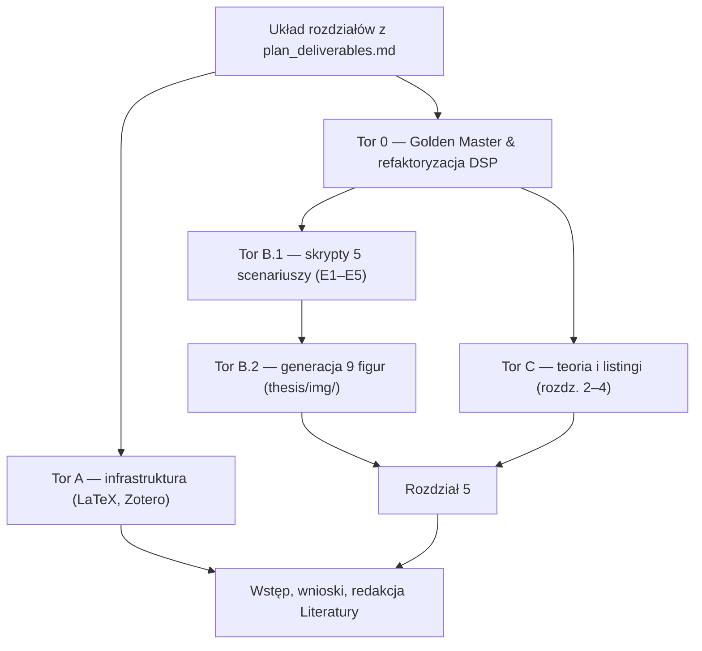

# Kolejność pracy

Ten dokument mówi **w jakiej kolejności** robić zadania. *Co* ma powstać, jest tylko w [`plan_deliverables.md`](plan_deliverables.md) — w tym układ rozdziałów, lista rysunków i reguły Zotero.

## Status realizacji prac (Dashboard)

| Tor / Etap | Zakres | Status |
| :--- | :--- | :--- |
| **Tor 0** | Golden Master & refaktoryzacja DSP do `lib/` | `[ZROBIONE]` |
| **Tor A** | Infrastruktura (Zotero, dane formalne, szkielet `.tex`) | `[ZROBIONE]` |
| **Tor B.1** | Skrypty 5 scenariuszy badawczych E1–E5 w `scripts/` | `[DO ZROBIENIA]` |
| **Tor B.2** | Obliczenia i katalog 9 figur scenariuszowych do `thesis/img/` | `[DO ZROBIENIA]` |
| **Tor C** | Rozdziały 2–4 w LaTeX (z listingami) | `[DO ZROBIENIA]` |
| **Rozdział 5** | Badania symulacyjne i interpretacja wyników | `[DO ZROBIENIA]` |
| **Domknięcie** | Wstęp, wnioski, program pracy, bibliografia | `[DO ZROBIENIA]` |

---

## Zasada

Po przyjęciu układu ze źródła prawdy pracujemy według ścieżki sterowanej zależnościami:
1. **Tor 0 (Krok zerowy)**: Zabezpieczenie kodu wzorcem Golden Master, lekka refaktoryzacja DSP do czystych funkcji w `lib/` oraz wygenerowanie listingów do pracy.
2. **Trzy tory równoległe**:
   - **Tor A (Infrastruktura)**: Zotero, dane formalne, szkielet rozdziałów LaTeX.
   - **Tor B (Eksperymenty)**: Dedykowane skrypty badawcze dla 5 scenariuszy fizycznych.
   - **Tor C (Teoria i algorytmy)**: Rozdziały 2–4 korzystające z gotowych listingów i ujednoliconej notacji.
3. **Faza domknięcia**: Rozdział 5 (po wygenerowaniu figur z Toru B), a następnie Wstęp, Wnioski i domknięcie Literatury.

---

## Twarda kolejność (zależności)

Zrób najpierw lewą kolumnę, zanim ruszysz prawą. Reszta nie jest bramką.

| Najpierw | Potem | Powód |
| :--- | :--- | :--- |
| Układ z [`plan_deliverables.md`](plan_deliverables.md) | puste `thesis/tex/20_pbr.tex` … `50_…tex` i `\include` w `main.tex` | inaczej powstaje zły szkielet |
| Wzorzec Golden Master + test regresyjny (`tests/`) | wydzielenie funkcji DSP do `lib/` | gwarancja braku rozjechania się wyników numerycznych |
| Czyste funkcje DSP w `lib/` + listingi w `thesis/listings/` | skrypty scenariuszy badawczych (B.1) i rozdział 4 (Tor C) | wywoływanie czystych funkcji w RAM; spójne nazwy zmiennych i wzorów w tekście |
| Implementacja skryptów eksperymentów E1–E5 (B.1) | wygenerowanie 9 figur (B.2) do `thesis/img/` | nie można wykreślić wyników przed implementacją scenariuszy |
| Stałe klucze w Zotero (choćby rdzeń: Braun, 802.11, Schmidl–Cox) | `\cite{...}` w tekście | nie trzeba pełnej bazy, trzeba niezmiennych kluczy |
| Obliczenia B.2 + zapis do `thesis/img/` | rozdział 5 | komentarz idzie pod konkretne rysunki |
| Szkice rozdz. 2–5 (albo jasna teza + faktyczne wyniki) | wstęp i wnioski | inaczej wstęp zmyśla cele, wnioski zmyślają odkrycia |

---

## Tor 0 — Bezpieczna refaktoryzacja i wzorzec Golden Master (krok wyjściowy)

Wykonywany przed pisaniem skryptów badawczych i rozdziału 4, aby dostarczyć czyste klocki DSP i listingi.

- [x] 1. **Utrwalenie wzorca odniesienia („Golden Master”)**: uruchomienie pełnego łańcucha ze stałym ziarnem (`rng(42, 'twister')`) i zapis referencyjnych macierzy (`golden_*.mat`).
- [x] 2. **Automatyczny test regresyjny**: skrypt `tests/verify_regression.m` porównujący wyniki nowego kodu z wzorcem z tolerancją `1e-12`.
- [x] 3. **Ekstrakcja czystych funkcji DSP do `lib/`**: `lib/estimate_channel_zf.m` (ZF, maskowanie, MTI, DC), `lib/compute_range_doppler_map.m` (okno 2D Blackman–Harris, periodogram 2D), `lib/run_coherent_clean.m` (pętla Coherent CLEAN).
- [x] 4. **Skrypty w `src/` jako fasady (pełna kompatybilność)**: wywołują funkcje z `lib/`, zapisują te same pliki `.mat`; `run_full_simulation.m` działa bez modyfikacji.
- [x] 5. **Pakiet listingów i styl `minted`**: wygenerowanie 4 zwartych plików kodu do `thesis/listings/` (rozdz. 4.2, 4.3–4.4, 4.5–4.6, 4.7) ze zmiennymi zbieżnymi z notacją pracy ($Y, X, H, \mathbf{W}_{\mathrm{2D}}$); konfiguracja `\setminted[matlab]{...}` w `thesis/tex/00_preambule.tex`.

---

## Tor A — infrastruktura (od razu, w tle)

Można przeplatać z kodem i z tekstem.

- [x] 1. Szkielet plików rozdziałów według tabeli w źródle prawdy (`10_introduction.tex` … `99_conclusion.tex` w `thesis/tex/`).
- [x] 2. Kolekcja Zotero *Wi-Fi Radar*, Better BibTeX, automatyczny eksport do `thesis/bibliography.bib`.
- [x] 3. Import materiałów z `references/` do Zotero, uzupełnienie metadanych/DOI i bezpośredni eksport do `.bib` (bez ręcznego inwentarza w Markdownie).
- [x] 4. Dane ze zgłoszenia w `thesis/main.tex` i stronie tytułowej; zmiana etykiety na pracę inżynierską; program pracy w `03_MasterThesisOutline.tex`.

Tor A nie blokuje toru B ani szkicowania rozdziałów 2–4. Blokuje tylko cytowania bez kluczy i skład całej pracy bez `\include`.

---

## Tor B — eksperymenty (wcześnie, bo żywi rozdział 5)

Dzięki Torowi 0 algorytmy DSP są już przetestowanymi, czystymi funkcjami w `lib/`. Tor B realizuje dwuetapowy proces: najpierw implementację 5 dedykowanych skryptów badawczych badających zjawiska fizyczne i algorytmiczne, a następnie generowanie i eksport finalnego katalogu 9 figur.

### B.1. Implementacja skryptów scenariuszy badawczych (przed wykreślaniem)
- [ ] 1. `scripts/exp1_bandwidth_resolution.m` — scenariusz E1: badanie wpływu pasma ($B = 20, 40, 80\,\mathrm{MHz}$) na rozdzielczość odległościową i separację bliskich celów ($\Delta R_{\mathrm{cel}} = 3\,\mathrm{m}$).
- [ ] 2. `scripts/exp2_doppler_aliasing.m` — scenariusz E2: badanie prędkości jednoznacznej i zjawiska aliasingu Dopplera w 802.11a vs 802.11ax dla szybkiego celu drogowego ($v = 25\,\mathrm{m/s}$).
- [ ] 3. `scripts/exp3_modulation_noise.m` — scenariusz E3: demonstracja efektu *noise enhancement* przy estymacji ZF dla MCS 0, 3 i 7 oraz zysku integracji przy skrajnym zaszumieniu ($\mathrm{SNR}_{\mathrm{in}} = -5\,\mathrm{dB}$).
- [ ] 4. `scripts/exp4_tgax_clutter.m` — scenariusz E4: ocena tłumienia stacjonarnego echa wielodrogowego w kanale TGax Model-B i D przez filtr MTI oraz rola interpolacji luki DC.
- [ ] 5. `scripts/exp5_coherent_clean.m` — scenariusz E5: weryfikacja i testowanie skuteczności algorytmu Coherent CLEAN:
  - rozszerzenie `lib/run_coherent_clean.m` o dynamiczne kryterium stopu (próg tła szumowego $\gamma_{\mathrm{th}}$ wg Brauna + limit $N_{\max}$) z zachowaniem zgodności dla `num_targets`,
  - demonstracja odkrywania słabego celu zamaskowanego w listkach bocznych dominującego odbicia ($>30\,\mathrm{dB}$ dynamiki mocy),
  - test skuteczności automatycznej detekcji w scenariuszu wielocelowym ($N \ge 3$ cele),
  - analiza odporności na zjawisko *over-cleaning* (eliminacja ryzyka detekcji fałszywych celów z szumu).
- [ ] 6. `scripts/run_all_experiments.m` — nadrzędny runner automatycznie uruchamiający wszystkie 5 eksperymentów.

### B.2. Przeprowadzenie symulacji i eksport katalogu 9 figur do `thesis/img/`
- [ ] 1. Uruchomienie `scripts/run_all_experiments.m` i zapis 9 figur z katalogu §4.4 źródła prawdy bezpośrednio do `thesis/img/` (oraz roboczo do `results/figures/`).
- [ ] 2. Sprawdzenie, czy `scripts/run_full_simulation.m` nadal bezbłędnie składa pojedynczy łańcuch bazowy.
- [ ] 3. Weryfikacja jakości i czytelności wygenerowanych figur (rozdzielczość, etykiety osi fizycznych w metrach i m/s, legendy).

Dopóki nie ma zestawu figur z §4.4 źródła prawdy, nie warto pisać rozdziału 5 „w ciemno”.

---

## Tor C — proza teoretyczna (równolegle z A i B)

Źródła: [`theory_notes.md`](theory_notes.md), Braun, 802.11, listingi z `thesis/listings/`, układ z źródła prawdy. Pisać od razu do `.tex`, nie przez drugi Markdown.

| Rozdział | Zależności | Równoległość |
| :--- | :--- | :--- |
| 2 PBR | prawie żadne (koncepcja + model CIR) | można zacząć natychmiast |
| 3 PHY 802.11 | notatki + standard; nie czeka na wykresy | niezależny od rozdz. 2 (w tym analiza sprzężeń telekomunikacyjnych i radarowych) |
| 4 algorytmy | Tor 0 (listingi z `thesis/listings/` i notacja wzorów) | po szkicu 3 wygodniej, ale nie twarda bramka |
| 5 wyniki | **Tor B.2 zakończony** (figury w `thesis/img/`) | po 2–4 albo w trakcie domykania 4 (interpretacja 5 scenariuszy E1–E5) |
| 1 wstęp | świadomy cel + wiemy, co wyszło w 5 | na końcu |
| 6 wnioski | rozdz. 5 | na końcu (podsumowanie ograniczeń i perspektywy: Multi-Frame CPI oraz SDR/CSI) |

Rozdział 4 bezpośrednio włącza listingi z `thesis/listings/` przez `\inputminted`. Nie czeka na skrypty badawcze Toru B. Rozdział 5 czeka.

Postęp pisania rozdziałów:
- [ ] Rozdział 2: Koncepcja bistatycznego radaru pasywnego (`thesis/tex/20_pbr.tex`)
- [ ] Rozdział 3: Sygnał Wi-Fi IEEE 802.11 (`thesis/tex/30_wifi_phy.tex`)
- [ ] Rozdział 4: Algorytmy przetwarzania radarowego (`thesis/tex/40_radar_dsp.tex`)
- [ ] Rozdział 5: Badania symulacyjne (`thesis/tex/50_simulation_results.tex`)
- [ ] Rozdział 1: Wstęp (`thesis/tex/10_introduction.tex`)
- [ ] Rozdział 6: Wnioski (`thesis/tex/99_conclusion.tex`)

---

## Sugerowany przebieg

1. **Dzień 0**:
   - Potwierdzić układ z [`plan_deliverables.md`](plan_deliverables.md).
   - Wykonać **Tor 0**: zabezpieczenie Golden Master, refaktoryzacja do `lib/`, test regresyjny, wygenerowanie listingów.
   - Rozpocząć **Tor A** (szkielet rozdziałów LaTeX + rdzeń Zotero).
2. **Dni 1–2 (Równolegle Tor B.1 i Tor C)**:
   - **Tor B.1**: implementacja 5 skryptów eksperymentów (`scripts/exp1_...m` do `exp5_...m`).
   - **Tor C**: pisanie rozdziałów 2, 3 i 4 (z wklejaniem gotowych listingów).
3. **Dzień 3 (Tor B.2 i Rozdział 5)**:
   - **Tor B.2**: wykonanie obliczeń symulacyjnych i wygenerowanie kompletu 9 figur do `thesis/img/`.
   - Zredagowanie rozdziału 5 pod kątem uzyskanych wykresów.
4. **Dzień 4**:
   - Wstęp (rozdz. 1), wnioski (rozdz. 6), program pracy (`03_MasterThesisOutline.tex`), domknięcie bibliografii w Zotero.
   - Weryfikacja końcowa.

---

## Weryfikacja na końcu

- [ ] 1. Test regresyjny `tests/verify_regression.m` przechodzi bezbłędnie (maksymalny błąd $\le 10^{-12}$).
- [ ] 2. Wzory w rozdz. 3–4 = zachowanie `src/` i funkcji w `lib/`.
- [ ] 3. Każde `\cite` ma rekord w Zotero i w eksporcie `.bib`; `pdflatex` + BibTeX bezbłędnie składa Literaturę.
- [ ] 4. Każdy z 9 rysunków z katalogu w źródle prawdy jest w `thesis/img/` i ma podpis w rozdz. 5.
- [ ] 5. Skrypty eksperymentów `scripts/exp*.m` wykonują się bez błędów i deterministycznie generują komplet figur.
