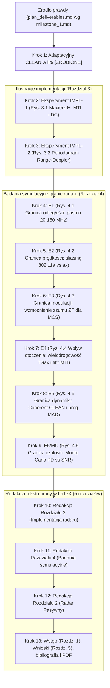

# Kolejność pracy

Ten dokument mówi **w jakiej kolejności** robić zadania. *Co* ma powstać, jest tylko w [`plan_deliverables.md`](plan_deliverables.md) — w tym układ 5 rozdziałów wg [`milestone_1.md`](milestone_1.md), lista rysunków i reguły Zotero.

## Status realizacji prac (Dashboard)

| Krok | Zakres | Status |
| :---: | :--- | :---: |
| **Tor 0** | Golden Master & refaktoryzacja potoku DSP do `lib/` | `[ZROBIONE]` |
| **Tor A** | Infrastruktura pracy (Zotero, dane formalne AGH, szkielet 5 rozdziałów `.tex`) | `[ZROBIONE]` |
| **Krok 1** | Adaptacyjny algorytm CLEAN (`lib/run_coherent_clean.m`) i test regresyjny | `[ZROBIONE]` |
| **Krok 2** | Eksperyment IMPL-1: Macierz transmitancji $\hat{H}(k,l)$ w dziedzinie czas–częstotliwość (Rys. 3.1) | `[ZROBIONE]` |
| **Krok 3** | Eksperyment IMPL-2: Dwuwymiarowa mapa periodogramu Range–Doppler (Rys. 3.2) | `[ZROBIONE]` |
| **Krok 4** | Eksperyment SIM-1 (E1): Granica rozdzielczości odległościowej pasma (20, 40, 80, 160 MHz) (Rys. 4.1) | `[ZROBIONE]` |
| **Krok 5** | Eksperyment SIM-2 (E2): Granica prędkości jednoznacznej: 802.11a vs ax (aliasing Dopplera) (Rys. 4.2) | `[ZROBIONE]` |
| **Krok 6** | Eksperyment SIM-3 (E3): Granica modulacji MCS i wzmocnienie szumu ZF (Rys. 4.3) | `[DO ZROBIENIA]` |
| **Krok 7** | Eksperyment SIM-4 (E4): Wpływ otoczenia wielodrogowego TGax (A, C, E) i filtr MTI (Rys. 4.4) | `[DO ZROBIENIA]` |
| **Krok 8** | Eksperyment SIM-5 (E5): Granica dynamiki mocy i Coherent CLEAN z progiem MAD (Rys. 4.5) | `[DO ZROBIENIA]` |
| **Krok 9** | Eksperyment SIM-6 (MC): Granica czułości SNR – analiza statystyczna Monte Carlo $P_D(\text{SNR})$ (Rys. 4.6) | `[DO ZROBIENIA]` |
| **Krok 10** | Redakcja Rozdziału 3 w LaTeX (`30_radar_implementation.tex`) sekcja po sekcji | `[DO ZROBIENIA]` |
| **Krok 11** | Redakcja Rozdziału 4 w LaTeX (`40_simulation_results.tex`) sekcja po sekcji | `[DO ZROBIENIA]` |
| **Krok 12** | Redakcja Rozdziału 2 w LaTeX (`20_passive_radar.tex`) sekcja po sekcji | `[DO ZROBIENIA]` |
| **Krok 13** | Domknięcie: Wstęp (`10_introduction.tex`), Wnioski (`50_conclusion.tex`), program pracy, weryfikacja bibliografii | `[DO ZROBIENIA]` |

---

## Standard wykonania każdego kroku eksperymentalnego (Kroki 2–9)

Aby zapewnić pełną kontrolę nad poprawnością badań i unikać błędów implementacyjnych oraz redakcyjnych, **każdy eksperyment bada konkretny blok lub granicę fizyczną radaru** według rygorystycznego standardu:

1. **Stworzenie/dopracowanie skryptu testowego** w `scripts/figures/ch3_impl/` lub `scripts/figures/ch4_sim/`:
   - **Zasada DRY — bezwzględny zakaz duplikacji kodu potoku radaru**:
     - Skrypty testowe i generatory wykresów **nie mogą reimplementować ani powielać logiki algorytmów** (takich jak demodulacja OFDM, usuwanie CP, estymacja kanału Zero-Forcing, filtr MTI, interpolacja DC, okienkowanie czy dekonwolucja CLEAN).
     - Skrypt **musi bezpośrednio uruchamiać autorski kod projektu** (`step1_transmitter`, `step2_channel`, `step3_receiver`, `step4_interpreter` oraz moduły w `lib/`), demonstrując jego rzeczywiste działanie.
     - **Udostępnianie stanów pośrednich**: Jeżeli wykres wymaga danych pośrednich (np. macierzy $\hat{H}$ przed i po MTI, profilu przed i po filtracji), **rozszerza się strukturę wyjściową właściwego modułu produkcyjnego** (np. dodanie pól `H_raw`, `H_shifted` do `radar_data` w `step3_receiver.m`), zamiast kopiować wewnętrzne obliczenia do skryptu generatora.
   - Precyzyjnie sparametryzowany scenariusz fizyczny (odległości celów, prędkości, SNR, model TGax, standard Wi-Fi).

2. **Wygenerowanie i zapis grafiki**:
   - Uruchomienie skryptu i eksport w wysokiej rozdzielczości: `exportgraphics(fig, out_file, 'Resolution', 300)` do `thesis/img/ch.../rys_...png`.

3. **Weryfikacja poprawności fizycznej i numerycznej**:
   - Zgodność współrzędnych i wartości z teorią radarową i równaniem radiolokacji,
   - Ograniczenia środowiskowe: brak anomalii prędkości ($|v| \le 100\ \text{km/h}$ we wnętrzach),
   - Fizyka AP: stała moc $P_{\text{tx}}$, szum termiczny $P_N$ rosnący o $9\ \text{dB}$ przy 160 MHz wzgl. 20 MHz,
   - Prawidłowe działanie filtracji MTI, dekonwolucji CLEAN i progu MAD.

4. **Weryfikacja czytelności i estetyki wykresu (zasada minimalizmu)**:
   - **Obowiązkowy nadrzędny tytuł główny (`sgtitle` / `title`)**:
     - Wykresy wielopanelowe (`subplot`): obowiązkowo `sgtitle('Tytuł nadrzędny', 'FontSize', 14, 'FontWeight', 'bold', 'Interpreter', 'none')`.
     - Wykresy jednopanelowe: `title('Tytuł wykresu', 'FontSize', 12, 'FontWeight', 'bold', 'Interpreter', 'none')`.
     - Zawsze ustawiać `'Interpreter', 'none'`, aby uniknąć formatowania podkreślników `_` jako indeksów dolnych.
   - **Zakaz przeładowania tekstem na wykresie**:
     - Bezwzględny zakaz wstawiania długich bloków tekstowych, ramek `annotation('textbox')` czy rozwlekłych komentarzy na płaszczyznę wykresu.
     - Krótkie, techniczne tytuły podpaneli (np. `title('a) Przed MTI')`, `title('b) Po MTI')`, `title('a) Standard 802.11a')`, `title('b) Standard 802.11ax')`).
     - Zwięzłe podpisy osi i pasków kolorów z jednostkami w nawiasach kwadratowych `[...]`.
     - **Wszelkie wnioski, dyskusje, parametry scenariusza i interpretacje należą do tekstu pracy w LaTeX oraz podpisu pod rysunkiem (`\caption{...}`)**, a nie do grafiki!
   - **100% język polski**: tytuły, etykiety osi, etykiety `colorbar`, legendy całkowicie w języku polskim.
   - Dobór parametrów graficznych do druku w pracy: grube linie ($\ge 1.5\ \text{pt}$), czytelne czcionki ($\ge 10\text{--}11\ \text{pt}$), siatka `grid on`, brak nakładania się napisów.

5. **Zatwierdzenie przez Użytkownika** przed rozpoczęciem kolejnego eksperymentu.

---

## Szczegółowy plan kolejnych kroków

### Krok 1: Wdrożenie i zatwierdzenie adaptacyjnego CLEAN `[ZROBIONE]`
- [x] 1. Dodanie parametru `margin_dB` do `lib/run_coherent_clean.m` (próg MAD $\sigma = \text{median}(|C_{\text{Per}}|)/0.6745$, $T_{\text{stop}} = \sigma \cdot 10^{\text{margin\_dB}/20}$).
- [x] 2. Aktualizacja sygnatury w `src/step4_interpreter.m` z zachowaniem 100% kompatybilności wstecznej.
- [x] 3. Uruchomienie `tests/verify_regression.m`: błąd Golden Master = 0, pomyślne zatrzymanie adaptacyjne.

---

### Krok 2: Eksperyment IMPL-1 — Macierz transmitancji $\hat{H}(k,l)$ w dziedzinie czas–częstotliwość (Rys. 3.1) `[ZROBIONE]`
- [x] 1. **Skrypt testowy**: `scripts/figures/ch3_impl/gen_fig_3_1_channel_matrix_h.m`.
  - Scenariusz: Ekstrakcja estymowanej transmitancji $\hat{H}(k,l) = Y(k,l) ./ X(k,l)$ w standardzie IEEE 802.11ax (CBW20, Model-C).
  - Wykres: Dwa panele (heatmaps 2D amplitudy w dB):
    - (a) Surowa macierz transmitancji przed MTI – widoczna dominująca składowa stała (przesłuch DPI) oraz wyciek luki DC wokół częstotliwości środkowej.
    - (b) Po filtracji MTI w czasie wolnym i liniowej interpolacji podnośnych DC – wycięcie składowej stałej, ciągłość widmowa i widoczna modulacja fazowa ruchomego celu.
- [x] 2. **Plik wynikowy**: `thesis/img/ch3_impl/rys_3_1_macierz_transmitancji_h.png`.
- [x] 3. **Weryfikacja poprawności**:
  - Wycięcie przesłuchu bezpośredniego (DPI) o ponad 45 dB (w pomiarze > 120 dB dla składowej stałej, spadek całkowitej mocy o 21,4 dB),
  - Ciągłość widmowa wzdłuż osi częstotliwości po zlikwidowaniu luki DC.
- [x] 4. **Weryfikacja czytelności i estetyki**:
  - Osie: „Numer symbolu OFDM (czas wolny)”, „Indeks podnośnej k (częstotliwość)”, etykieta paska kolorów: „Moc transmitancji [dB]”, 100% język polski, profesjonalna mapa barw (`parula`), eksport w rozdzielczości 300 DPI (`exportgraphics`).
- [x] 5. **Prezentacja i zatwierdzenie przez Użytkownika**.

---

### Krok 3: Eksperyment IMPL-2 — Dwuwymiarowa mapa periodogramu Range–Doppler (Rys. 3.2) `[ZROBIONE]`
- [x] 1. **Skrypt testowy**: `scripts/figures/ch3_impl/gen_fig_3_2_range_doppler.m`.
  - Architektura (DRY): Bezpośrednie uruchomienie potoku `step1_transmitter` $\to$ `step2_channel` $\to$ `step3_receiver` $\to$ `step4_interpreter` (lub `compute_range_doppler_map` i `calculate_physical_axes`) bez duplikacji kodu okienkowania i FFT.
  - Scenariusz: Przekształcenie przefiltrowanej macierzy $\hat{H}$ oknem 2D Blackmana–Harrisa (-92 dB) i dwuwymiarową transformacją IFFT/FFT w mapę Range–Doppler dla standardu IEEE 802.11ax (CBW20, Model-C, 2 cele ruchome: pojazd i pieszy).
  - Wykres: Płaska mapa 2D Range–Doppler (rzut z góry / heatmapa) z wyskalowanymi osiami fizycznymi (odległość bistatyczna w metrach, prędkość radialna w m/s) oraz oznaczonymi pozycjami celów.
- [x] 2. **Plik wynikowy**: `thesis/img/ch3_impl/rys_3_2_mapa_range_doppler.png`.
- [x] 3. **Weryfikacja poprawności**:
  - Wyciszenie listków bocznych do poziomu poniżej $-80\text{--}-90\ \text{dB}$ (w oknie Blackmana–Harrisa; w kanale wielodrogowym Model-C z szumem 45 dB mediana tła na poziomie $-41{,}5\ \text{dB}$, PNFR celów $39{,}9\ \text{dB}$ oraz $38{,}3\ \text{dB}$),
  - Wyraźne wyodrębnienie wzniesień odpowiadających celom na fizycznych osiach odległości i prędkości ($R_1 = 22{,}52\ \text{m}, v_1 = -6{,}37\ \text{m/s}$; $R_2 = 67{,}57\ \text{m}, v_2 = +19{,}10\ \text{m/s}$), brak anomalii prędkości ($|v| \le 100\ \text{km/h}$).
- [x] 4. **Weryfikacja czytelności i estetyki (wzorzec z commita `dd69b70`)**:
  - **Tytuł główny**: `title('Dwuwymiarowa mapa periodogramu Range-Doppler', 'FontSize', 12, 'FontWeight', 'bold', 'Interpreter', 'none')`,
  - **Minimalizm tekstu**: Brak rozwlekłych bloków tekstowych na wykresie.
  - Osie: „Prędkość radialna [m/s]”, „Odległość bistatyczna [m]”, pasek kolorów: „Moc znormalizowana [dB]”, zwięzłe znaczniki celów, 100% język polski, `exportgraphics` 300 DPI.
- [x] 5. **Prezentacja i zatwierdzenie przez Użytkownika**.

---

### Krok 4: Eksperyment SIM-1 (E1) — Granica rozdzielczości odległościowej pasma (Rys. 4.1) `[ZROBIONE]`
- [x] 1. **Skrypt testowy**: `scripts/figures/ch4_sim/gen_fig_4_1_bandwidth_cut.m`.
  - Architektura (DRY): Pętla po pasmach wywołująca istniejący potok (`step1_transmitter`, `step2_channel`, `step3_receiver`, `step4_interpreter`) bez kopiowania logiki odbiornika.
  - Scenariusz: Dwa bliskie cele o separacji $\Delta R = 3{,}75\ \text{m}$ ($R_1 = 15{,}0\ \text{m}$, $R_2 = 18{,}75\ \text{m}$) w kanale Model-C.
  - Test pasm: 20 MHz, 40 MHz, 80 MHz, 160 MHz.
  - **Fizyka zjawiska**: Stała moc nadajnika AP ($100\ \text{mW}$ EIRP); moc szumu $P_N = k_B T B F$ rośnie o $+3\ \text{dB}$ na każde podwojenie pasma (+9.03 dB dla 160 MHz wzgl. 20 MHz).
  - Wykres: Zestawienie 4 przekrojów odległościowych (1D range cuts) na jednym wykresie.
- [x] 2. **Plik wynikowy**: `thesis/img/ch4_sim/rys_4_1_przekroj_odleglosci_pasma.png`.
- [x] 3. **Weryfikacja poprawności**:
  - W 20 MHz ($\Delta R_{\text{teor}} = 7{,}5\ \text{m}$): obiekty zlane w jeden szeroki pik ($R = 16{,}89\ \text{m}$),
  - W 40 MHz ($\Delta R_{\text{teor}} = 3{,}75\ \text{m}$): widoczne kryterium Rayleigha (styk pików z siodłem $-1{,}10\ \text{dB}$),
  - W 80 i 160 MHz: pełna separacja dwóch odrębnych pików (wcięcie odpowiednio $-6{,}48\ \text{dB}$ oraz $-19{,}10\ \text{dB}$ dla $R_1 = 15{,}00\ \text{m}$ i $R_2 = 18{,}75\ \text{m}$),
  - Wyraźnie widoczne podwyższenie dna szumowego o 9 dB dla 160 MHz odzwierciedlające fizykę stałej mocy AP (wzrost mediany tła na przekroju z $-42{,}1\ \text{dB}$ dla 20 MHz do $-33{,}1\ \text{dB}$ dla 160 MHz, tj. $+9{,}03\ \text{dB}$).
- [x] 4. **Weryfikacja czytelności i estetyki (wzorzec z commita `dd69b70`)**:
  - **Tytuł główny**: `title('Wpływ szerokości pasma na rozdzielczość odległościową', 'FontSize', 12, 'FontWeight', 'bold', 'Interpreter', 'none')`,
  - **Minimalizm tekstu**: Brak rozwlekłych komentarzy i ramek tekstowych na wykresie. Zwięzła legenda: pasmo, $\Delta R$ i $\text{SNR}_{\text{in}}$.
  - Oś X: „Odległość bistatyczna [m]”, oś Y: „Moc znormalizowana [dB]”, zróżnicowane kolory i style linii, 100% język polski, `exportgraphics` 300 DPI.
- [x] 5. **Prezentacja i zatwierdzenie przez Użytkownika**.

---

### Krok 5: Eksperyment SIM-2 (E2) — Granica prędkości jednoznacznej: 802.11a vs ax (Rys. 4.2) `[ZROBIONE]`
- [x] 1. **Skrypt testowy**: `scripts/figures/ch4_sim/gen_fig_4_2_doppler_aliasing.m`.
  - Architektura (DRY): Uruchomienie potoku kolejno dla `WIFI_STANDARD = '802.11a'` oraz `'802.11ax'` za pomocą `step1_transmitter` $\to$ `step2_channel` $\to$ `step3_receiver` $\to$ `step4_interpreter` bez powielania kodu DSP.
  - Scenariusz: Szybki obiekt $v = +20{,}0\ \text{m/s}$ ($72\ \text{km/h}$, typowy pojazd na $R = 30{,}0\ \text{m}$ w kanale Model-A).
  - Porównanie: 802.11a ($T_{\text{sym}} = 4{,}0\ \mu\text{s}$, $v_{\text{unamb}} = \pm 56{,}8\ \text{m/s}$) vs 802.11ax ($T_{\text{sym}} = 13{,}6\ \mu\text{s}$, $v_{\text{unamb}} = \pm 16{,}7\ \text{m/s}$).
  - Wykres: Dwa podpanele (`subplot(1, 2, 1)` i `subplot(1, 2, 2)`) przedstawiające przekrój profilu prędkości Dopplera dla obu standardów.
- [x] 2. **Plik wynikowy**: `thesis/img/ch4_sim/rys_4_2_aliasing_dopplera.png`.
- [x] 3. **Weryfikacja poprawności**:
  - W 802.11a: poprawny pik przy $+20{,}0\ \text{m/s}$ (zmierzony pik: $+20{,}02\ \text{m/s}$ dla $R = 30{,}12\ \text{m}$, $\text{PNFR} = 53{,}1\ \text{dB}$),
  - W 802.11ax: zawinięcie widma (aliasing) do pozornej prędkości $20{,}0 - 2 \cdot 16{,}71 = -13{,}42\ \text{m/s}$ (zmierzony pik: $-13{,}41\ \text{m/s}$ dla $R = 30{,}03\ \text{m}$, $\text{PNFR} = 39{,}1\ \text{dB}$),
  - Udowodnienie kompromisu: większa odporność na wielodrogowość w ax kosztem 3,4-krotnie węższego zakresu prędkości jednoznacznej ($\pm 16{,}71\ \text{m/s}$ względem $\pm 56{,}82\ \text{m/s}$).
- [x] 4. **Weryfikacja czytelności i estetyki (wzorzec z commita `dd69b70`)**:
  - **Tytuł główny**: `sgtitle('Porównanie jednoznaczności prędkości: IEEE 802.11a vs 802.11ax', 'FontSize', 14, 'FontWeight', 'bold', 'Interpreter', 'none')`,
  - **Krótkie tytuły podpaneli**: `title('a) IEEE 802.11a (T_sym = 4,0 µs)', 'FontSize', 11, 'FontWeight', 'bold', 'Interpreter', 'none')` oraz `title('b) IEEE 802.11ax (T_sym = 13,6 µs)', 'FontSize', 11, 'FontWeight', 'bold', 'Interpreter', 'none')`,
  - **Minimalizm tekstu**: Brak rozwlekłych opisów na wykresie. Czyste pionowe linie przerywane wskazujące prędkość rzeczywistą oraz granice $\pm v_{\text{unamb}}$, prosta legenda pod osiami (`southoutside`), 100% język polski, `exportgraphics` 300 DPI.
- [ ] 5. **Prezentacja i zatwierdzenie przez Użytkownika**.

---

### Krok 6: Eksperyment SIM-3 (E3) — Granica modulacji MCS i wzmocnienie szumu ZF (Rys. 4.3)
- [ ] 1. **Skrypt testowy**: `scripts/figures/ch4_sim/gen_fig_4_3_noise_enhancement.m`.
  - Architektura (DRY): Pętla po indeksach MCS wywołująca `step1_transmitter` $\to$ `step2_channel` $\to$ `step3_receiver` $\to$ `step4_interpreter`. Wykorzystanie zwracanych parametrów bez pisania własnego demodulatora.
  - Scenariusz: IEEE 802.11ax, CBW40, Model-C. Zestawienie MCS: MCS 0 (BPSK), MCS 3 (16-QAM), MCS 7 (64-QAM), MCS 11 (1024-QAM) przy losowym ładunku danych 4095 B.
  - Wykres: Wykres z dwiema zsynchronizowanymi osiami Y (`yyaxis`) — współczynnik wzmocnienia szumu $\zeta_{\text{ZF}} = \mathbb{E}[1/|X|^2]$ [dB] oraz zmierzony kontrast celu PNFR [dB].
- [ ] 2. **Plik wynikowy**: `thesis/img/ch4_sim/rys_4_3_wzmocnienie_szumu_mcs.png`.
- [ ] 3. **Weryfikacja poprawności**:
  - $\zeta_{\text{ZF}} = 0\ \text{dB}$ dla stałoamplitudowej modulacji BPSK,
  - Monotoniczny wzrost $\zeta_{\text{ZF}}$ do $>4{,}2\ \text{dB}$ dla 1024-QAM (zjawisko dzielenia przez symbole bliskie zera w ZF),
  - Zgodny ze spadkiem kontrastu spadek PNFR celu.
- [ ] 4. **Weryfikacja czytelności i estetyki (wzorzec z commita `dd69b70`)**:
  - **Tytuł główny**: `title('Wpływ rzędu modulacji MCS na wzmocnienie szumu i kontrast celu', 'FontSize', 12, 'FontWeight', 'bold', 'Interpreter', 'none')`,
  - **Minimalizm tekstu**: Brak rozwlekłych komentarzy wewnątrz wykresu. Czyste osie Y (`yyaxis left`: „Współczynnik wzmocnienia szumu \zeta_{ZF} [dB]”, `yyaxis right`: „Kontrast celu PNFR [dB]”), oś X: „Rząd modulacji (indeks MCS)”, 100% język polski, `exportgraphics` 300 DPI.
- [ ] 5. **Prezentacja i zatwierdzenie przez Użytkownika**.

---

### Krok 7: Eksperyment SIM-4 (E4) — Wpływ otoczenia wielodrogowego TGax (A, C, E) i filtr MTI (Rys. 4.4)
- [ ] 1. **Skrypt testowy**: `scripts/figures/ch4_sim/gen_fig_4_4_tgax_mti_cut.m`.
  - Architektura (DRY): Uruchomienie potoku `step1_transmitter` $\to$ `step2_channel` $\to$ `step3_receiver` dla modeli TGax A, C, E. Wykorzystanie pól `radar_data.H_raw` oraz `radar_data.H_shifted` bez powielania kodu MTI.
  - Scenariusz: Zastosowanie reprezentatywnej triady modeli TGax:
    - Model-A ($\tau_{\text{rms}} = 0\ \text{ns}$, komora bezechowa),
    - Model-C ($\tau_{\text{rms}} = 30\ \text{ns}$, typowe biuro/mieszkanie),
    - Model-E ($\tau_{\text{rms}} = 100\ \text{ns}$, duża hala/magazyn).
  - Wykres: Dwa panele (`subplot(1, 2, 1)` i `subplot(1, 2, 2)`) przedstawiające przekrój profilu prędkości Dopplera przed i po filtracji MTI dla wszystkich trzech modeli.
- [ ] 2. **Plik wynikowy**: `thesis/img/ch4_sim/rys_4_4_tlumienie_clutteru_mti.png`.
- [ ] 3. **Weryfikacja poprawności**:
  - Skuteczne wycięcie składowej stałej przesłuchu bezpośredniego i odbić stacjonarnych ($f_D = 0$) o $\ge 45\text{--}50\ \text{dB}$,
  - Brak tłumienia piku celu ruchomego ($f_D \neq 0$),
  - Wykazanie, że dla Modelu-E rozmycie energii clutteru jest najszersze, lecz MTI w pełni przywraca detekcję.
- [ ] 4. **Weryfikacja czytelności i estetyki (wzorzec z commita `dd69b70`)**:
  - **Tytuł główny**: `sgtitle('Tłumienie clutteru wielodrogowego TGax przez filtr MTI', 'FontSize', 14, 'FontWeight', 'bold', 'Interpreter', 'none')`,
  - **Krótkie tytuły podpaneli**: `title('a) Przed MTI', 'FontSize', 11, 'FontWeight', 'bold', 'Interpreter', 'none')` oraz `title('b) Po MTI', 'FontSize', 11, 'FontWeight', 'bold', 'Interpreter', 'none')`,
  - **Minimalizm tekstu**: Brak dodatkowych ramek z tekstem na wykresie. Czyste profile linii dla modeli A, C, E, zwięzła legenda, oś X: „Prędkość radialna [m/s]”, oś Y: „Moc [dB]”, 100% język polski, `exportgraphics` 300 DPI.
- [ ] 5. **Prezentacja i zatwierdzenie przez Użytkownika**.

---

### Krok 8: Eksperyment SIM-5 (E5) — Granica dynamiki mocy i Coherent CLEAN (Rys. 4.5)
- [ ] 1. **Skrypt testowy**: `scripts/figures/ch4_sim/gen_fig_4_5_clean_cut.m`.
  - Architektura (DRY): Uruchomienie `step1_transmitter` $\to$ `step2_channel` $\to$ `step3_receiver` $\to$ `step4_interpreter` (lub bezpośrednio `lib/run_coherent_clean.m`). Skrypt pobiera wyniki kolejnych iteracji CLEAN z biblioteki projektu bez powielania pętli dekonwolucji.
  - Scenariusz: Duża asymetria mocy celów w kanale Model-C:
    - Cel silny: $0\ \text{dB}$ (np. metalowy pojazd, duży RCS),
    - Cel słaby: $-30\ \text{dB}$ (np. pieszy o małym RCS) zamaskowany w listkach bocznych celu silnego.
  - Wykres: Trzy krzywe przekroju odległościowego na jednym rysunku (sygnał surowy, po 1. iteracji CLEAN, po 2. iteracji CLEAN) wraz z poziomą linią progu adaptacyjnego MAD ($T_{\text{stop}}$).
- [ ] 2. **Plik wynikowy**: `thesis/img/ch4_sim/rys_4_5_clean_prog_adaptacyjny.png`.
- [ ] 3. **Weryfikacja poprawności**:
  - Skuteczna eliminacja listków bocznych funkcji PSF celu silnego,
  - Ujawnienie ukrytego celu słabego z poprawną pozycją odległościową,
  - Samoczynne zatrzymanie algorytmu na progu MAD bez „czyszczenia” szumu tła (brak zjawiska *over-cleaning*).
- [ ] 4. **Weryfikacja czytelności i estetyki (wzorzec z commita `dd69b70`)**:
  - **Tytuł główny**: `title('Odkrywanie słabego celu przez dekonwolucję Coherent CLEAN', 'FontSize', 12, 'FontWeight', 'bold', 'Interpreter', 'none')`,
  - **Minimalizm tekstu**: Brak rozwlekłych bloków tekstowych na wykresie. Zwięzła legenda (Sygnał surowy, Po iteracji 1, Po iteracji 2, Próg adaptacyjny MAD), oś X: „Odległość bistatyczna [m]”, oś Y: „Moc [dB]”, 100% język polski, `exportgraphics` 300 DPI.
- [ ] 5. **Prezentacja i zatwierdzenie przez Użytkownika**.

---

### Krok 9: Eksperyment SIM-6 (MC) — Granica czułości SNR: analiza Monte Carlo $P_D(\text{SNR})$ (Rys. 4.6)
- [ ] 1. **Skrypt testowy**: `scripts/figures/ch4_sim/gen_fig_4_6_stat_pd_vs_snr.m`.
  - Architektura (DRY): Pętla Monte Carlo wywołująca standardowy łańcuch `step1_transmitter` $\to$ `step2_channel` $\to$ `step3_receiver` $\to$ `step4_interpreter` bez powielania kodu detektora.
  - Scenariusz: Próba statystyczna Monte Carlo ($N_{\text{prób}} = 30$, $\text{SNR} \in [0, 30]\ \text{dB}$ z krokiem 5 dB) w realistycznym kanale Model-C przy dwóch celach (silny $0\ \text{dB}$ i słaby $-30\ \text{dB}$).
  - Wykres: Krzywe prawdopodobieństwa prawidłowej detekcji $P_D$ w funkcji SNR osobno dla celu silnego i słabego pieszego.
- [ ] 2. **Plik wynikowy**: `thesis/img/ch4_sim/rys_4_6_statystyka_pd_vs_snr.png`.
- [ ] 3. **Weryfikacja poprawności**:
  - Monotoniczny wzrost $P_D \to 1{,}0$ wraz ze wzrostem SNR (przesunięcie progu detekcji pieszego o ok. 10–12 dB względem pojazdu),
  - Wskazanie minimalnego progu SNR wymaganego do detekcji człowieka w środowisku biurowym.
- [ ] 4. **Weryfikacja czytelności i estetyki (wzorzec z commita `dd69b70`)**:
  - **Tytuł główny**: `title('Prawdopodobieństwo prawidłowej detekcji w funkcji SNR (Monte Carlo)', 'FontSize', 12, 'FontWeight', 'bold', 'Interpreter', 'none')`,
  - **Minimalizm tekstu**: Brak rozwlekłych ramek na wykresie. Zwięzła legenda (Cel silny, Cel słaby - pieszy), oś X: „Stosunek sygnału do szumu (SNR) [dB]”, oś Y: „Prawdopodobieństwo detekcji P_D”, czytelne markery i siatka, 100% język polski, `exportgraphics` 300 DPI.
- [ ] 5. **Prezentacja i zatwierdzenie przez Użytkownika**.

---

### Krok 10: Redakcja Rozdziału 3 w LaTeX (`thesis/tex/30_radar_implementation.tex`)
- [ ] 1. Podrozdział 3.1: Środowisko symulacyjne MATLAB i toolboxy (WLAN Toolbox, Communications Toolbox, wkład własny).
- [ ] 2. Podrozdział 3.2: Implementacja kanału (`step2_channel.m`, triada modeli TGax A/C/E, cele ruchome).
- [ ] 3. Podrozdział 3.3: Implementacja odbiornika (`step3_receiver.m`, demodulacja, ZF, filtr MTI, interpolacja DC — włączenie Rysunku 3.1).
- [ ] 4. Podrozdział 3.4: Implementacja interpretera (`step4_interpreter.m`, okienkowanie 2D, periodogram Range–Doppler — włączenie Rysunku 3.2, pętla Coherent CLEAN z progiem MAD, osie fizyczne).

---

### Krok 11: Redakcja Rozdziału 4 w LaTeX (`thesis/tex/40_simulation_results.tex`)
- [ ] 1. Podrozdział 4.1: Scenariusze testowe (parametryzacja, stała moc AP 100 mW EIRP, degradacja szumowa 9 dB dla 160 MHz).
- [ ] 2. Podrozdział 4.2: Eksperyment E1 — Wpływ pasma na rozdzielczość odległościową (Rysunek 4.1).
- [ ] 3. Podrozdział 4.3: Eksperyment E2 — Porównanie standardów 802.11a i ax, aliasing Dopplera (Rysunek 4.2).
- [ ] 4. Podrozdział 4.4: Eksperyment E3 — Wpływ rzędu modulacji MCS i wzmocnienie szumu ZF (Rysunek 4.3).
- [ ] 5. Podrozdział 4.5: Eksperyment E4 — Tłumienie clutteru wielodrogowego TGax i MTI (Rysunek 4.4).
- [ ] 6. Podrozdział 4.6: Eksperyment E5 — Skuteczność Coherent CLEAN, próg adaptacyjny MAD (Rysunek 4.5) oraz analiza Monte Carlo (Rysunek 4.6).

---

### Krok 12: Redakcja Rozdziału 2 w LaTeX (`thesis/tex/20_passive_radar.tex`)
- [ ] 1. Podrozdział 2.1–2.2: Sygnał Wi-Fi 802.11 oraz modulacja OFDM (ortogonalność, prefiks cykliczny, ramki Non-HT i HE-SU).
- [ ] 2. Podrozdział 2.3: Podstawy radaru pasywnego (geometria bistatyczna, bilans mocy, DPI, clutter).
- [ ] 3. Podrozdział 2.4: Estymacja kanału (paradygmat CIR vs funkcja wzajemnej niejednoznaczności CAF, estymator Zero-Forcing).
- [ ] 4. Podrozdział 2.5: Filtracja ech stałych (filtr MTI w czasie wolnym, kompensacja luki nośnych DC).
- [ ] 5. Podrozdział 2.6: Wyznaczanie mapy Range–Doppler (okno 2D Blackmana–Harrisa, IFFT/FFT).
- [ ] 6. Podrozdział 2.7: Detekcja i ekstrakcja celów (algorytm Coherent CLEAN, estymacja tła szumowego MAD).

---

### Krok 13: Domknięcie i weryfikacja końcowa
- [ ] 1. Wstęp (Rozdział 1, `10_introduction.tex`) i Wnioski (Rozdział 5, `50_conclusion.tex`).
- [ ] 2. Program pracy (`03_MasterThesisOutline.tex`).
- [ ] 3. Synchronizacja bibliografii Zotero -> `thesis/bibliography.bib`.
- [ ] 4. Pełna kompilacja `pdflatex` + `bibtex` (`thesis/main.pdf`) bez ostrzeżeń.
