# Kolejność pracy

Ten dokument mówi **w jakiej kolejności** robić zadania. *Co* ma powstać, jest tylko w [`plan_deliverables.md`](plan_deliverables.md) — w tym układ rozdziałów, lista rysunków i reguły Zotero.

## Status realizacji prac (Dashboard)

| Krok | Zakres | Status |
| :---: | :--- | :---: |
| **Tor 0** | Golden Master & refaktoryzacja potoku DSP do `lib/` | `[ZROBIONE]` |
| **Tor A** | Infrastruktura pracy (Zotero, dane formalne AGH, szkielet `.tex`) | `[ZROBIONE]` |
| **Krok 1** | Adaptacyjny algorytm CLEAN (`lib/run_coherent_clean.m`) i test regresyjny | `[ZROBIONE]` |
| **Krok 2** | Eksperyment DSP-1: Konstelacja RX i korekcja kanału (Rys. 4.1) | `[DO ZROBIENIA]` |
| **Krok 3** | Eksperyment DSP-2: Macierz transmitancji $\hat{H}(k,l)$ w dziedzinie czas–częstotliwość (Rys. 4.2) | `[DO ZROBIENIA]` |
| **Krok 4** | Eksperyment DSP-3: Trójwymiarowy periodogram Range–Doppler (Rys. 4.3) | `[DO ZROBIENIA]` |
| **Krok 5** | Eksperyment SIM-0: Bazowa mapa 2D Range–Doppler w paśmie 40 MHz (Rys. 5.1) | `[DO ZROBIENIA]` |
| **Krok 6** | Eksperyment SIM-1 (E1): Rozdzielczość pasma a stała moc AP i szum termiczny (Rys. 5.2) | `[DO ZROBIENIA]` |
| **Krok 7** | Eksperyment SIM-2 (E2): Długość symbolu OFDM a aliasing Dopplera (802.11a vs ax) (Rys. 5.3) | `[DO ZROBIENIA]` |
| **Krok 8** | Eksperyment SIM-3 (E3): Rząd modulacji MCS a wzmocnienie szumu ZF i kontrast PNFR (Rys. 5.4) | `[DO ZROBIENIA]` |
| **Krok 9** | Eksperyment SIM-4 (E4): Tłumienie stacjonarnego clutteru TGax (A, C, E) filtrem MTI (Rys. 5.5) | `[DO ZROBIENIA]` |
| **Krok 10** | Eksperyment SIM-5 (E5): Dekonwolucja Coherent CLEAN i adaptacyjny próg MAD (Rys. 5.6) | `[DO ZROBIENIA]` |
| **Krok 11** | Eksperyment SIM-6 (MC): Statystyczna analiza Monte Carlo — $P_D(\text{SNR})$ i zliczanie celów (Rys. 5.7, 5.8) | `[DO ZROBIENIA]` |
| **Krok 12** | Redakcja Rozdziału 4 w LaTeX (`40_radar_dsp.tex`) sekcja po sekcji | `[DO ZROBIENIA]` |
| **Krok 13** | Redakcja Rozdziału 5 w LaTeX (`50_simulation_results.tex`) sekcja po sekcji | `[DO ZROBIENIA]` |
| **Krok 14** | Redakcja Rozdziałów 2 i 3 w LaTeX (`20_pbr.tex`, `30_wifi_phy.tex`) | `[DO ZROBIENIA]` |
| **Krok 15** | Domknięcie: Wstęp, Wnioski, program pracy, weryfikacja bibliografii | `[DO ZROBIENIA]` |

---

## Standard wykonania każdego kroku eksperymentalnego (Kroki 2–11)

Aby zapewnić pełną kontrolę nad poprawnością badań i unikać hurtowych zmian, **każdy eksperyment realizowany jest w osobnym kroku** według 4-etapowego protokołu:

1. **Stworzenie/dopracowanie skryptu testowego** w `scripts/figures/ch.../`:
   - Zwięzły, czytelny kod MATLAB wywołujący potok `step1_transmitter` – `step4_interpreter` oraz bibliotekę `lib/`,
   - Precyzyjnie sparametryzowany scenariusz fizyczny (odległości celów, prędkości, SNR, model TGax, standard Wi-Fi).
2. **Wygenerowanie i zapis grafiki**:
   - Uruchomienie skryptu i zapis wykresu w formacie PNG wysokiej rozdzielczości do `thesis/img/ch.../rys_...png`.
3. **Weryfikacja poprawności fizycznej i numerycznej**:
   - Zgodność współrzędnych i wartości z teorią radarową i równaniem radiolokacji,
   - Ograniczenia środowiskowe: brak anomalii prędkości ($|v| \le 100\ \text{km/h}$ we wnętrzach),
   - Fizyka AP: stała moc $P_{\text{tx}}$, szum termiczny $P_N$ rosnący o $9\ \text{dB}$ przy 160 MHz wzgl. 20 MHz,
   - Prawidłowe działanie filtracji MTI, dekonwolucji CLEAN i progu MAD.
4. **Weryfikacja czytelności i estetyki wykresu**:
   - **100% język polski**: tytuł, podpisy osi z jednostkami w nawiasach kwadratowych `[...]`, etykiety pasków barwnych, legendy,
   - Dobór parametrów graficznych do druku w pracy: grube linie ($\ge 1.5\ \text{pt}$), czytelne czcionki ($\ge 10\text{--}11\ \text{pt}$), siatka `grid on`, brak nakładania się napisów,
   - Sprawdzenie kontrastu i czytelności po przeskalowaniu do szerokości kolumny tekstu w LaTeX.
5. **Zatwierdzenie przez Użytkownika** przed rozpoczęciem kolejnego eksperymentu.

```mermaid
flowchart TD
    D["Źródło prawdy (plan_deliverables.md)"]
    K1["Krok 1: Adaptacyjny CLEAN w lib/ [ZROBIONE]"]
    
    subgraph EXP_DSP["Eksperymenty DSP (Rozdział 4)"]
        K2["Krok 2: Eksperyment DSP-1 (Rys. 4.1 Konstelacja RX)"]
        K3["Krok 3: Eksperyment DSP-2 (Rys. 4.2 Macierz transmitancji H)"]
        K4["Krok 4: Eksperyment DSP-3 (Rys. 4.3 Periodogram 3D)"]
    end

    subgraph EXP_SIM["Eksperymenty symulacyjne (Rozdział 5)"]
        K5["Krok 5: Eksperyment SIM-0 (Rys. 5.1 Mapa 2D Range-Doppler)"]
        K6["Krok 6: Eksperyment SIM-1 / E1 (Rys. 5.2 Rozdzielczość pasma i szum)"]
        K7["Krok 7: Eksperyment SIM-2 / E2 (Rys. 5.3 Aliasing Dopplera 802.11a vs ax)"]
        K8["Krok 8: Eksperyment SIM-3 / E3 (Rys. 5.4 Wzmocnienie szumu ZF dla MCS)"]
        K9["Krok 9: Eksperyment SIM-4 / E4 (Rys. 5.5 Clutter TGax i filtr MTI)"]
        K10["Krok 10: Eksperyment SIM-5 / E5 (Rys. 5.6 CLEAN i próg adaptacyjny MAD)"]
        K11["Krok 11: Eksperyment SIM-6 / MC (Rys. 5.7 i 5.8 Monte Carlo: PD i zliczanie)"]
    end

    subgraph LATEX["Redakcja tekstu pracy w LaTeX"]
        K12["Krok 12: Redakcja Rozdziału 4 sekcja po sekcji"]
        K13["Krok 13: Redakcja Rozdziału 5 podrozdział po podrozdziale"]
        K14["Krok 14: Redakcja Rozdziałów 2 i 3"]
        K15["Krok 15: Wstęp, Wnioski, program pracy i kompilacja PDF"]
    end

    D --> K1
    K1 --> K2
    K2 --> K3 --> K4 --> K5
    K5 --> K6 --> K7 --> K8 --> K9 --> K10 --> K11
    K11 --> K12
    K12 --> K13
    K13 --> K14
    K14 --> K15
```

---

## Szczegółowy plan kolejnych kroków

### Krok 1: Wdrożenie i zatwierdzenie adaptacyjnego CLEAN `[ZROBIONE]`
- [x] 1. Dodanie parametru `margin_dB` do `lib/run_coherent_clean.m` (próg MAD $\sigma = \text{median}(|C_{\text{Per}}|)/0.6745$, $T_{\text{stop}} = \sigma \cdot 10^{\text{margin\_dB}/20}$).
- [x] 2. Aktualizacja sygnatury w `src/step4_interpreter.m` z zachowaniem 100% kompatybilności wstecznej.
- [x] 3. Uruchomienie `tests/verify_regression.m`: błąd Golden Master = 0, pomyślne zatrzymanie adaptacyjne.

---

### Krok 2: Eksperyment DSP-1 — Konstelacja RX i korekcja kanału (Rys. 4.1)
- [ ] 1. **Skrypt testowy**: `scripts/figures/ch4_dsp/gen_fig_4_1_constellation_rx.m`.
  - Scenariusz: IEEE 802.11ax, CBW20, MCS 0 (BPSK), kanał TGax Model-C, SNR = 25 dB.
  - Wykres: Dwa panele obok siebie — punkty odebrane $F_{\text{rx}}$ przed korekcją transmitancji kanału vs po korekcji Zero-Forcing ($F_{\text{rx}} ./ \hat{H}$).
- [ ] 2. **Plik wynikowy**: `thesis/img/ch4_dsp/rys_4_1_konstelacja_rx.png`.
- [ ] 3. **Weryfikacja poprawności**:
  - Przed korekcją: widoczne zniekształcenia fazowo-amplitudowe wywołane selektywnością częstotliwościową kanału TGax Model-C.
  - Po korekcji: punkty BPSK ściśle skupione w obszarach decyzyjnych $\{-1, +1\}$.
- [ ] 4. **Weryfikacja czytelności i estetyki**:
  - Podpisy osi: „Część rzeczywista (I)”, „Część urojona (Q)”, tytuły podwykresów: „(a) Przed korekcją transmitancji”, „(b) Po korekcji Zero-Forcing”, 100% język polski, kontrastowe punkty.
- [ ] 5. **Prezentacja i zatwierdzenie przez Użytkownika**.

---

### Krok 3: Eksperyment DSP-2 — Macierz transmitancji $\hat{H}(k,l)$ w dziedzinie czas–częstotliwość (Rys. 4.2)
- [ ] 1. **Skrypt testowy**: `scripts/figures/ch4_dsp/gen_fig_4_2_channel_matrix_h.m`.
  - Scenariusz: Ekstrakcja estymowanej transmitancji $\hat{H}(k,l) = Y(k,l) ./ X(k,l)$ w siatce podnośnych $k$ i symboli OFDM $l$, interpolacja podnośnych DC.
  - Wykres: Heatmapa 2D amplitudy transmitancji $|\hat{H}(k,l)|$ w decybelach z interpolowaną luką DC.
- [ ] 2. **Plik wynikowy**: `thesis/img/ch4_dsp/rys_4_2_macierz_transmitancji_h.png`.
- [ ] 3. **Weryfikacja poprawności**:
  - Ciągłość widmowa wzdłuż osi częstotliwości po eliminacji wycieku DC,
  - Zmienność wzdłuż osi symboli odzwierciedlająca rotację fazy wywołaną przesunięciem Dopplera celu ruchomego.
- [ ] 4. **Weryfikacja czytelności i estetyki**:
  - Osie: „Numer symbolu OFDM (czas wolny)”, „Numer podnośnej (częstotliwość)”, etykieta paska kolorów: „Amplituda transmitancji [dB]”, 100% język polski.
- [ ] 5. **Prezentacja i zatwierdzenie przez Użytkownika**.

---

### Krok 4: Eksperyment DSP-3 — Trójwymiarowy periodogram Range–Doppler (Rys. 4.3)
- [ ] 1. **Skrypt testowy**: `scripts/figures/ch4_dsp/gen_fig_4_3_range_doppler_3d.m`.
  - Scenariusz: Wyznaczenie periodogramu 2D za pomocą analitycznego okna 2D Blackmana–Harrisa (-92 dB) i dwuwymiarowego IFFT/FFT.
  - Wykres: Wykres powierzchniowy 3D (`surf`) z rzutem poziomic mocy na płaszczyznę bazową.
- [ ] 2. **Plik wynikowy**: `thesis/img/ch4_dsp/rys_4_3_periodogram_3d.png`.
- [ ] 3. **Weryfikacja poprawności**:
  - Wyciszenie listków bocznych do poziomu poniżej $-80\text{--}-90\ \text{dB}$,
  - Wyraźne wyodrębnienie wzniesień odpowiadających celom na fizycznych osiach odległości i prędkości.
- [ ] 4. **Weryfikacja czytelności i estetyki**:
  - Starannie dobrany kąt rzutu 3D (brak zasłaniania piku drugiego celu), osie z jednostkami: „Odległość bistatyczna [m]”, „Prędkość radialna [m/s]”, „Moc znormalizowana [dB]”, 100% język polski.
- [ ] 5. **Prezentacja i zatwierdzenie przez Użytkownika**.

---

### Krok 5: Eksperyment SIM-0 — Bazowa mapa 2D Range–Doppler (Rys. 5.1)
- [ ] 1. **Skrypt testowy**: `scripts/figures/ch5_sim/gen_fig_5_1_range_doppler_2d.m`.
  - Scenariusz: Standard 802.11ax, pasmo 40 MHz, Model-A (warunki bezechowe), cele: pieszy ($15\ \text{m}$, $+1.2\ \text{m/s}$), pojazd ($45\ \text{m}$, $-3.5\ \text{m/s}$).
  - Wykres: Płaska mapa 2D Range–Doppler (rzut z góry) z naniesionymi markerami detekcji i adnotacjami współrzędnych.
- [ ] 2. **Plik wynikowy**: `thesis/img/ch5_sim/rys_5_1_mapa_range_doppler_2d.png`.
- [ ] 3. **Weryfikacja poprawności**:
  - Zgodność współrzędnych pików z zadanymi parametrami fizycznymi celów, brak fałszywych detekcji w komorze bezechowej.
- [ ] 4. **Weryfikacja czytelności i estetyki**:
  - Kontrastowa mapa barwna, czytelne znaczniki celów (np. krzyżyki/okręgi z etykietami), osie: „Prędkość radialna [m/s]”, „Odległość bistatyczna [m]”, pasek kolorów: „Moc [dB]”, 100% język polski.
- [ ] 5. **Prezentacja i zatwierdzenie przez Użytkownika**.

---

### Krok 6: Eksperyment SIM-1 (E1) — Rozdzielczość pasma a stała moc AP i szum termiczny (Rys. 5.2)
- [ ] 1. **Skrypt testowy**: `scripts/figures/ch5_sim/gen_fig_5_2_bandwidth_cut.m`.
  - Scenariusz: Dwa bliskie cele o separacji $\Delta R = 3.75\ \text{m}$ ($R_1 = 15.0\ \text{m}$, $R_2 = 18.75\ \text{m}$) w kanale Model-C.
  - Test pasm: 20 MHz, 40 MHz, 80 MHz, 160 MHz.
  - **Fizyka zjawiska**: Stała moc nadajnika AP ($100\ \text{mW}$ EIRP); moc szumu $P_N = k_B T B F$ rośnie o $+3\ \text{dB}$ na każde podwojenie pasma (+9.03 dB dla 160 MHz wzgl. 20 MHz).
  - Wykres: Zestawienie 4 przekrojów odległościowych (1D range cuts) na jednym wykresie.
- [ ] 2. **Plik wynikowy**: `thesis/img/ch5_sim/rys_5_2_przekroj_odleglosci_pasma.png`.
- [ ] 3. **Weryfikacja poprawności**:
  - W 20 MHz ($\Delta R_{\text{teor}} = 7.5\ \text{m}$): obiekty zlane w jeden szeroki pik,
  - W 40 MHz ($\Delta R_{\text{teor}} = 3.75\ \text{m}$): widoczne kryterium Rayleigha (styk pików),
  - W 80 i 160 MHz: pełna separacja dwóch odrębnych pików,
  - Wyraźnie widoczne podwyższenie dna szumowego o 9 dB dla 160 MHz odzwierciedlające fizykę stałej mocy AP.
- [ ] 4. **Weryfikacja czytelności i estetyki**:
  - Oś X: „Odległość bistatyczna [m]”, oś Y: „Moc znormalizowana [dB]”, zróżnicowane kolory i style linii, czytelna legenda z oznaczeniem pasm i rozdzielczości teoretycznej, 100% język polski.
- [ ] 5. **Prezentacja i zatwierdzenie przez Użytkownika**.

---

### Krok 7: Eksperyment SIM-2 (E2) — Długość symbolu OFDM a aliasing Dopplera (802.11a vs ax) (Rys. 5.3)
- [ ] 1. **Skrypt testowy**: `scripts/figures/ch5_sim/gen_fig_5_3_doppler_aliasing.m`.
  - Scenariusz: Szybki obiekt $v = +20.0\ \text{m/s}$ ($72\ \text{km/h}$, typowy pojazd).
  - Porównanie: 802.11a ($T_{\text{sym}} = 4.0\ \mu\text{s}$, $v_{\text{unamb}} = \pm 56.8\ \text{m/s}$) vs 802.11ax ($T_{\text{sym}} = 13.6\ \mu\text{s}$, $v_{\text{unamb}} = \pm 16.7\ \text{m/s}$).
  - Wykres: Dwa panele przekroju profilu Dopplera (lub nałożone profile) z pionowymi liniami wskazującymi prędkość rzeczywistą oraz granice jednoznaczności.
- [ ] 2. **Plik wynikowy**: `thesis/img/ch5_sim/rys_5_3_aliasing_dopplera_porownanie.png`.
- [ ] 3. **Weryfikacja poprawności**:
  - W 802.11a: poprawny pik przy $+20.0\ \text{m/s}$,
  - W 802.11ax: zawinięcie widma (aliasing) do pozorne prędkości $20.0 - 2 \cdot 16.7 = -13.4\ \text{m/s}$,
  - Udowodnienie kompromisu: większa odporność na wielodrogowość w ax kosztem 4-krotnie węższego zakresu prędkości jednoznacznej.
- [ ] 4. **Weryfikacja czytelności i estetyki**:
  - Oś X: „Prędkość radialna [m/s]”, oś Y: „Moc [dB]”, linie przerywane z adnotacjami granic jednoznaczności $v_{\text{unamb}}$, legenda, 100% język polski.
- [ ] 5. **Prezentacja i zatwierdzenie przez Użytkownika**.

---

### Krok 8: Eksperyment SIM-3 (E3) — Wzmocnienie szumu ZF w funkcji rzędu MCS (Rys. 5.4)
- [ ] 1. **Skrypt testowy**: `scripts/figures/ch5_sim/gen_fig_5_4_noise_enhancement.m`.
  - Scenariusz: IEEE 802.11ax, CBW40, Model-C. Zestawienie MCS: MCS 0 (BPSK), MCS 3 (16-QAM), MCS 7 (64-QAM), MCS 11 (1024-QAM) przy losowym ładunku danych 4095 B.
  - Wykres: Dwie zsynchronizowane osie Y — współczynnik wzmocnienia szumu $\zeta_{\text{ZF}} = \mathbb{E}[1/|X|^2]$ [dB] oraz zmierzony kontrast celu PNFR [dB].
- [ ] 2. **Plik wynikowy**: `thesis/img/ch5_sim/rys_5_4_wzmocnienie_szumu_mcs.png`.
- [ ] 3. **Weryfikacja poprawności**:
  - $\zeta_{\text{ZF}} = 0\ \text{dB}$ dla stałoamplitudowej modulacji BPSK,
  - Monotoniczny wzrost $\zeta_{\text{ZF}}$ do $>4.2\ \text{dB}$ dla 1024-QAM (zjawisko dzielenia przez symbole bliskie zera w ZF),
  - Zgodny ze spadkiem kontrastu spadek PNFR celu.
- [ ] 4. **Weryfikacja czytelności i estetyki**:
  - Oś X: „Rząd modulacji (indeks MCS)”, lewa oś Y: „Współczynnik wzmocnienia szumu \zeta_{ZF} [dB]”, prawa oś Y: „Kontrast celu PNFR [dB]”, czytelne markery i siatka, 100% język polski.
- [ ] 5. **Prezentacja i zatwierdzenie przez Użytkownika**.

---

### Krok 9: Eksperyment SIM-4 (E4) — Tłumienie stacjonarnego clutteru wielodrogowego TGax (A, C, E) filtrem MTI (Rys. 5.5)
- [ ] 1. **Skrypt testowy**: `scripts/figures/ch5_sim/gen_fig_5_5_tgax_mti_cut.m`.
  - Scenariusz: Zastosowanie reprezentatywnej triady modeli TGax:
    - Model-A ($\tau_{\text{rms}} = 0\ \text{ns}$, komora bezechowa),
    - Model-C ($\tau_{\text{rms}} = 30\ \text{ns}$, typowe biuro/mieszkanie),
    - Model-E ($\tau_{\text{rms}} = 100\ \text{ns}$, duża hala/magazyn).
  - Wykres: Przekrój profilu prędkości Dopplera przed i po filtracji MTI w czasie wolnym dla wszystkich trzech modeli.
- [ ] 2. **Plik wynikowy**: `thesis/img/ch5_sim/rys_5_5_tlumienie_clutteru_mti.png`.
- [ ] 3. **Weryfikacja poprawności**:
  - Skuteczne wycięcie składowej stałej przesłuchu bezpośredniego i odbić stacjonarnych ($f_D = 0$) o $\ge 45\text{--}50\ \text{dB}$,
  - Brak tłumienia piku celu ruchomego ($f_D \neq 0$),
  - Wykazanie, że dla Modelu-E rozmycie energii clutteru jest najszersze, lecz MTI w pełni przywraca detekcję.
- [ ] 4. **Weryfikacja czytelności i estetyki**:
  - Oś X: „Prędkość radialna [m/s]”, oś Y: „Moc [dB]”, czytelna kolorystyka i legenda odróżniająca profile A, C, E oraz stan przed i po MTI, 100% język polski.
- [ ] 5. **Prezentacja i zatwierdzenie przez Użytkownika**.

---

### Krok 10: Eksperyment SIM-5 (E5) — Koherentna dekonwolucja CLEAN i adaptacyjny próg MAD (Rys. 5.6)
- [ ] 1. **Skrypt testowy**: `scripts/figures/ch5_sim/gen_fig_5_6_clean_cut.m`.
  - Scenariusz: Duża asymetria mocy celów w kanale Model-C:
    - Cel silny: $0\ \text{dB}$ (np. metalowy pojazd, duży RCS),
    - Cel słaby: $-30\ \text{dB}$ (np. pieszy o małym RCS) zamaskowany w listkach bocznych celu silnego.
  - Wykres: Trzy krzywe przekroju odległościowego na jednym rysunku:
    1. Sygnał surowy (przed CLEAN) — widoczny tylko cel silny,
    2. Po 1. iteracji CLEAN — odjęcie celu silnego, odsłonięcie słabego pieszego,
    3. Po 2. iteracji CLEAN z poziomą linią progu adaptacyjnego MAD ($T_{\text{stop}}$).
- [ ] 2. **Plik wynikowy**: `thesis/img/ch5_sim/rys_5_6_clean_prog_adaptacyjny.png`.
- [ ] 3. **Weryfikacja poprawności**:
  - Skuteczna eliminacja listków bocznych funkcji PSF celu silnego,
  - Ujawnienie ukrytego celu słabego z poprawną pozycją odległościową,
  - Samoczynne zatrzymanie algorytmu na progu MAD bez „czyszczenia” szumu tła (brak zjawiska *over-cleaning*).
- [ ] 4. **Weryfikacja czytelności i estetyki**:
  - Oś X: „Odległość bistatyczna [m]”, oś Y: „Moc [dB]”, pozioma linia przerywana z opisem „Próg adaptacyjny MAD”, legenda, 100% język polski.
- [ ] 5. **Prezentacja i zatwierdzenie przez Użytkownika**.

---

### Krok 11: Eksperyment SIM-6 (MC) — Statystyczna analiza Monte Carlo: krzywe $P_D(\text{SNR})$ i zliczanie celów (Rys. 5.7, 5.8)
- [ ] 1. **Skrypty testowe**: `scripts/figures/ch5_sim/gen_fig_5_7_stat_pd_vs_snr.m` oraz `gen_fig_5_8_stat_accuracy_vs_snr.m`.
  - Scenariusz: Próba statystyczna Monte Carlo ($N_{\text{prób}} = 30$, $\text{SNR} \in [0, 30]\ \text{dB}$ z krokiem 5 dB) w realistycznym kanale Model-C przy dwóch celach o różnym RCS.
  - Wykresy:
    - Rys. 5.7: Prawdopodobieństwo prawidłowej detekcji $P_D$ w funkcji SNR osobno dla celu silnego i słabego.
    - Rys. 5.8: Prawdopodobieństwo poprawnego zliczenia dokładnie 2 celów $P(N_{\text{det}} == 2)$ oraz odsetek fałszywych alarmów $P_{\text{FA}}$.
- [ ] 2. **Pliki wynikowe**:
  - `thesis/img/ch5_sim/rys_5_7_statystyka_pd_vs_snr.png`,
  - `thesis/img/ch5_sim/rys_5_8_statystyka_dokladnosc_zliczenia.png`.
- [ ] 3. **Weryfikacja poprawności**:
  - Monotoniczny wzrost $P_D \to 1.0$ wraz ze wzrostem SNR (przesunięcie progu detekcji pieszego o ok. 10–12 dB względem pojazdu),
  - Skuteczność zliczania dążąca do 100% powyżej SNR = 15–20 dB,
  - Odsetek fałszywych alarmów równy 0% dzięki adaptacyjnemu progowi odcięcia MAD.
- [ ] 4. **Weryfikacja czytelności i estetyki**:
  - Oś X: „Stosunek sygnału do szumu (SNR) [dB]”, oś Y: „Prawdopodobieństwo detekcji P_D” / „Odsetek prób [%]”, siatka, czytelne znaczniki punktów pomiarowych, legenda, 100% język polski.
- [ ] 5. **Prezentacja i zatwierdzenie przez Użytkownika**.

---

### Krok 12: Redakcja Rozdziału 4 w LaTeX (`thesis/tex/40_radar_dsp.tex`)
Redakcja partiami, z bezpośrednim dołączaniem zweryfikowanych rysunków 4.1–4.3 i listingów z `lib/`:
- [ ] 1. Podrozdział 4.1: Synchronizacja pakietu i wyznaczanie początku ramki (Schmidl–Cox, L-LTF, Rysunek 4.1).
- [ ] 2. Podrozdział 4.2: Estymacja transmitancji Zero-Forcing i maska podnośnych (Rysunek 4.2).
- [ ] 3. Podrozdział 4.3: Tłumienie przesłuchu bezpośredniego i ech stałych (filtr MTI).
- [ ] 4. Podrozdział 4.4: Rekonstrukcja nośnych stałoprądowych (interpolacja DC).
- [ ] 5. Podrozdział 4.5: Dwuwymiarowe okienkowanie Blackmana–Harrisa (-92 dB).
- [ ] 6. Podrozdział 4.6: Dwuwymiarowy periodogram Range–Doppler i osie fizyczne (Rysunek 4.3).
- [ ] 7. Podrozdział 4.7: Koherentne usuwanie celów (Coherent CLEAN z progiem MAD).

---

### Krok 13: Redakcja Rozdziału 5 w LaTeX (`thesis/tex/50_simulation_results.tex`)
Redakcja partiami pod zweryfikowane wykresy 5.1–5.8:
- [ ] 1. Podrozdział 5.1: Środowisko symulacyjne MATLAB, triada TGax A/C/E, fizyka mocy AP (Rysunek 5.1).
- [ ] 2. Podrozdział 5.2: Eksperyment E1 — Wpływ pasma na rozdzielczość odległościową (Rysunek 5.2).
- [ ] 3. Podrozdział 5.3: Eksperyment E2 — Porównanie standardów 802.11a i ax, aliasing Dopplera (Rysunek 5.3).
- [ ] 4. Podrozdział 5.4: Eksperyment E3 — Wpływ rzędu modulacji MCS i wzmocnienie szumu ZF (Rysunek 5.4).
- [ ] 5. Podrozdział 5.5: Eksperyment E4 — Tłumienie clutteru wielodrogowego TGax i MTI (Rysunek 5.5).
- [ ] 6. Podrozdział 5.6: Eksperyment E5 — Skuteczność Coherent CLEAN i próg adaptacyjny (Rysunek 5.6).
- [ ] 7. Podrozdział 5.7: Analiza statystyczna Monte Carlo — krzywe $P_D(\text{SNR})$ i zliczanie celów (Rysunki 5.7 i 5.8).

---

### Krok 14: Redakcja Rozdziałów 2 i 3
- [ ] 1. Rozdział 2 (`thesis/tex/20_pbr.tex`): Koncepcja bistatycznego radaru pasywnego, geometria, bilans mocy, paradygmat CIR.
- [ ] 2. Rozdział 3 (`thesis/tex/30_wifi_phy.tex`): Warstwa fizyczna 802.11a i 802.11ax, ramki, podnośne, trade-offs radarowe.

---

### Krok 15: Domknięcie i weryfikacja końcowa
- [ ] 1. Wstęp (`10_introduction.tex`) i Wnioski (`99_conclusion.tex`).
- [ ] 2. Program pracy (`03_MasterThesisOutline.tex`).
- [ ] 3. Synchronizacja bibliografii Zotero -> `thesis/bibliography.bib` (lub zweryfikowane wpisy).
- [ ] 4. Pełna kompilacja `pdflatex` + `bibtex` (`thesis/main.pdf`) bez ostrzeżeń o brakujących etykietach czy cytowaniach.
