# Kolejność pracy

Ten dokument mówi **w jakiej kolejności** robić zadania. *Co* ma powstać, jest tylko w [`plan_deliverables.md`](plan_deliverables.md) — w tym układ 5 rozdziałów wg [`milestone_1.md`](milestone_1.md), lista rysunków i reguły Zotero.

## Status realizacji prac (Dashboard)

| Krok | Zakres | Status |
| :---: | :--- | :---: |
| **Tor 0** | Golden Master & refaktoryzacja potoku DSP do `lib/` | `[ZROBIONE]` |
| **Tor A** | Infrastruktura pracy (Zotero, dane formalne AGH, szkielet 5 rozdziałów `.tex`) | `[ZROBIONE]` |
| **Krok 1** | Algorytmy **Binary STC** i **Coherent STC** z progiem CFAR $\eta$ (`lib/binary_successive_target_cancellation.m`, `lib/coherent_successive_target_cancellation.m`, `lib/get_detection_algorithm.m`) i testy regresyjne | `[ZROBIONE]` |
| **Krok 2** | Eksperyment IMPL-1: Macierz transmitancji $\hat{H}(k,l)$ w dziedzinie czas–częstotliwość (Rys. 3.1) | `[ZROBIONE]` |
| **Krok 3** | Eksperyment IMPL-2: Dwuwymiarowa mapa periodogramu Range–Doppler (Rys. 3.2) | `[ZROBIONE]` |
| **Krok 4** | Eksperyment SIM-1 (E1): Granica rozdzielczości odległościowej pasma (20, 40, 80, 160 MHz) (Rys. 4.1) | `[ZROBIONE]` |
| **Krok 5** | Eksperyment SIM-2 (E2): Granica prędkości jednoznacznej: 802.11a vs ax (aliasing Dopplera) (Rys. 4.2) | `[ZROBIONE]` |
| **Krok 6** | Eksperyment SIM-3 (E3): Granica modulacji MCS i wzmocnienie szumu ZF (Rys. 4.3) | `[ZROBIONE]` |
| **Krok 7** | Eksperyment SIM-4 (E4): Wpływ otoczenia wielodrogowego TGax (A, C, E) i filtr MTI (Rys. 4.4) | `[ZROBIONE]` |
| **Krok 8** | Eksperyment SIM-5 (E5): Granica dynamiki mocy — **Binary STC vs Coherent STC** z progiem CFAR $\eta$ (Rys. 4.5) | `[ZROBIONE]` |
| **Krok 9** | Eksperymenty SIM-6 (Zasięg graniczny $\text{PNFR}(R)$ w `Model-C`, Rys. 4.6) i SIM-7 (Monte Carlo $P_D(R)$ w `Model-C` z losowaniem `CBW`/`MCS` i analizą korelacji, Rys. 4.7) | `[ZROBIONE]` |
| **Krok 10a** | Migracja struktury LaTeX do nowego układu pracy wg [`plan_structure_migration.md`](plan_structure_migration.md) (Wstęp nienumerowany, `1. Sygnał 802.11`, `2. Radar pasywny`, `3. Opis oprogramowania`, `4. Opis eksperymentów`, Wnioski końcowe, Literatura — bez Dodatków) | `[ZROBIONE]` |
| **Krok 10b** | Redakcja Rozdziału 3 (`3. Opis oprogramowania`) w LaTeX (`30_radar_implementation.tex`) wg [`plan_chapter_3.md`](plan_chapter_3.md) | `[DO ZROBIENIA]` |
| **Krok 11** | Redakcja Rozdziału 4 (`4. Opis eksperymentów`) w LaTeX (`40_simulation_results.tex`) sekcja po sekcji | `[DO ZROBIENIA]` |
| **Krok 12** | Redakcja Rozdziału 2 (`2. Radar pasywny`, podrozdziały 2.1–2.5) w LaTeX (`20_passive_radar.tex`) wg [`plan_chapter_2.md`](plan_chapter_2.md) | `[DO ZROBIENIA]` |
| **Krok 13** | Domknięcie: Wstęp (`05_introduction.tex`), Wnioski końcowe (`50_conclusion.tex`), Dodatki (`60_appendices.tex`), program pracy, weryfikacja bibliografii | `[DO ZROBIENIA]` |

---

## Standard wykonania każdego kroku eksperymentalnego (Kroki 2–9)

Aby zapewnić pełną kontrolę nad poprawnością badań i unikać błędów implementacyjnych oraz redakcyjnych, **każdy eksperyment bada konkretny blok lub granicę fizyczną radaru** według rygorystycznego standardu:

1. **Stworzenie/dopracowanie skryptu testowego** w `scripts/figures/ch3_impl/` lub `scripts/figures/ch4_sim/`:
   - **Zasada DRY — bezwzględny zakaz duplikacji kodu potoku radaru**:
     - Skrypty testowe i generatory wykresów **nie mogą reimplementować ani powielać logiki algorytmów** (takich jak demodulacja OFDM, usuwanie CP, estymacja kanału Zero-Forcing, filtr MTI, interpolacja DC, okienkowanie czy sekwencyjna ekstrakcja Binary/Coherent STC).
     - Skrypt **musi bezpośrednio uruchamiać autorski kod projektu** (`step1_transmitter`, `step2_channel`, `step3_receiver`, `step4_interpreter` oraz moduły w `lib/`), demonstrując jego rzeczywiste działanie.
     - **Udostępnianie stanów pośrednich**: Jeżeli wykres wymaga danych pośrednich (np. macierzy $\hat{H}$ przed i po MTI, profilu przed i po filtracji), **rozszerza się strukturę wyjściową właściwego modułu produkcyjnego** (np. dodanie pól `H_raw`, `H_shifted` do `radar_data` w `step3_receiver.m`), zamiast kopiować wewnętrzne obliczenia do skryptu generatora.
   - Precyzyjnie sparametryzowany scenariusz fizyczny (odległości celów, prędkości, SNR, model TGax, standard Wi-Fi).

2. **Wygenerowanie i zapis grafiki**:
   - Uruchomienie skryptu i eksport w wysokiej rozdzielczości: `exportgraphics(fig, out_file, 'Resolution', 300)` do `thesis/img/ch.../rys_...png`.

3. **Weryfikacja poprawności fizycznej i numerycznej**:
   - Zgodność współrzędnych i wartości z teorią radarową i równaniem radiolokacji,
   - Ograniczenia środowiskowe: brak anomalii prędkości ($|v| \le 100\ \text{km/h}$ we wnętrzach),
   - Fizyka AP: stała moc $P_{\text{tx}}$, szum termiczny $P_N$ rosnący o $9\ \text{dB}$ przy 160 MHz wzgl. 20 MHz,
   - Prawidłowe działanie filtracji MTI, algorytmów Binary STC / Coherent STC i progu CFAR $\eta$.

4. **Weryfikacja czytelności i estetyki wykresu (zasada minimalizmu)**:
   - **Obowiązkowy nadrzędny tytuł główny (`sgtitle` / `title`)**:
     - Wykresy wielopanelowe (`subplot`): obowiązkowo `sgtitle('Tytuł nadrzędny', 'FontSize', 14, 'FontWeight', 'bold', 'Interpreter', 'none')`.
     - Wykresy jednopanelowe: `title('Tytuł wykresu', 'FontSize', 12, 'FontWeight', 'bold', 'Interpreter', 'none')`.
     - Zawsze ustawiać `'Interpreter', 'none'`, aby uniknąć formatowania podkreślników `_` jako indeksów dolnych.
   - **Zakaz przeładowania tekstem na wykresie**:
     - Bezwzględny zakaz wstawiania długich bloków tekstowych, ramek `annotation('textbox')` czy rozwlekłych komentarzy na płaszczyznę wykresu.
     - Krótkie, techniczne tytuły podpaneli (np. `title('a) Przed MTI')`, `title('b) Po MTI')`, `title('a) Standard 802.11a')`, `title('b) Standard 802.11ax')`).
     - Zwięzłe podpisy osi i pasków kolorów z jednostkami w nawiasach kwadratowych `[...]`.
     - **Wszelkie wnioski, dyskusje, parametry scenariusza i interpretacje należą do tekstu pracy w LaTeX oraz podpisu pod rysunkiem (`\caption{...}`)**, a nie do grafiki!
   - **100% język polski**: tytuły, etykiety osi, etykiety `colorbar`, legendy całkowicie w języku polskim.
   - Dobór parametrów graficznych do druku w pracy: grube linie ($\ge 1.5\ \text{pt}$), czytelne czcionki ($\ge 10\text{--}11\ \text{pt}$), siatka `grid on`, brak nakładania się napisów.
   - **Zamknięta pełna ramka wykresów 2D (`box on`)**: każdy wykres 2D (liniowy, stem, mapa 2D, przekrój) **musi mieć włączoną pełną ramkę osi (`box on;` / `set(gca, 'Box', 'on')`)**, dorysowującą krawędź górną („sufit”) oraz krawędź prawą („prawą ścianę”). Niedopuszczalne są wykresy z otwartą przestrzenią bez górnej i prawej krawędzi.

5. **Zatwierdzenie przez Użytkownika** przed rozpoczęciem kolejnego eksperymentu.

```mermaid
flowchart TD
    D["Źródło prawdy (plan_deliverables.md wg milestone_1.md)"]
    K1["Krok 1: Binary/Coherent STC + CFAR w lib/ [ZROBIONE]"]
    
    subgraph EXP_IMPL["Ilustracje implementacji (Rozdział 3)"]
        K2["Krok 2: Eksperyment IMPL-1 (Rys. 3.1 Macierz H: MTI i DC)"]
        K3["Krok 3: Eksperyment IMPL-2 (Rys. 3.2 Periodogram Range-Doppler)"]
    end

    subgraph EXP_SIM["Badania symulacyjne granic radaru (Rozdział 4)"]
        K4["Krok 4: E1 (Rys. 4.1 Granica odległości: pasmo 20-160 MHz)"]
        K5["Krok 5: E2 (Rys. 4.2 Granica prędkości: aliasing 802.11a vs ax)"]
        K6["Krok 6: E3 (Rys. 4.3 Granica modulacji: wzmocnienie szumu ZF dla MCS)"]
        K7["Krok 7: E4 (Rys. 4.4 Wpływ otoczenia: wielodrogowość TGax i filtr MTI)"]
        K8["Krok 8: E5 (Rys. 4.5 Granica dynamiki: Binary vs Coherent STC i CFAR)"]
        K9["Krok 9: SIM-6 (Rys. 4.6 Zasięg graniczny PNFR) + SIM-7 (Rys. 4.7 MC Model-C, CBW/MCS + korelacje) [ZROBIONE]"]
    end

    subgraph LATEX["Migracja i redakcja tekstu pracy w LaTeX"]
        K10a["Krok 10a: Migracja struktury LaTeX (plan_structure_migration.md)"]
        K10b["Krok 10b: Redakcja Rozdziału 3 (Opis oprogramowania — plan_chapter_3.md)"]
        K11["Krok 11: Redakcja Rozdziału 4 (Opis eksperymentów)"]
        K12["Krok 12: Redakcja Rozdziału 2 (Radar pasywny — plan_chapter_2.md)"]
        K13["Krok 13: Wstęp, Wnioski końcowe, Dodatki, bibliografia i PDF"]
    end

    D --> K1
    K1 --> K2
    K2 --> K3
    K3 --> K4 --> K5 --> K6 --> K7 --> K8 --> K9
    K9 --> K10a
    K10a --> K10b
    K10b --> K11
    K11 --> K12
    K12 --> K13
```

---

## Szczegółowy plan kolejnych kroków

### Krok 1: Wdrożenie algorytmów Binary STC i Coherent STC (Braun 2014) `[ZROBIONE]`
- [x] 1. Wdrożenie kanonicznych algorytmów Brauna (`lib/binary_successive_target_cancellation.m`, `lib/coherent_successive_target_cancellation.m`) z estymacją szumu ML poza $N_{\max}$, progiem CFAR $\eta = -\hat{\sigma}^2 \ln\left(1 - (1 - p_{\mathrm{FA}})^{1/(NM)}\right)$, 2D interpolacją paraboliczną i estymacją RCS oraz centralnego rejestru `lib/get_detection_algorithm.m`.
- [x] 2. Aktualizacja fasady `src/step4_interpreter.m` (domyślnie `'binary'`, obsługa `'coherent'`, parametr `p_FA = 1e-3`, symetryczne wycentrowanie osi prędkości w `lib/calculate_physical_axes.m`).
- [x] 3. Uruchomienie `tests/verify_regression.m`: zgodność Golden Master (`< 1e-12`), testy jednostkowe AWGN/off-grid/symetrii, testy potoku E2E (IMPL23 i E5 30 dB) oraz testy rejestru `get_detection_algorithm`.

---

### Krok 2: Eksperyment IMPL-1 — Macierz transmitancji $\hat{H}(k,l)$ w dziedzinie czas–częstotliwość (Rys. 3.1) `[ZROBIONE]`
- [x] 1. **Skrypt testowy**: `scripts/figures/ch3_impl/gen_fig_3_1_channel_matrix_h.m`.
  - Scenariusz: Ekstrakcja estymowanej transmitancji $\hat{H}(k,l) = Y(k,l) ./ X(k,l)$ w standardzie IEEE 802.11ax (`CBW80`, 80 MHz, MCS 0, $P_{\text{rx}} = -63{,}0\ \text{dBm}$, $\text{SNR}_{\text{eff}} = 24{,}94\ \text{dB}$, `Model-C`, ziarna `rng(42)`/`rng(23)`, cele: pieszy $7{,}5\ \text{m} / -4{,}0\ \text{m/s}$ oraz samochód $18{,}0\ \text{m} / +14{,}0\ \text{m/s}$).
  - Wykres: Dwa panele (heatmaps 2D amplitudy w dB):
    - (a) Surowa macierz transmitancji przed MTI – widoczna dominująca składowa stała (przesłuch DPI), zaniki wielodrogowe oraz wyciek luki DC wokół częstotliwości środkowej.
    - (b) Po filtracji MTI w czasie wolnym i liniowej interpolacji podnośnych DC – wycięcie składowej stałej, ciągłość widmowa i odsłonięcie zmodulowanych fazowo składowych ruchomych.
- [x] 2. **Plik wynikowy**: `thesis/img/ch3_impl/rys_3_1_macierz_transmitancji_h.png`.
- [x] 3. **Weryfikacja poprawności**:
  - Wycięcie składowej stałej ($v = 0$) na mapie Range–Doppler o $22{,}8\ \text{dB}$; spadek mocy całkowitej macierzy o $16{,}64\ \text{dB}$,
  - Ciągłość widmowa wzdłuż osi częstotliwości po zlikwidowaniu luki DC.
- [x] 4. **Weryfikacja czytelności i estetyki**:
  - Osie: „Numer symbolu OFDM (czas wolny)”, „Indeks podnośnej k (częstotliwość)”, etykieta paska kolorów: „Moduł transmitancji |H(k,l)| [dB]”, 100% język polski, mapa barw `parula`, eksport w rozdzielczości 300 DPI (`exportgraphics`).
- [x] 5. **Prezentacja i zatwierdzenie przez Użytkownika**.

---

### Krok 3: Eksperyment IMPL-2 & IMPL-3 — Mapy periodogramu Range–Doppler przed i po DSP (Rys. 3.2 i 3.3) `[ZROBIONE]`
- [x] 1. **Skrypty testowe (osobne pliki dla każdego rysunku, ujednolicone pasmo referencyjne CBW80 = 80 MHz)**:
  - `scripts/figures/ch3_impl/gen_fig_3_2_range_doppler.m` (Rys. 3.2 — porównanie mapy przed DSP i po DSP dla `CBW80`, układ 2x2: góra wykresy 3D całej mapy, dół zbliżenie 2D na strefę celów z detekcją Coherent STC przy CFAR $p_{\text{FA}} = 10^{-3}$),
  - `scripts/figures/ch3_impl/gen_fig_3_3_processing_stages.m` (Rys. 3.3 — dekompozycja 4 etapów przetwarzania dla `CBW80`: Periodogram bazowy $\to$ Odjęcie średniej czasowej $\to$ Okno 2D BH + interpolacja DC $\to$ Ekstrakcja Coherent STC).
  - Architektura (DRY): Bezpośrednie uruchomienie potoku `step1_transmitter` $\to$ `step2_channel` $\to$ `step3_receiver` $\to$ `step4_interpreter` oraz funkcji `compute_range_doppler_map` z `lib/` bez duplikacji kodu okienkowania i FFT.
- [x] 2. **Pliki wynikowe**:
  - `thesis/img/ch3_impl/rys_3_2_mapa_range_doppler.png`,
  - `thesis/img/ch3_impl/rys_3_3_etapy_przetwarzania.png`.
- [x] 3. **Weryfikacja poprawności**:
  - Pełna spójność parametryczna pomiędzy Rys. 3.1, 3.2 i 3.3 (`cbw = 'CBW80'`, `mcs = 0`, $P_{\text{rx}} = -63{,}0\ \text{dBm}$, $\text{SNR}_{\text{eff}} = 24{,}94\ \text{dB}$, `Model-C`, ziarna `rng(42)` i `rng(23)`, jednakowe cele $7{,}5\ \text{m} / -4{,}0\ \text{m/s}$ oraz $18{,}0\ \text{m} / +14{,}0\ \text{m/s}$),
  - Wyeliminowanie przesłuchu bezpośredniego DPI przez MTI, tłumienie listków bocznych przez okno 2D Blackmana–Harrisa oraz ekstrakcja obu celów przez Coherent STC ($p_{\text{FA}} = 10^{-3}$, 17 iteracji, 12 odrzuconych rezyduów; $\text{PNFR}_1 = 52{,}6\ \text{dB}$, $\text{PNFR}_2 = 41{,}2\ \text{dB}$).
- [x] 4. **Weryfikacja czytelności i estetyki (wzorzec z commita `dd69b70`)**:
  - Nadrzędny tytuł główny `sgtitle(..., 'Interpreter', 'none')`, krótkie techniczne tytuły podpaneli `a) ...`–`d) ...`,
  - Osie: „Prędkość radialna [m/s]”, „Odległość bistatyczna [m]”, pasek kolorów: „Moc znormalizowana [dB]”, 100% język polski, `exportgraphics` 300 DPI.
- [x] 5. **Prezentacja i zatwierdzenie przez Użytkownika**.

---

### Krok 4: Eksperyment SIM-1 (E1) — Granica rozdzielczości odległościowej pasma (Rys. 4.1) `[ZROBIONE]`
- [x] 1. **Skrypt testowy**: `scripts/figures/ch4_sim/gen_fig_4_1_bandwidth_cut.m`.
  - Architektura (DRY): Pętla po pasmach wywołująca istniejący potok (`step1_transmitter`, `step2_channel`, `step3_receiver`, `step4_interpreter`) bez kopiowania logiki odbiornika.
  - Scenariusz: Dwa bliskie cele o separacji $\Delta R = 3{,}75\ \text{m}$ — pieszy ($R_1 = 7{,}50\ \text{m}$) i samochód ($R_2 = 11{,}25\ \text{m}$) — w kanale `Model-A`.
  - Test pasm: 20 MHz, 40 MHz, 80 MHz, 160 MHz.
  - **Fizyka zjawiska**: Stałe $P_{\text{rx}} = -63\ \text{dBm}$; moc szumu termicznego $P_N = k_B T_0 B F$ rośnie o $+3{,}01\ \text{dB}$ na każde podwojenie pasma ($\text{SNR}_{\text{eff}}$ spada z $30{,}96\ \text{dB}$ w `CBW20` do $21{,}93\ \text{dB}$ w `CBW160`).
  - Wykres: Zestawienie 4 przekrojów odległościowych (1D range cuts) na jednym wykresie.
- [x] 2. **Plik wynikowy**: `thesis/img/ch4_sim/rys_4_1_przekroj_odleglosci_pasma.png`.
- [x] 3. **Weryfikacja poprawności**:
  - W 20 MHz ($\Delta R_{\text{teor}} = 7{,}50\ \text{m}$): obiekty zlane w jeden pik ($15\ \text{m}$),
  - W 40–160 MHz: rozdzielenie obu celów (w 160 MHz piki przy $7{,}5\ \text{m}$ i $11{,}25\ \text{m}$ z wcięciem $-21{,}84\ \text{dB}$).
- [x] 4. **Weryfikacja czytelności i estetyki (wzorzec z commita `dd69b70`)**:
  - **Tytuł główny**: `title('Wpływ szerokości pasma na rozdzielczość odległościową', 'FontSize', 12, 'FontWeight', 'bold', 'Interpreter', 'none')`,
  - **Minimalizm tekstu**: Brak rozwlekłych komentarzy i ramek tekstowych na wykresie.
  - Oś X: „Odległość bistatyczna [m]”, oś Y: „Moc znormalizowana [dB]”, zróżnicowane kolory, `box on`, 100% język polski, `exportgraphics` 300 DPI.
- [x] 5. **Prezentacja i zatwierdzenie przez Użytkownika**.

---

### Krok 5: Eksperyment SIM-2 (E2) — Granica prędkości jednoznacznej: 802.11a vs ax (Rys. 4.2) `[ZROBIONE]`
- [x] 1. **Skrypt testowy**: `scripts/figures/ch4_sim/gen_fig_4_2_doppler_aliasing.m`.
  - Architektura (DRY): Uruchomienie potoku kolejno dla `WIFI_STANDARD = '802.11a'` oraz `'802.11ax'` za pomocą `step1_transmitter` $\to$ `step2_channel` $\to$ `step3_receiver` $\to$ `step4_interpreter` bez powielania kodu DSP.
  - Scenariusz: Szybki obiekt $v = +20{,}0\ \text{m/s}$ ($72\ \text{km/h}$, pojazd na $R = 12{,}0\ \text{m}$ w kanale `Model-A`, $P_{\text{rx}} = -63\ \text{dBm}$, $\text{SNR}_{\text{eff}} = 30{,}96\ \text{dB}$, krok próbkowania czasu wolnego $k_{\text{PRI}} = 60$).
  - Porównanie: 802.11a ($T_{\text{sym}} = 4{,}0\ \mu\text{s}$, $v_{\max} = \pm 56{,}82\ \text{m/s}$) vs 802.11ax ($T_{\text{sym}} = 13{,}6\ \mu\text{s}$, $v_{\max} = \pm 16{,}71\ \text{m/s}$).
  - Wykres: Jeden zintegrowany wykres przekroju profilu Dopplera w oknie jednoznaczności 802.11a ($\pm 56{,}8\ \text{m/s}$) z okresowym rozwinięciem widma 802.11ax i zaznaczonymi granicami $\pm 16{,}7\ \text{m/s}$.
- [x] 2. **Plik wynikowy**: `thesis/img/ch4_sim/rys_4_2_aliasing_dopplera.png`.
- [x] 3. **Weryfikacja poprawności**:
  - W 802.11a: poprawny, jednoznaczny pik przy $+20{,}00\ \text{m/s}$ ($R_{\text{det}} = 12{,}00\ \text{m}$, $\text{PNFR} = 64{,}5\ \text{dB}$),
  - W 802.11ax: zawinięcie widma (aliasing) do pozornej prędkości $20{,}00 - 2 \cdot 16{,}71 = -13{,}42\ \text{m/s}$ (zmierzone na siatce $-13{,}41\ \text{m/s}$, po interpolacji $-13{,}42\ \text{m/s}$, $R_{\text{det}} = 12{,}00\ \text{m}$, $\text{PNFR} = 64{,}9\ \text{dB}$) oraz okresowe repliki.
- [x] 4. **Weryfikacja czytelności i estetyki (wzorzec z commita `dd69b70`)**:
  - **Tytuł główny**: `title('Profile Dopplera w przedziale jednoznaczności IEEE 802.11a (±56,8 m/s)', 'FontSize', 12, 'FontWeight', 'bold', 'Interpreter', 'none')`,
  - **Minimalizm tekstu**: Pionowe linie prędkości rzeczywistej ($+20{,}0\ \text{m/s}$) oraz granic jednoznaczności 802.11ax ($\pm 16{,}7\ \text{m/s}$), legenda pod wykresem (`southoutside`), `box on`, 100% język polski, `exportgraphics` 300 DPI.
- [x] 5. **Prezentacja i zatwierdzenie przez Użytkownika**.

---

### Krok 6: Eksperyment SIM-3 (E3) — Granica modulacji MCS i wzmocnienie szumu ZF (Rys. 4.3) `[ZROBIONE]`
- [x] 1. **Skrypt testowy**: `scripts/figures/ch4_sim/gen_fig_4_3_noise_enhancement.m`.
  - Architektura (DRY): Pętla po wszystkich indeksach MCS 0–11 ($N = 10$ prób uśredniania na MCS) wywołująca `step1_transmitter` $\to$ `step2_channel` $\to$ `step3_receiver` $\to$ `step4_interpreter`.
  - Scenariusz: IEEE 802.11ax, `CBW40`, `Model-A`, $\text{SNR}_{\text{eff}} = 27{,}95\ \text{dB}$, cel `'car'` $R = 12{,}0\ \text{m}, v = +14{,}0\ \text{m/s}$. Wszystkie indeksy MCS 0–11 przy skalowanym ładunku PSDU ($8190 \to 136500\ \text{B}$) utrzymującym stały czas ramki ($3871{,}20\ \mu\text{s}$, $M = 281$ symboli OFDM).
  - Wykres: Wykres z dwiema zsynchronizowanymi osiami Y (`yyaxis`, skala 1:1 dB) — współczynnik wzmocnienia szumu $\zeta_{\text{ZF}}$ [dB] oraz średni kontrast celu PNFR [dB].
- [x] 2. **Plik wynikowy**: `thesis/img/ch4_sim/rys_4_3_wzmocnienie_szumu_mcs.png`.
- [x] 3. **Weryfikacja poprawności**:
  - $\zeta = 0{,}00\ \text{dB}$ dla stałoamplitudowych modulacji BPSK (MCS 0) i QPSK (MCS 1–2),
  - Schodkowy wzrost $\zeta$ z rzędem modulacji do $6{,}14\ \text{dB}$ (MCS 11) oraz lustrzany spadek średniego PNFR z $65{,}14\ \text{dB}$ (MCS 0) do $59{,}10\ \text{dB}$ (MCS 11), tj. zmiana $-6{,}05\ \text{dB}$.
- [x] 4. **Weryfikacja czytelności i estetyki (wzorzec z commita `dd69b70`)**:
  - Zsynchronizowane osie Y (`yyaxis left`: „Współczynnik wzmocnienia szumu ζ [dB]”, `yyaxis right`: „Kontrast celu PNFR [dB]”), oś X: „Indeks schematu modulacji i kodowania (MCS)”, legenda pod wykresem (`southoutside`), `box on`, 100% język polski, `exportgraphics` 300 DPI.
- [x] 5. **Prezentacja i zatwierdzenie przez Użytkownika**.

---

### Krok 7: Eksperyment SIM-4 (E4) — Wpływ otoczenia wielodrogowego TGax (A, C, E) i odejmowanie średniej czasowej (Rys. 4.4) `[ZROBIONE]`
- [x] 1. **Skrypt testowy**: `scripts/figures/ch4_sim/gen_fig_4_4_tgax_static_removal.m`.
  - Architektura (DRY): Uruchomienie potoku `step1_transmitter` $\to$ `step2_channel` $\to$ `step3_receiver` dla modeli TGax: `Model-A`, `Model-C`, `Model-E` (`CBW80`, MCS 0, $P_{\text{rx}} = -63\ \text{dBm}$, $\text{SNR}_{\text{eff}} = 24{,}94\ \text{dB}$, cel `'car'`: $R = 10{,}0\ \text{m}$, $v = +8{,}0\ \text{m/s}$).
  - Wykres: Sześciopanelowe zestawienie map 2D Range–Doppler ($3 \times 2$) ze wspólną bezwzględną skalą barwną `[-100, 0]` dB względem maksimum DPI w Modelu-A.
- [x] 2. **Plik wynikowy**: `thesis/img/ch4_sim/rys_4_4_usuwanie_echa_stalego.png`.
- [x] 3. **Weryfikacja poprawności**:
  - Stłumienie składowej stacjonarnej ($v = 0\ \text{m/s}$) przy $R = 10{,}0\ \text{m}$ o $7{,}8\ \text{dB}$ w `Model-C` oraz $40{,}5\ \text{dB}$ w `Model-E`,
  - Odsłonięcie celu spod clutteru: wzrost SCR z $-9{,}8\ \text{dB}$ do $+3{,}4\ \text{dB}$ (`Model-C`) oraz z $-4{,}0\ \text{dB}$ do $+1{,}3\ \text{dB}$ (`Model-E`).
- [x] 4. **Weryfikacja czytelności i estetyki**:
  - Siatka 3x2, oś X: „Prędkość radialna [m/s]”, oś Y: „Odległość bistatyczna [m]”, wspólny colorbar po prawej stronie, znaczniki celu, `exportgraphics` 300 DPI.
- [x] 5. **Prezentacja i zatwierdzenie przez Użytkownika**.

---

### Krok 8: Eksperyment SIM-5 (E5) — Granica dynamiki mocy: Binary STC vs Coherent STC z progiem CFAR (Rys. 4.5) `[ZROBIONE]`
- [x] 1. **Skrypt testowy**: `scripts/figures/ch4_sim/gen_fig_4_5_stc_comparison.m`.
  - Architektura (DRY): Uruchomienie potoku `step1_transmitter` $\to$ `step2_channel` $\to$ `step3_receiver`, a następnie obu algorytmów Brauna przez `step4_interpreter(..., p_FA, 'binary')` oraz `step4_interpreter(..., p_FA, 'coherent')` ($p_{\text{FA}} = 10^{-3}$).
  - Scenariusz: IEEE 802.11ax (`CBW40`, 40 MHz, MCS 0, `Model-A`, $\text{SNR}_{\text{eff}} = 27{,}95\ \text{dB}$), fizyczne amplitudy z równania radiolokacji (bez ręcznych `gain`):
    - Cel 1 (pieszy na $R_1 = 10{,}0\ \text{m}$, $v_1 = +8{,}0\ \text{m/s}$, silniejszy wskutek bliskiej odległości $R^{-2}$),
    - Cel 2 (samochód na $R_2 = 22{,}0\ \text{m}$, $v_2 = +8{,}0\ \text{m/s}$, położony wewnątrz listka głównego Blackmana–Harrisa).
- [x] 2. **Plik wynikowy**: `thesis/img/ch4_sim/rys_4_5_porownanie_stc.png`.
- [x] 3. **Weryfikacja poprawności**:
  - **Binary STC**: 2 detekcje, samochód niewykryty (`car detected = 0`, strefa ślepa $B = 0$ obejmuje $R_2 = 22{,}0\ \text{m}$),
  - **Coherent STC**: 7 detekcji, 9 odrzuconych rezyduów, samochód wykryty (`car detected = 1` przy $22{,}06\ \text{m}, +7{,}46\ \text{m/s}$, $\text{PNFR} = 55{,}4\ \text{dB}$ ponad progiem $\eta = -46{,}30\ \text{dB}$).
- [x] 4. **Weryfikacja czytelności i estetyki (wzorzec z commita `dd69b70`)**:
  - Nadrzędny tytuł `sgtitle(..., 'Interpreter', 'none')`, zwięzła legenda pod każdym panelem (`southoutside`), zamknięta ramka (`box on`), siatka (`grid on`), 100% język polski, `exportgraphics` 300 DPI.
- [x] 5. **Prezentacja i zatwierdzenie przez Użytkownika**.

---

### Krok 9: Eksperymenty SIM-6 i SIM-7 — Zasięg graniczny $\text{PNFR}(R)$ oraz Monte Carlo w otoczeniu WLAN (Rys. 4.6 i 4.7) `[ZROBIONE]`
- [x] 1. **Moduły pomocnicze i skrypty badawcze**:
  - `lib/run_range_limit_sweep.m` + `scripts/figures/ch4_sim/gen_fig_4_6_range_limits.m` (**SIM-6**, Rys. 4.6): wyznaczanie krzywych $\text{PNFR}(R)$ dla 6 profili celów (pojedynczy cel w każdym przebiegu, $R = 2:2:42\ \text{m}$, `802.11ax`, `CBW40`, `MCS 5`, `Model-C` z $d_{\text{BP}} = 5\ \text{m}$, $P_{\text{rx}} = -63\ \text{dBm}$, $\text{SNR}_{\text{eff}} = 28{,}0\ \text{dB}$, $N_{\text{MC}} = 8$). Zmierzone zasięgi graniczne względem progu CFAR ($12{,}7\ \text{dB}$): samochód szybki $40{,}1\ \text{m}$, samochód wolny $25{,}6\ \text{m}$, rowerzysta $26{,}3\ \text{m}$, pieszy $16{,}3\ \text{m}$, zwierzę bieg $19{,}4\ \text{m}$, zwierzę chód $12{,}0\ \text{m}$.
  - `lib/run_detection_monte_carlo.m` + `lib/plot_detection_vs_range.m` + `scripts/figures/ch4_sim/gen_fig_4_7_stat_environment.m` (**SIM-7**, Rys. 4.7): stochastyczna symulacja Monte Carlo ($N = 120$ prób, `802.11ax`, `Model-C` z $d_{\text{BP}} = 5\ \text{m}$, $P_{\text{rx}} = -63\ \text{dBm}$, $p_{\text{FA}} = 10^{-3}$, losowe `CBW` $\in \{\text{CBW20}, \text{CBW40}, \text{CBW80}, \text{CBW160}\}$ oraz `MCS` $\in \{0..8\}$ w każdej próbie, 4 klasy celów z indywidualnymi `range_lim`), wyznaczająca $P_D(R)$ z 95% przedziałami ufności Wilsona dla Binary STC vs Coherent STC oraz moduł analizy korelacji Pearsona/Spearmana i rozbicia stratyfikowanego po `CBW`, `MCS`, `|sync_err|`, `R` i `|v|`.
- [x] 2. **Pliki wynikowe i cache**: `thesis/img/ch4_sim/rys_4_6_zasieg_graniczny.png` (`results/exp6_range_limits.mat`) oraz `thesis/img/ch4_sim/rys_4_7_statystyka_otoczenie_wlan.png` (`results/exp7_mc_environment.mat`).

---

### Krok 10a: Migracja struktury LaTeX (`docs/plan_structure_migration.md`) `[ZROBIONE]`
- [x] 1. Wydzielenie podrozdziałów `1.1–1.2` z `20_passive_radar.tex` do `thesis/tex/10_wifi_signal.tex` (`1. Sygnał 802.11`).
- [x] 2. Przekształcenie Wstępu (`05_introduction.tex`) oraz Wniosków końcowych (`50_conclusion.tex`) na sekcje nienumerowane (bez numerowanych `\subsection`).
- [x] 3. Zmiana tytułów Rozdziałów 3 (`Opis oprogramowania`) i 4 (`Opis eksperymentów`), dodanie `tikz` w `00_preambule.tex` oraz aktualizacja `thesis/main.tex` (bez Dodatków).
- [x] 4. Próbna kompilacja `pdflatex` + `bibtex` i weryfikacja spisu treści oraz odwołań.

---

### Krok 10b: Redakcja Rozdziału 3 w LaTeX (`thesis/tex/30_radar_implementation.tex`) wg `docs/plan_chapter_3.md`
- [ ] 1. Podrozdział 3.1: Środowisko symulacyjne MATLAB i wykorzystane pakiety narzędziowe (WLAN Toolbox, Communications Toolbox, Signal Processing Toolbox dla `blackmanharris`, wkład własny bez Radar Toolboxa, `tab:toolboxes_vs_custom`).
- [ ] 2. Podrozdział 3.2: Ogólna architektura oprogramowania i przepływ danych (schemat blokowy zależności TikZ **Rys. 3.1**, `src/` vs `lib/`, zasada DRY, tabela `tab:software_modules`, układ współlokowany z dwiema odizolowanymi antenami Tx/Rx).
- [ ] 3. Podrozdział 3.3: Implementacja nadajnika sygnału IEEE 802.11 (`step1_transmitter.m`, `get_wifi_params.m` — zwięźle, akcent na konfigurację i skalowanie czasu ramki).
- [ ] 4. Podrozdział 3.4: Implementacja modelu kanału propagacyjnego i celów ruchomych (`step2_channel.m`, `configure_targets.m`, `get_carrier_frequency.m`, TGax A/B/C/E, opóźnienia ułamkowe, zakotwiczenie szumu `awgn` do `clutter_signal` oraz **jawne doprecyzowanie braku ray-tracingu 3D i modelu SIC jako świadomego uproszczenia**).
- [ ] 5. Podrozdział 3.5: Implementacja odbiornika radarowego (podrozdziały `3.5.1` synchronizacja *leading-edge* + `demodulate.m`; `3.5.2` `estimate_channel.m` + `interpolate_dc_nulls.m` z **Rys. 3.2**; `3.5.3` `compute_range_doppler_map.m` + `calculate_physical_axes.m` z **Rys. 3.3–3.4**; `3.5.4` `step4_interpreter.m`, `get_detection_algorithm.m`, Binary/Coherent STC, `compute_pnfr.m`, testy `verify_regression.m` oraz odesłanie do Dodatku A), z odniesieniami do Rozdziałów 1 i 2.

---

### Krok 11: Redakcja Rozdziału 4 w LaTeX (`thesis/tex/40_simulation_results.tex`)
- [ ] 1. Podrozdział 4.1: Scenariusze testowe (**założenia geometrii monostatycznej z dwiema odizolowanymi antenami Tx/Rx, brak modelu ray-tracingu 3D jako świadome uproszczenie modelu tła, synchronizacja czasowa WLAN Toolbox z detekcją pierwszego czoła**, parametryzacja, stała moc AP 100 mW EIRP, degradacja szumowa 9 dB dla 160 MHz).
- [ ] 2. Podrozdział 4.2: Eksperyment E1 — Wpływ pasma na rozdzielczość odległościową (Rysunek 4.1).
- [ ] 3. Podrozdział 4.3: Eksperyment E2 — Porównanie standardów 802.11a i ax, aliasing Dopplera (Rysunek 4.2).
  - **Ważna uwaga metodologiczna (do jawnego opisania w tekście 4.3):** przy przetwarzaniu wewnątrz pojedynczej ciągłej ramki symbol po symbolu ($k_{\text{PRI}} = 1$) na paśmie $5{,}5\ \text{GHz}$ jednoznaczny zakres prędkości wynosi $\pm 1002{,}7\ \text{m/s}$ (802.11ax) i $\pm 3409{,}1\ \text{m/s}$ (802.11a), więc dla obiektów drogowych aliasing nie zachodzi. Zastosowanie $k_{\text{PRI}} = 60$ ($T_O = 240\ \mu\text{s}$ w 802.11a vs $816\ \mu\text{s}$ w 802.11ax) należy przedstawić wprost jako **celowe podpróbkowanie w czasie wolnym** (modelujące np. decymację kolumn dla wydłużenia CPI/redukcji kosztu FFT lub pracę z rzadszym PRI rzędu $\sim 0{,}8\ \text{ms}$ analogiczną do przetwarzania międzyramkowego), które pozwala w skali typowych prędkości samochodowych ($+20\ \text{m/s}$) zweryfikować granicę Nyquista–Shannona oraz $3{,}4$-krotne zawężenie okna jednoznacznego w 802.11ax. Nie sugerować, że pojedyncza niepodpróbkowana ramka 802.11ax aliasuje przy $72\ \text{km/h}$.
- [ ] 4. Podrozdział 4.4: Eksperyment E3 — Wpływ rzędu modulacji MCS i wzmocnienie szumu ZF (Rysunek 4.3).
- [ ] 5. Podrozdział 4.5: Eksperyment E4 — Tłumienie clutteru wielodrogowego TGax i MTI (Rysunek 4.4).
- [ ] 6. Podrozdział 4.6: Eksperyment E5 — Skuteczność Binary STC i Coherent STC z progiem CFAR $\eta$ (Rysunek 4.5), zasięg graniczny $\text{PNFR}(R)$ dla 6 profili celów w `Model-C` (Rysunek 4.6, `rys_4_6_zasieg_graniczny.png`) oraz analiza Monte Carlo $P_D(R)$ i korelacji w otoczeniu WLAN `Model-C` z losowymi `CBW`/`MCS` (Rysunek 4.7, `rys_4_7_statystyka_otoczenie_wlan.png`).

---

### Krok 12: Redakcja Rozdziału 2 w LaTeX (`thesis/tex/20_passive_radar.tex`) wg `docs/plan_chapter_2.md`
- [ ] 1. Podrozdział 2.1 (dawny 2.3): Geometria pomiarowa i parametry radaru: konfiguracja współlokowana (geometria monostatyczna z dwiema odizolowanymi antenami Tx/Rx w trybie Full-Duplex, bilans mocy, DPI, clutter).
- [ ] 2. Podrozdział 2.2 (dawny 2.4): Estymacja częstotliwościowej odpowiedzi kanału (paradygmat CFR vs funkcja CAF, estymatory ZF i MF, zjawisko *noise enhancement*).
- [ ] 3. Podrozdział 2.3 (dawny 2.5): Tłumienie ech stałych i kompensacja luki DC (filtr MTI w czasie wolnym, interpolacja wielopunktowa nośnych DC).
- [ ] 4. Podrozdział 2.4 (dawny 2.6): Wyznaczanie mapy odległość–prędkość (okno 2D Blackmana–Harrisa, IFFT/FFT, zero-padding 4x).
- [ ] 5. Podrozdział 2.5 (dawny 2.7): Detekcja progowa CFAR i iteracyjna ekstrakcja celów (estymacja szumu ML, próg CFAR $\eta$, algorytmy Binary STC oraz Coherent STC, metryka PNFR).

---

### Krok 13: Domknięcie i weryfikacja końcowa
- [ ] 1. Wstęp (`05_introduction.tex`, nienumerowany) i Wnioski końcowe (`50_conclusion.tex`, nienumerowane — w tym ograniczenia uproszczenia braku ray-tracingu 3D i fizycznego toru SIC).
- [ ] 2. Dodatki (`60_appendices.tex` — wybrane listingi kodu MATLAB i instrukcja uruchomienia).
- [ ] 3. Program pracy (`03_MasterThesisOutline.tex`).
- [ ] 4. Synchronizacja bibliografii Zotero -> `thesis/bibliography.bib` i usunięcie `\nocite{*}`.
- [ ] 5. Pełna kompilacja `pdflatex` + `bibtex` (`thesis/main.pdf`) bez ostrzeżeń.
